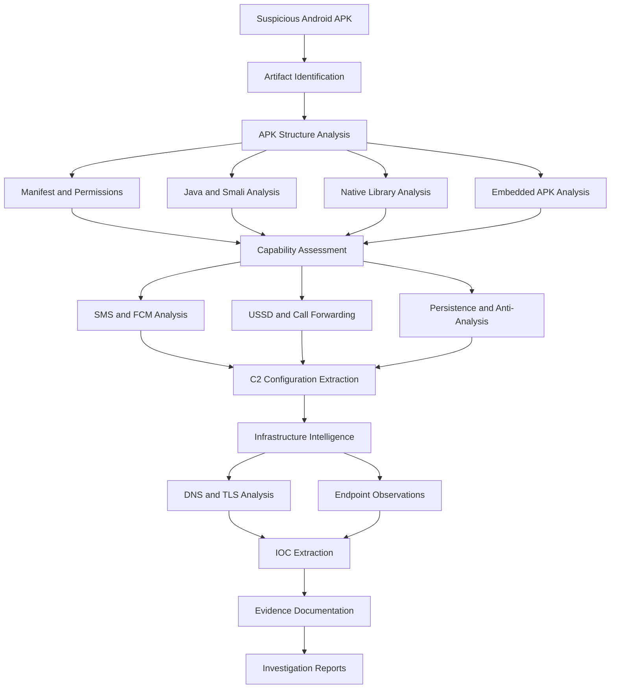
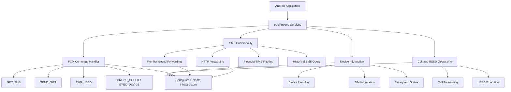

<h1 align="center">
  HDFC Android APK Investigation
</h1>

<p align="center">
  <strong>Android Malware Analysis | Digital Forensics | C2 Infrastructure Intelligence</strong>
</p>

<p align="center">
  
  
  
  
</p>

## Overview

An independent Android security investigation into a suspicious application labelled **HDFC BANK LOAN SERVICE**.

This research examines the application's internal structure, embedded APK, code-derived capabilities, remote command handling, Firebase Cloud Messaging (FCM) integration, and associated command-and-control (C2) infrastructure.

The investigation focuses on identifying potentially unauthorised access to sensitive mobile functionality, particularly financial SMS handling, remote SMS operations, device information collection, USSD execution, and call-forwarding manipulation.

The work combines static APK analysis, Java and Smali inspection, native library examination, and passive infrastructure intelligence.

> **Investigation status:** Static analysis and infrastructure intelligence documented. Dynamic analysis was not performed.

---

## Investigation at a Glance

| Category | Details |
|---|---|
| Target platform | Android |
| Application label | HDFC BANK LOAN SERVICE |
| Package | `com.sec.android.app.finance.kaxqj68` |
| Version | `2.9.65` |
| Minimum SDK | 24 |
| Target SDK | 37 |
| Primary analysis | Static APK analysis |
| Infrastructure analysis | DNS, TLS, certificates and endpoint observations |
| Embedded application | `com.nxtwave.support` |
| Dynamic analysis | Not performed |
| Repository focus | Malware research and DFIR |

## Investigation Workflow

The following diagram represents the investigation methodology and the relationships between its major analysis phases.



*This is a representation of the investigation process, not a claim that the application's capabilities were executed.*

---

## Key Findings

The following capabilities were identified during static code analysis.

| Investigation Area | Technical Finding |
|---|---|
| SMS collection | Financial and transaction-related SMS filtering logic |
| Historical SMS | Inbox query logic covering a recent 30-day period |
| SMS forwarding | HTTP-based SMS forwarding functionality |
| Number-based forwarding | Separate SMS forwarding mechanism using a remotely configured number |
| FCM integration | Remote command handlers for SMS, USSD and device operations |
| Device information | Collection of device, SIM and battery information |
| Call forwarding | USSD-based call-forwarding configuration |
| USSD operations | Remote USSD command handling and status reporting |
| Persistence | Boot receiver and background service mechanisms |
| Anti-analysis | Native checks for Frida, Xposed, Substrate and debugging indicators |
| C2 infrastructure | Multiple configured PHP endpoints |
| Embedded APK | Secondary APK recovered from an encrypted application asset |

### Important interpretation

These findings demonstrate the presence of relevant functionality in the examined application code. They do not establish successful execution, successful data transmission, server-side storage, or confirmed victim impact.

---

## Application Analysis

### Primary APK

| Attribute | Value |
|---|---|
| Application | HDFC BANK LOAN SERVICE |
| Package | `com.sec.android.app.finance.kaxqj68` |
| Version | `2.9.65` |
| Signing certificate CN | `editor` |
| Key type | RSA 2048 |
| SHA-256 | `08cfe1f957d7539320eaaa97f1d6838182f5df57e6f875d00dc3060e432d35af` |

### Embedded APK

An additional APK was identified inside the primary application's assets.

| Attribute | Value |
|---|---|
| Original asset | `rmtley9lr.db` |
| Decoded package | `com.nxtwave.support` |
| Version | `1.0` |
| Minimum SDK | 25 |
| Target SDK | 34 |
| SHA-256 | `13f93b8c70881f9414944fdc55811bfc627dbec966f023c664eb98782690cb4c` |

The embedded APK was extracted and analysed separately. Its presence does not independently prove that the primary application installs or executes it.

---

## Technical Capability Overview

The following diagram summarises the major code-derived functionality identified in the primary application.



*The diagram represents code-derived functionality and configured relationships. It does not establish successful remote execution.*

Detailed technical analysis is available in the [`analysis/`](analysis/) directory.

---

## C2 Infrastructure Intelligence

The application contains configuration references to multiple remote infrastructure endpoints.

### Identified domains

| Domain | Observed role |
|---|---|
| `w60.kinginfo.online` | Primary configured application endpoint |
| `host.kinginfo.online` | Secondary configured endpoint |
| `w60.mrkinginfoback.online` | Configured call-forwarding update endpoint |

### Configured functionality

- Background device information reporting.
- FCM token registration.
- SMS forwarding and SMS transmission.
- Call-forwarding configuration.
- USSD configuration and status reporting.
- Device permission and status operations.

### Infrastructure investigation

The infrastructure investigation included:

- Domain registration intelligence.
- DNS resolution observations.
- TLS certificate examination.
- Certificate Transparency dataset analysis.
- Configured endpoint response observations.
- Firebase project configuration examination.

Cloudflare edge IP addresses were observed for some domains. These addresses must not be interpreted as confirmed origin-server addresses.

The infrastructure findings do not establish common ownership, operator identity, or malicious hosting attribution.

More information: [`infrastructure/`](infrastructure/)

---

## Firebase Cloud Messaging

The application contains Firebase Cloud Messaging configuration and command-handling logic.

The examined code includes handlers for:

| Command | Code-derived purpose |
|---|---|
| `ONLINE_CHECK` | Update device online state |
| `SYNC_DEVICE` | Device synchronisation operation |
| `PING` | Connectivity or availability check |
| `SEND_SMS` | Initiate SMS sending service |
| `GET_SMS` | Initiate SMS collection service |
| `RUN_USSD` | Initiate USSD service |

The presence of these handlers does not prove that any remote command was delivered or successfully executed.

---

## Anti-Analysis and Evasion

The primary APK contains a native ARM64 library with anti-analysis functionality.

The native library was found to include checks associated with:

- Frida instrumentation.
- Xposed framework.
- Substrate.
- Gadget-related indicators.
- Debugger tracing through `TracerPid`.
- Process memory maps.
- Known instrumentation-related network ports.

These findings are based on static examination of the native library. Runtime anti-analysis behaviour was not tested.

---

## Methodology and Tools

The investigation used a combination of Android reverse-engineering tools, forensic utilities, and infrastructure intelligence sources.

| Category | Tools / Techniques |
|---|---|
| APK examination | APKTool, JADX |
| Code analysis | Java and Smali inspection |
| Native analysis | ELF inspection, symbol analysis |
| Hashing | SHA-256 |
| Firebase analysis | Static configuration and code inspection |
| Network intelligence | DNS and TLS examination |
| Certificate intelligence | Certificate Transparency datasets |
| Endpoint observations | HTTP response inspection |
| Documentation | Markdown, CSV and JSON |

The investigation followed a static-analysis and passive-intelligence approach. No dynamic malware execution was performed.

---

## Repository Structure

```text
hdfc-android-apk-investigation/
│
├── README.md
│
├── analysis/
│   ├── anti-analysis.md
│   ├── apk-metadata.md
│   ├── call-forwarding-analysis.md
│   ├── fcm-analysis.md
│   ├── permissions-analysis.md
│   ├── persistence-analysis.md
│   ├── sms-analysis.md
│   └── ussd-analysis.md
│
├── docs/
│   ├── executive-summary.md
│   ├── findings.md
│   ├── investigation-scope.md
│   ├── limitations.md
│   ├── methodology.md
│   └── timeline.md
│
├── diagrams/
│
├── evidence/
│   ├── chain-of-custody.md
│   └── evidence-register.md
│
├── infrastructure/
│   ├── dns-analysis.md
│   ├── domain-intelligence.md
│   ├── endpoint-observations.md
│   ├── firebase-analysis.md
│   └── tls-analysis.md
│
├── iocs/
│   ├── domains.json
│   ├── hashes.json
│   ├── indicators.csv
│   └── indicators.md
│
├── reports/
│   ├── c2-infrastructure-report.md
│   ├── final-investigation-report.md
│   └── static-analysis-report.md
│
└── scripts/
    ├── README.md
    └── requirements.txt
```

---

## Investigation Limitations

The following limitations must be considered when interpreting this research:

1. Dynamic analysis was not performed.
2. No live victim-device acquisition was conducted as part of this investigation.
3. Successful SMS exfiltration has not been demonstrated.
4. Successful remote SMS transmission has not been demonstrated.
5. Successful USSD execution or call forwarding has not been demonstrated.
6. FCM command delivery has not been established.
7. Server-side receipt or storage of collected information has not been established.
8. Infrastructure ownership and operator attribution remain unverified.
9. The embedded APK's execution relationship with the primary application has not been established.

The investigation therefore documents code-derived capabilities and infrastructure observations rather than confirmed victim impact.

---

## Responsible Disclosure

The application's apparent impersonation of an established financial institution and its sensitive device-operation capabilities warrant security review.

Responsible disclosure to the relevant organisation is appropriate.

This repository distinguishes verified technical observations from unconfirmed behaviour and does not make unsupported attribution claims.

---

## Evidence Handling

Evidence integrity is an important part of this investigation.

- Cryptographic hashes are recorded for examined APK artifacts.
- Original evidence should be preserved separately from working copies.
- Sensitive information must be redacted before publication.
- Credentials, authentication tokens and private personal information must not be committed.
- Investigation timestamps and evidence provenance should be maintained.
- Original APKs and sensitive raw evidence are not distributed through this repository.

---

## Disclaimer

This repository documents an independent cybersecurity investigation for research, defensive security and digital-forensics purposes.

It is not an official HDFC Bank security assessment, endorsement, or confirmation of application ownership.

The application is classified as **highly suspicious and potentially unauthorised financial-service impersonation software** based on the examined evidence. This classification is an investigative assessment, not an official determination by the organisation.

The presence of a code path, configured endpoint or infrastructure relationship does not establish successful execution or malicious operator attribution.

All security testing must be performed in an authorised and isolated research environment.

---

**Research Areas:** Android Malware Analysis · Digital Forensics · Mobile Security · Reverse Engineering · C2 Infrastructure Intelligence