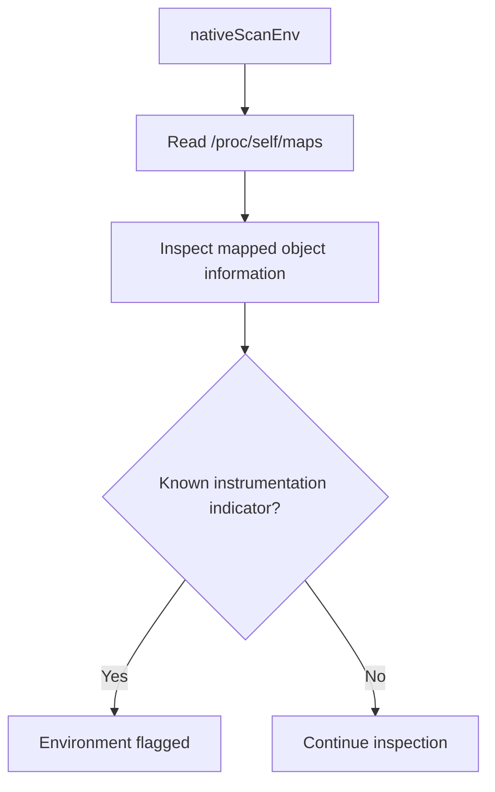
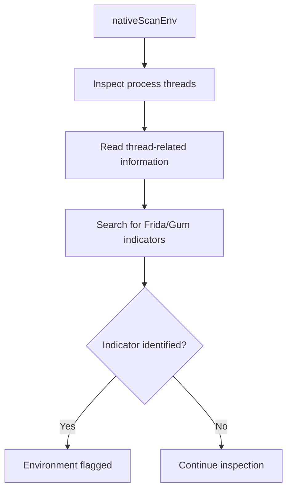
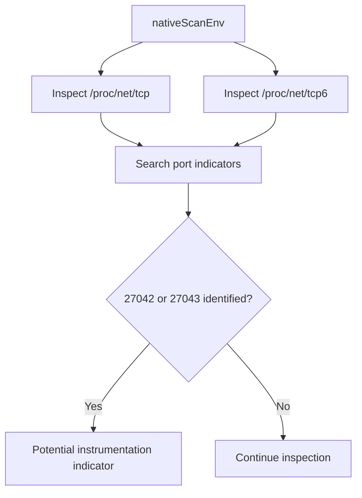
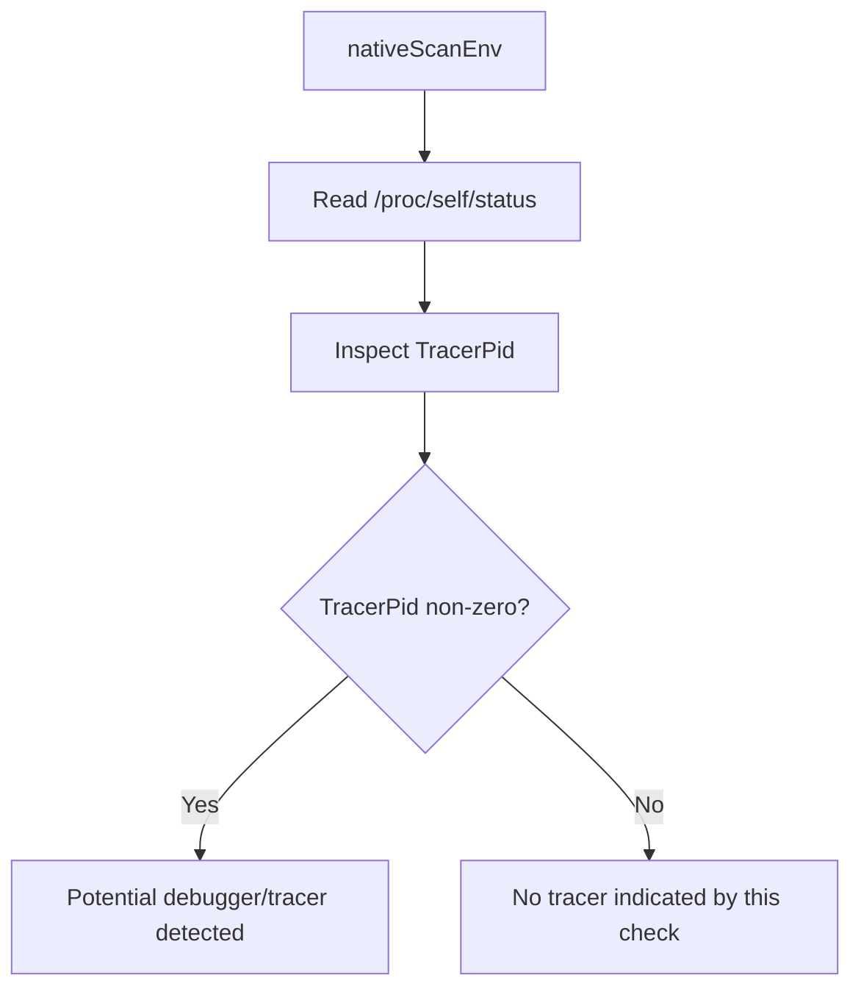
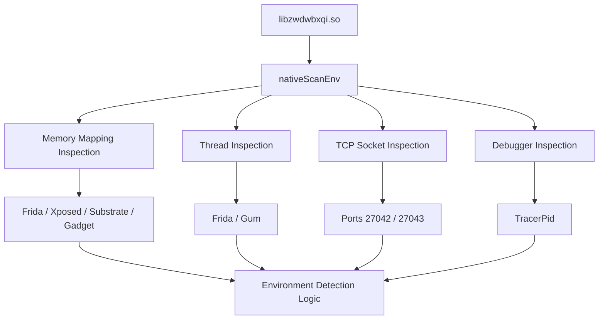

# Anti-Analysis and Environment Detection Analysis

## 1. Overview

This document examines the anti-analysis and environment-detection functionality identified in the primary APK labelled `HDFC BANK LOAN SERVICE`.

Static analysis identified a native ARM64 shared library:

```text
libzwdwbxqi.so
```

The library contains native functionality associated with:

- Runtime environment inspection.
- Frida-related artifact detection.
- Xposed and Substrate framework detection.
- Process and thread inspection.
- Local TCP connection inspection.
- Debugger detection through process status information.

These checks are relevant to malware analysis because instrumentation frameworks, debugging tools, and runtime monitoring environments are commonly used to examine Android application behavior.

**Investigation boundary:** The library was examined statically. No controlled runtime experiment was performed to determine whether the checks successfully detect or interfere with an analysis environment.

---

## 2. Identified Native Library

### 2.1 Library identification

| Attribute | Observed value |
|---|---|
| Library | `libzwdwbxqi.so` |
| File type | Native shared library |
| Architecture | ARM64 |
| Symbol status | Stripped |
| Analysis method | Static native-library examination |

The library is stripped, meaning that conventional debugging and reverse-engineering information such as many original function and variable names is unavailable.

Despite this limitation, several JNI-exported functions were identified.

### 2.2 Identified JNI exports

| Exported function | Documented purpose |
|---|---|
| `getSecretKey` | Secret-key-related functionality |
| `nativeXorChunk` | Native XOR processing |
| `getTargetPackage` | Target-package-related functionality |
| `nativeScanEnv` | Runtime environment inspection |

The exact cryptographic or operational role of every export should not be inferred from its name alone.

The most relevant function for this document is:

```text
nativeScanEnv
```

It contains environment-inspection logic associated with anti-analysis checks.

---

## 3. Frida Detection

### 3.1 Identified behavior

The `nativeScanEnv` functionality checks process memory-map information through:

```text
/proc/self/maps
```

The documented inspection searches for indicators associated with:

- Frida
- Xposed
- Substrate
- Gadget

### 3.2 Technical significance

On Linux-based Android systems, `/proc/self/maps` provides information about memory mappings associated with the current process.

This information can expose loaded libraries and mapped objects.

Searching these mappings for instrumentation-related names can help an application identify the presence of certain dynamic instrumentation frameworks.

### 3.3 Conceptual detection flow



### 3.4 Security significance

Frida is widely used by security researchers for:

- Dynamic method tracing.
- Runtime instrumentation.
- Java and native function observation.
- API monitoring.
- Behavioral analysis.

Detection of Frida-related artifacts can indicate that the application attempts to recognize instrumentation environments.

However, the presence of detection logic does not establish that the application terminates, hides functionality, or successfully evades a researcher.

---

## 4. Xposed and Substrate Detection

The native environment-inspection logic also searches for indicators associated with:

- Xposed Framework
- Substrate

These frameworks are commonly associated with Android runtime modification and instrumentation.

### 4.1 Detection approach

The documented checks use process memory-map inspection and indicator matching.

The presence of these checks suggests that the application considers modified or instrumented Android environments relevant to its execution.

### 4.2 Security significance

Detection of runtime modification frameworks may interfere with certain reverse-engineering and behavioral-analysis workflows.

It can also provide an application with information about whether it is executing in an environment commonly used for security research.

**Limitation:** The available evidence establishes indicator checks, not successful identification of every Xposed or Substrate installation.

---

## 5. Thread Inspection

### 5.1 Identified behavior

The native library also examines thread-related information for indicators associated with:

- Frida
- Gum

Thread inspection can reveal names associated with instrumentation-related runtime components.

### 5.2 Conceptual detection flow



### 5.3 Security significance

Thread inspection provides another detection surface independent of searching loaded memory mappings.

Using multiple inspection techniques can make environment detection more comprehensive than relying on a single indicator.

Nevertheless, thread names are not definitive proof of instrumentation. Detection results require contextual interpretation.

---

## 6. TCP Port Inspection

### 6.1 Identified behavior

The native library examines:

```text
/proc/net/tcp
/proc/net/tcp6
```

The documented checks include the following ports:

| Port | Decimal value |
|---|---:|
| 27042 | 27042 |
| 27043 | 27043 |

These ports are commonly associated with Frida server communication.

### 6.2 Technical significance

The `/proc/net/tcp` and `/proc/net/tcp6` interfaces expose information about TCP sockets.

Inspecting these files for known port indicators can help identify certain instrumentation-related network services.

### 6.3 Detection flow



### 6.4 Security significance

This check provides a network-state-based detection mechanism.

It is relevant because instrumentation frameworks may expose local communication services that can be identified through socket information.

**Limitation:** The presence of a matching port does not independently prove that Frida is running. Likewise, the absence of these ports does not establish that the environment is free from instrumentation.

---

## 7. Debugger Detection

### 7.1 Identified behavior

The native library also examines:

```text
/proc/self/status
```

The documented check includes inspection of:

```text
TracerPid
```

### 7.2 Technical significance

The `TracerPid` field provides information about the process currently tracing the inspected process.

A non-zero value can indicate that the process is being traced by another process.

This information can be used to identify certain debugging or tracing scenarios.

### 7.3 Conceptual flow



### 7.4 Security significance

Debugger detection can make it more difficult to examine application execution step by step.

However, `TracerPid` is only one indicator. It does not detect every possible debugging, instrumentation, or monitoring technique.

---

## 8. Combined Native Environment-Detection Architecture

The identified checks can be grouped into four main categories.



### 8.1 Detection coverage

| Inspection surface | Source | Indicators |
|---|---|---|
| Memory mappings | `/proc/self/maps` | Frida, Xposed, Substrate, Gadget |
| Threads | Process thread information | Frida, Gum |
| TCP sockets | `/proc/net/tcp` | Ports 27042, 27043 |
| TCP IPv6 sockets | `/proc/net/tcp6` | Ports 27042, 27043 |
| Process status | `/proc/self/status` | `TracerPid` |

The combination of these checks indicates multiple independent environment-inspection techniques.

---

## 9. Anti-Analysis Assessment

### 9.1 Why these checks matter

Security researchers commonly use dynamic instrumentation and debugging frameworks to understand an application's runtime behavior.

An application that checks for these tools may be attempting to identify whether it is operating inside a research or analysis environment.

In this investigation, the native library contains checks associated with several widely used instrumentation and debugging techniques.

### 9.2 Potential implications

| Finding | Potential implication |
|---|---|
| Frida indicator checks | Awareness of dynamic instrumentation environments |
| Xposed detection | Awareness of Android runtime modification |
| Substrate detection | Awareness of instrumentation frameworks |
| Gadget detection | Awareness of injected instrumentation components |
| Thread inspection | Detection through runtime thread information |
| TCP port inspection | Detection through local network socket information |
| TracerPid inspection | Detection of certain debugging or tracing conditions |

### 9.3 What the findings do not establish

The available evidence does not demonstrate that the application:

- Terminates when Frida is detected.
- Hides functionality when instrumentation is present.
- Deletes evidence or modifies logs.
- Blocks all debugging tools.
- Detects every Android emulator.
- Successfully evades dynamic analysis.
- Changes its network behavior in response to detection.

These behaviors would require additional control-flow verification or runtime testing.

---

## 10. Relationship to the Investigation

The anti-analysis functionality is relevant to the broader investigation because the APK contains sensitive code paths involving:

- Financial SMS processing.
- HTTP-based SMS forwarding.
- Number-based SMS forwarding.
- Remote SMS transmission.
- Firebase command dispatch.
- USSD operations.
- Call-forwarding configuration.
- Device-information reporting.

Runtime instrumentation could help researchers validate how these features behave on a controlled device.

The existence of environment-detection functionality is therefore an important analytical observation, particularly because it may complicate future behavioral examination.

However, the investigation did not establish that these sensitive operations are conditionally hidden or disabled when analysis tools are detected.

---

## 11. Evidence and Confidence Boundaries

| Claim | Assessment |
|---|---|
| Native ARM64 library exists | Supported by static analysis |
| Library is stripped | Supported by static analysis |
| JNI exports were identified | Supported by static analysis |
| `nativeScanEnv` exists | Supported by static analysis |
| Memory-map inspection occurs | Supported by static analysis |
| Frida/Xposed/Substrate/Gadget indicators are checked | Supported by static analysis |
| Thread inspection includes Frida/Gum indicators | Supported by static analysis |
| TCP and TCP6 inspection occurs | Supported by static analysis |
| Ports 27042 and 27043 are checked | Supported by static analysis |
| `TracerPid` is inspected | Supported by static analysis |
| Application successfully detects a live Frida installation | Not established |
| Application terminates or changes behavior after detection | Not established |
| Dynamic analysis was evaded | Not established |

---

## 12. Limitations

1. The native library is stripped.
2. Original source code for the native implementation was not available.
3. Function names provide limited semantic information.
4. No runtime execution of `nativeScanEnv` was performed.
5. No Frida, Xposed, or Substrate detection experiment was performed.
6. No debugger-detection experiment was performed.
7. The exact response to a positive detection result was not fully established.
8. No evidence establishes conditional hiding or disabling of malicious functionality.
9. Dynamic analysis was not performed.

---

## 13. Conclusion

The primary APK contains a stripped ARM64 native library named `libzwdwbxqi.so` with a JNI-exported environment-inspection function named `nativeScanEnv`.

The documented implementation examines process memory mappings, thread information, TCP socket information, and debugger-related process status.

The identified indicators include Frida, Xposed, Substrate, Gadget, Gum, TCP ports 27042 and 27043, and `TracerPid`.

These observations demonstrate code-level anti-analysis and environment-detection capabilities.

However, the investigation did not establish successful detection of an active instrumentation environment, debugger evasion, application termination, or conditional suppression of application functionality.

The findings should therefore be classified as **native anti-analysis and instrumentation-detection capabilities**, with their runtime effectiveness unconfirmed.

---

*Analysis type: Static native-library and anti-analysis examination.*

*Native runtime testing: Not performed.*

*Dynamic analysis: Not performed.*