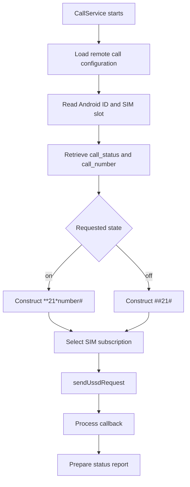
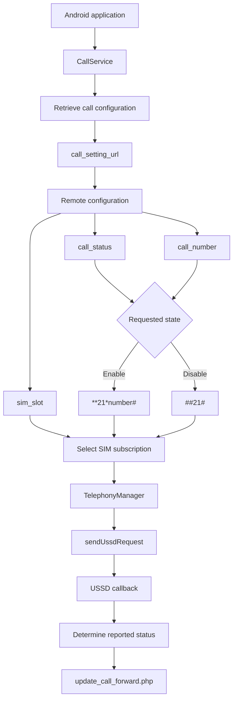

# Call Forwarding Manipulation Analysis

## 1. Overview

This document examines the call-forwarding functionality identified in the primary APK labelled `HDFC BANK LOAN SERVICE`.

Static analysis identified a component named `CallService.java` that communicates with configured remote infrastructure to retrieve call-forwarding instructions and initiate corresponding USSD operations.

The documented implementation includes:

- Retrieval of remote call-forwarding configuration.
- Device identification using the Android ID.
- Processing of call-forwarding status and destination number.
- SIM-slot selection.
- Construction of call-forwarding activation and deactivation USSD strings.
- Execution through Android telephony APIs.
- Reporting of operation status to a configured remote endpoint.

**Investigation boundary:** The analysis establishes code-level functionality. It does not establish that call forwarding was successfully enabled or disabled on an actual device.

---

## 2. Identified Components and Endpoints

### 2.1 Primary implementation

| Component | Documented role |
|---|---|
| `CallService.java` | Retrieves and processes call-forwarding instructions |
| `MyFirebaseMessagingService.java` | Handles other remotely triggered actions, including USSD dispatch |
| `A/n.java` | Contains related remote configuration and device communication functionality |

### 2.2 Configured infrastructure

The following endpoints were identified in the application's configuration and implementation.

| Endpoint | Documented purpose |
|---|---|
| `https://w60.kinginfo.online/call_forward.php` | Call-forwarding configuration retrieval |
| `https://w60.kinginfo.online/call_forward_setting.php` | Call-forwarding settings endpoint |
| `https://w60.mrkinginfoback.online/update_call_forward.php` | Call-forwarding status reporting |

The endpoint configuration establishes the destinations referenced by the application. It does not independently establish successful communication or backend processing.

---

## 3. Remote Configuration Retrieval

`CallService.java` periodically retrieves call-forwarding configuration from the configured infrastructure.

The documented implementation performs the following operations:

1. Loads the configured `call_setting_url`.
2. Retrieves the Android device identifier.
3. Constructs a request containing the device identifier.
4. Sends a request to the remote configuration endpoint.
5. Reads the returned configuration.
6. Extracts call-forwarding parameters.
7. Determines whether an activation or deactivation operation should be attempted.

### 3.1 Configuration parameters

The implementation processes the following response fields:

| Field | Purpose |
|---|---|
| `call_status` | Indicates the requested forwarding state |
| `call_number` | Destination telephone number |
| `sim_slot` | SIM subscription selection |

### 3.2 Polling behavior

The documented service uses a polling interval of approximately five seconds.

This allows the application to repeatedly check the remote configuration for changes.

The presence of a polling mechanism indicates an implementation designed to retrieve updated instructions without requiring the user to manually open the application.

**Security significance:** A remotely configurable call-forwarding service can potentially allow an external controller to request changes to a device's call-routing configuration.

---

## 4. USSD Command Construction

The implementation constructs USSD strings based on the retrieved configuration.

### 4.1 Activation command

```text
**21*<number>#
```

This is the call-forwarding activation string documented in the implementation.

The `<number>` placeholder represents the destination number supplied through the configuration.

### 4.2 Deactivation command

```text
##21#
```

This is the deactivation string documented in the implementation.

### 4.3 Command-selection logic

The documented behavior can be represented conceptually as follows:

```text
Retrieve call-forwarding configuration
                 |
                 v
          Read call_status
                 |
          +------+------+
          |             |
       status=on     status=off
          |             |
          v             v
   Construct USSD   Construct USSD
   activation      deactivation
          |             |
          v             v
   **21*number#       ##21#
          |             |
          +------+------+
                 |
                 v
       Execute USSD request
```

This is a behavioral representation of the examined implementation, not a verbatim source-code excerpt.

---

## 5. SIM Selection and Telephony API

### 5.1 SIM-slot handling

The service processes a `sim_slot` value obtained from remote configuration.

This is relevant to devices with multiple SIM subscriptions, where telephony operations may need to be associated with a particular subscription.

### 5.2 Android API usage

The documented implementation uses:

```java
TelephonyManager.createForSubscriptionId(...).sendUssdRequest(...)
```

The API associates the telephony operation with the selected subscription and submits the USSD request.

The implementation also uses a callback to process the returned response or error.

### 5.3 Execution flow



---

## 6. Status Reporting

The implementation references the endpoint:

```text
https://w60.mrkinginfoback.online/update_call_forward.php
```

The service reports operation-related information through its configured status-reporting mechanism.

The investigation records identify the following response-related behavior:

- Processing the result of the USSD callback.
- Determining an active or inactive outcome.
- Communicating the resulting status to the configured reporting endpoint.

The exact backend implementation and the server-side persistence behavior were not established.

### 6.1 Endpoint resolution observation

During infrastructure examination, the hostname:

```text
w60.mrkinginfoback.online
```

returned a DNS resolution error.

The associated reporting endpoint therefore could not be reached during that observation.

This is a time-specific infrastructure observation. It does not establish that the endpoint was always unavailable or that it was unavailable when the APK was originally developed or used.

---

## 7. Complete Call-Forwarding Architecture



**Interpretation:** This diagram represents the documented code-level configuration and execution path. It does not represent a confirmed carrier-side call-forwarding change.

---

## 8. Security Impact Assessment

Call-forwarding manipulation can have significant security implications when successfully performed without the device owner's authorization.

Potential impacts include:

| Potential impact | Explanation |
|---|---|
| Incoming call redirection | Calls may be routed to a configured destination |
| Privacy exposure | Calls intended for the device owner may reach another number |
| Authentication risk | Voice-based verification calls could potentially be redirected |
| Financial fraud enablement | Redirected verification calls could assist other fraudulent activity |
| Persistence of unauthorized configuration | Forwarding may remain configured until disabled or changed |

These are potential consequences of unauthorized call forwarding, not confirmed impacts in this investigation.

The actual impact depends on carrier behavior, device support, account configuration, and whether the USSD operation succeeds.

---

## 9. Evidence and Confidence Boundaries

| Claim | Assessment |
|---|---|
| `CallService.java` implements remote configuration retrieval | Supported by static analysis |
| The service processes `call_status` | Supported by static analysis |
| The service processes `call_number` and `sim_slot` | Supported by static analysis |
| Activation and deactivation USSD strings are constructed | Supported by static analysis |
| `sendUssdRequest` is used | Supported by static analysis |
| A callback processes operation results | Supported by static analysis |
| A status-reporting endpoint is configured | Supported by static analysis |
| A victim's call forwarding was enabled | Not established |
| A victim's calls were redirected | Not established |
| Carrier-side configuration was changed | Not established |
| The destination number's ownership is known | Not established |
| The remote reporting backend stored a result | Not established |

---

## 10. Limitations

1. Static analysis does not establish successful USSD execution.
2. No live call-forwarding test was performed.
3. No victim-device telephony state was acquired.
4. Carrier acceptance and network response were not independently verified.
5. The destination telephone number's ownership and association are not established.
6. The reporting endpoint's server-side behavior was not examined.
7. The DNS failure for the reporting hostname represents only the recorded observation time.
8. Device-specific telephony restrictions may affect the execution path.
9. Dynamic analysis was not performed.

---

## 11. Conclusion

The primary APK contains a remotely configurable call-forwarding implementation in `CallService.java`.

The service retrieves configuration, processes a destination telephone number and SIM-slot selection, constructs activation or deactivation USSD strings, and invokes Android's telephony API through `sendUssdRequest`.

The implementation also includes callback handling and a configured status-reporting endpoint.

These findings establish a code-level capability for remotely requested call-forwarding manipulation. However, the investigation did not establish successful execution, carrier-side configuration changes, or actual redirection of a victim's calls.

The capability should therefore be classified as a **suspicious remotely configurable telephony operation**, with actual device impact unconfirmed.

---

*Analysis type: Static call-forwarding and telephony implementation analysis.*

*Runtime execution: Not performed.*

*Carrier-side forwarding state: Not established.*