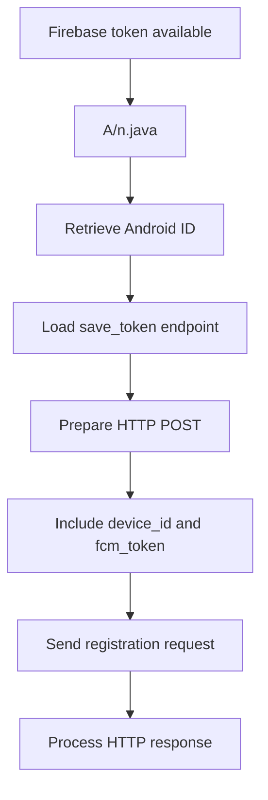
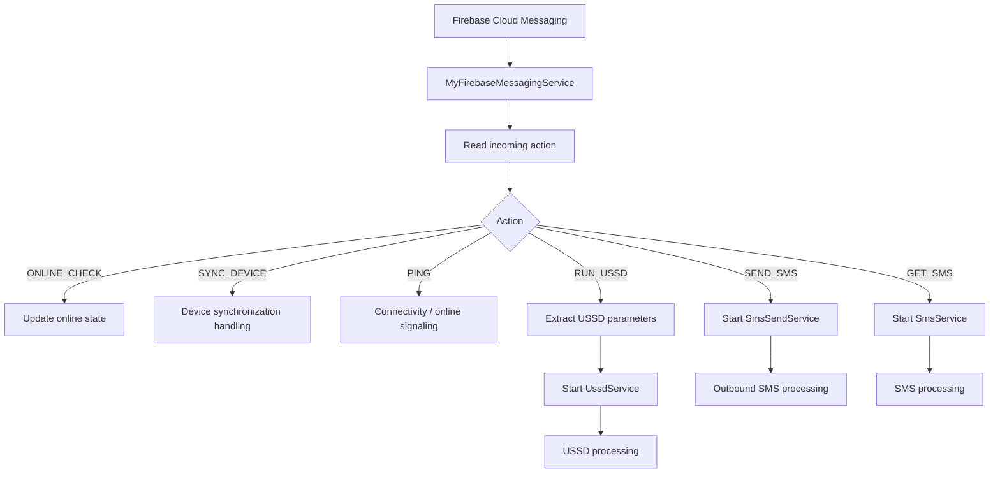
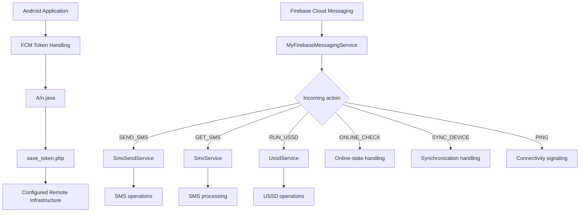

# Firebase Cloud Messaging (FCM) Analysis

## 1. Overview

This document examines the Firebase Cloud Messaging (FCM) integration identified in the primary APK labelled `HDFC BANK LOAN SERVICE`.

Static analysis identified Firebase-related configuration and application components responsible for registering device tokens and processing incoming message actions.

The most significant component is:

```text
MyFirebaseMessagingService.java
```

The documented implementation includes:

- Firebase project configuration.
- FCM token handling.
- Device identification.
- Token registration with configured infrastructure.
- Incoming message-action dispatch.
- SMS-related command handling.
- USSD command handling.
- Device online-state and synchronization actions.

The integration is security-relevant because FCM can deliver application messages that trigger application-side operations.

**Investigation boundary:** The application-side implementation was examined statically. No live FCM command delivery or execution was demonstrated.

---

## 2. Firebase Project Configuration

The primary APK contains Firebase configuration associated with the following project.

| Attribute | Observed value |
|---|---|
| Firebase project ID | `fcmtoken-af5a6` |
| Sender ID | `705898731` |
| Firebase application ID | `1:705898731153:web:130e5565c49b143bfb9130` |
| Firebase API key | Redacted |

### 2.1 Configuration interpretation

The Firebase project identifier and sender ID identify the Firebase configuration referenced by the application.

The application ID identifies the configured Firebase application.

These values establish a configuration relationship. They do not independently establish:

- Ownership of the Firebase project.
- Identity of the project administrator.
- Access to the Firebase console.
- Whether the project remains active.
- Whether the project delivered commands to a device.

### 2.2 Security consideration

Firebase configuration values embedded in client applications should not automatically be treated as secrets.

However, their presence can help identify the application's messaging infrastructure and support further defensive investigation.

The API key is intentionally excluded from this public report.

---

## 3. FCM Token Registration

### 3.1 Identified implementation

The investigation identified token-registration functionality in:

```text
A/n.java
```

The documented implementation:

1. Obtains the Android device identifier.
2. Receives or processes the FCM registration token.
3. Loads the configured token-registration endpoint.
4. Prepares an HTTP POST request.
5. Sends the device identifier and FCM token.
6. Processes the HTTP response.

### 3.2 Configured endpoint

```text
https://w60.kinginfo.online/save_token.php
```

### 3.3 Documented request fields

| Field | Purpose |
|---|---|
| `device_id` | Android device identifier |
| `fcm_token` | Firebase Cloud Messaging registration token |

### 3.4 Token registration flow



### 3.5 Duplicate registration logic

The investigation also identified a separate token-registration block in `A/n.java`.

The available records indicate that this block uses longer connection/read timeouts and processes the response.

This is worth documenting as an additional registration-related implementation path. Its exact triggering conditions and relationship with the initial registration path should not be assumed beyond what was verified in the code.

### 3.6 Security significance

A device identifier associated with an FCM token can provide infrastructure with a means of associating messaging activity with an application installation.

If the backend stores and uses this association, it could support device-specific message delivery.

**Not established:** Successful token registration, backend storage, or subsequent command delivery.

---

## 4. FCM Message Handling

### 4.1 Primary implementation

The principal message-handling component is:

```text
MyFirebaseMessagingService.java
```

The documented implementation processes incoming Firebase messages and dispatches actions based on their action values.

The following actions were identified:

| Action | Documented application-side behavior |
|---|---|
| `ONLINE_CHECK` | Updates online-state information |
| `SYNC_DEVICE` | Updates or processes device synchronization state |
| `PING` | Handles online-state or connectivity-related signaling |
| `SEND_SMS` | Starts `SmsSendService` |
| `GET_SMS` | Starts `SmsService` with `fetch_latest_sms=true` |
| `RUN_USSD` | Extracts USSD request parameters and starts `UssdService` |

These action names and behaviors are derived from the examined implementation.

The exact server-side message-generation logic was not established.

---

## 5. Command-by-Command Analysis

### 5.1 ONLINE_CHECK

The implementation processes the `ONLINE_CHECK` action and updates online-state information.

**Potential purpose:**

- Indicate application availability.
- Update device online-state information.
- Support remote monitoring of application status.

The code-level action does not prove that a backend received or stored an online-status update.

### 5.2 SYNC_DEVICE

The implementation includes a `SYNC_DEVICE` action associated with device synchronization handling.

The available records establish the action and its online-state-related handling, but do not provide enough detail to claim the exact data synchronized or the complete synchronization protocol.

### 5.3 PING

The `PING` action is associated with online-state or connectivity-related signaling.

It may be used by the application to process a remote availability check.

The exact server-side purpose and resulting backend behavior are not established.

### 5.4 SEND_SMS

The `SEND_SMS` action starts:

```text
SmsSendService
```

The service contains outbound SMS functionality using Android's `SmsManager`.

The documented implementation includes:

- SIM/subscription selection.
- Single-part SMS handling.
- Multipart SMS handling.
- SMS-sent callback handling.
- SMS-delivered callback handling.
- Retry handling.

**Security significance:** A remote message may trigger an application-side outbound SMS job if the relevant conditions and permissions are satisfied.

**Not established:** Actual command delivery or successful SMS transmission.

### 5.5 GET_SMS

The `GET_SMS` action starts:

```text
SmsService
```

The documented dispatch supplies:

```text
fetch_latest_sms=true
```

This establishes a code-level path for triggering SMS-related processing through Firebase messaging.

The exact messages returned, the complete query behavior for this specific action, and the successful transmission of any results must not be inferred solely from the action name.

**Security significance:** Remote triggering of SMS-related processing can create a potential privacy risk when combined with the application's documented SMS access and forwarding capabilities.

### 5.6 RUN_USSD

The `RUN_USSD` action extracts the following parameters:

| Parameter | Purpose |
|---|---|
| `request_id` | Request identifier |
| `ussd_code` | USSD command string |
| `sim_slot` | SIM-slot selection |

The implementation then starts:

```text
UssdService
```

The service contains callback and status-reporting functionality associated with USSD operations.

**Security significance:** The application contains a code-level mechanism through which an incoming Firebase action can initiate USSD-related processing.

**Not established:** Actual remote command receipt, execution, or carrier-side success.

---

## 6. FCM Command Dispatch Architecture



This diagram represents the documented application-side action dispatch. It does not establish a live connection to a command-and-control operator or demonstrate that any command was delivered.

---

## 7. Relationship Between FCM and Other Application Components

FCM is particularly important because it connects message handling with functionality implemented elsewhere in the APK.

| FCM action | Triggered component | Related analysis |
|---|---|---|
| `SEND_SMS` | `SmsSendService` | [SMS Analysis](./sms-analysis.md) |
| `GET_SMS` | `SmsService` | [SMS Analysis](./sms-analysis.md) |
| `RUN_USSD` | `UssdService` | [USSD Analysis](./ussd-analysis.md) |
| `ONLINE_CHECK` | Online-state handling | [Infrastructure Analysis](../infrastructure/endpoint-observations.md) |
| `SYNC_DEVICE` | Device synchronization handling | [Infrastructure Analysis](../infrastructure/endpoint-observations.md) |
| `PING` | Online-state/connectivity handling | [Infrastructure Analysis](../infrastructure/endpoint-observations.md) |

The FCM integration therefore provides an application-side dispatch mechanism connecting messaging actions to SMS and USSD functionality.

The presence of these connections does not independently prove that an external party controlled a victim device.

---

## 8. Combined Firebase and Backend Architecture

The following diagram combines the documented token-registration and message-dispatch paths.



**Interpretation:** The diagram documents two related but distinct mechanisms: application token registration with configured infrastructure and Firebase message handling. It does not establish that the configured HTTP backend and Firebase project are controlled by the same individual or organization.

---

## 9. Security Impact Assessment

| Finding | Potential security implication | Evidence classification |
|---|---|---|
| Firebase configuration embedded in APK | Identifies messaging project configuration | Configuration-derived |
| FCM token handling | Supports application-instance messaging association | Code-derived |
| Token registration endpoint | Potential device-token registration with remote infrastructure | Code-derived |
| `SEND_SMS` action | Potential remote triggering of outbound SMS | Code-derived |
| `GET_SMS` action | Potential remote triggering of SMS processing | Code-derived |
| `RUN_USSD` action | Potential remote triggering of USSD processing | Code-derived |
| `ONLINE_CHECK` action | Potential remote online-state signaling | Code-derived |
| `SYNC_DEVICE` action | Device synchronization handling | Code-derived |
| `PING` action | Connectivity or online-state signaling | Code-derived |

### Overall assessment

The combination of token registration and application-side command dispatch is security-relevant.

In particular, the `SEND_SMS`, `GET_SMS`, and `RUN_USSD` actions connect remote messaging functionality with sensitive Android telephony capabilities.

This represents a potentially significant remote-control capability if the application receives and processes unauthorized commands.

---

## 10. Evidence and Confidence Boundaries

| Claim | Assessment |
|---|---|
| Firebase project configuration is present | Supported by static analysis |
| FCM token handling exists | Supported by static analysis |
| Device ID and FCM token are prepared for registration | Supported by static analysis |
| `save_token.php` is configured | Supported by static analysis |
| Six message actions were identified | Supported by static analysis |
| `SEND_SMS` starts `SmsSendService` | Supported by static analysis |
| `GET_SMS` starts `SmsService` | Supported by static analysis |
| `RUN_USSD` starts `UssdService` | Supported by static analysis |
| A remote FCM command was received | Not established |
| The Firebase project is controlled by a particular actor | Not established |
| The backend stored an FCM token | Not established |
| A remote SMS or USSD command succeeded | Not established |
| The backend and Firebase project share ownership | Not established |

---

## 11. Limitations

1. The analysis is based on static examination of the APK.
2. No live FCM message was sent or received during the investigation.
3. Firebase console access was not available.
4. Backend ownership and administration were not established.
5. Token registration and server-side token storage were not independently verified.
6. The exact server-side command-generation process is unknown.
7. No victim-device runtime logs were acquired.
8. The precise behavior of every command is limited to the implementation details available in the examined code.
9. Dynamic analysis was not performed.

---

## 12. Conclusion

The primary APK contains a Firebase Cloud Messaging integration with token-handling functionality and multiple application-side command-dispatch paths.

The most significant findings are:

- Firebase project configuration associated with `fcmtoken-af5a6`.
- FCM token-registration functionality in `A/n.java`.
- A configured registration endpoint at `save_token.php`.
- Six identified message actions in `MyFirebaseMessagingService.java`.
- SMS-related command dispatch through `SmsSendService` and `SmsService`.
- USSD-related command dispatch through `UssdService`.

The integration demonstrates a code-level mechanism for connecting incoming Firebase messages with sensitive SMS and USSD functionality.

However, the investigation does not establish actual remote command delivery, unauthorized device control, successful SMS transmission, or successful USSD execution.

The findings should therefore be classified as **code-derived remote messaging and command-dispatch capabilities**, with runtime behavior and backend control unconfirmed.

---

*Analysis type: Static Firebase configuration, token registration and message-dispatch analysis.*

*FCM command execution: Not observed.*

*Backend token storage: Not established.*

*Dynamic analysis: Not performed.*