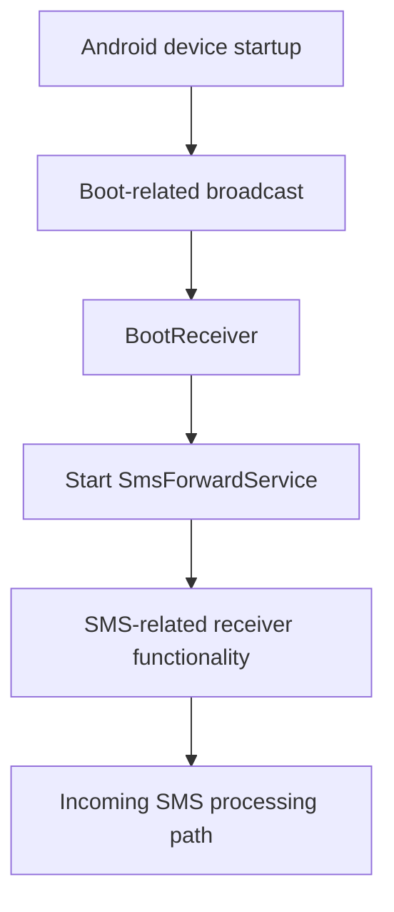
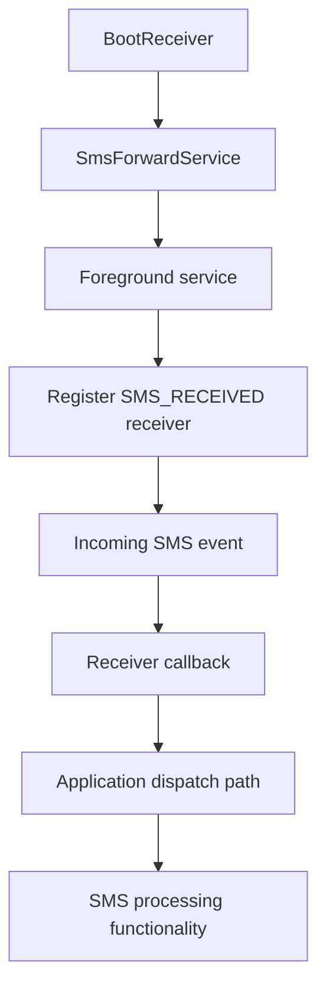
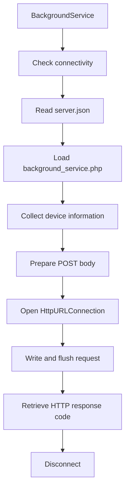
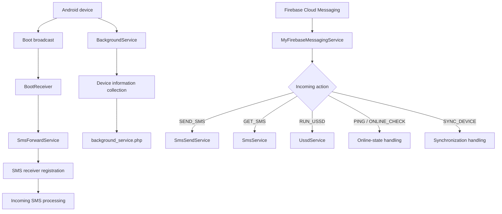

# Android Background Execution and Persistence Analysis

## 1. Overview

This document examines the background execution and persistence-related functionality identified in the primary APK labelled `HDFC BANK LOAN SERVICE`.

Static analysis identified several components associated with background operation:

- `BootReceiver`
- `SmsForwardService.java`
- `BackgroundService.smali`
- `SmsService.java`
- `MyFirebaseMessagingService.java`

The documented implementation indicates that the application contains mechanisms for starting background services, processing SMS-related events, communicating with remote infrastructure, and handling Firebase messages.

The objective is to determine how these components could support continued application activity beyond the foreground user interface.

**Investigation boundary:** The findings are based on static analysis. Persistence across an actual device reboot, survival after force-stop, and continued background execution were not dynamically tested.

---

## 2. Identified Components

| Component | Documented role | Security relevance |
|---|---|---|
| `BootReceiver` | Starts `SmsForwardService` during boot-related handling | Potential automatic service startup |
| `SmsForwardService.java` | Maintains SMS-related receiver functionality | Background SMS processing |
| `BackgroundService.smali` | Reports device information to configured infrastructure | Background network communication |
| `SmsService.java` | Processes SMS-related information | Background data processing |
| `MyFirebaseMessagingService.java` | Handles incoming Firebase message actions | Event-driven remote command dispatch |

These components should be considered together because they implement different aspects of background operation.

---

## 3. Boot Receiver

### 3.1 Identified behavior

The investigation identified a component named:

```text
BootReceiver
```

The available static-analysis records indicate that this receiver starts:

```text
SmsForwardService
```

during boot-related handling.

This suggests an implementation designed to restart SMS-related background functionality following a device startup event.

### 3.2 Conceptual execution flow



### 3.3 Security significance

Automatic service startup can allow an application to resume selected background functionality after a device restart.

In a suspicious application, this capability may increase the duration during which sensitive functionality remains available.

However, a boot receiver does not independently prove that the application successfully restarts under every Android version or device configuration.

### 3.4 Verification requirements

The following details should be verified against the original manifest and implementation:

- Boot broadcast action declarations.
- Receiver export status.
- Receiver permission requirements.
- Whether the receiver is enabled.
- The exact service-starting method.
- Android version and background execution restrictions.

The complete manifest declaration and exact boot broadcast actions are not reproduced in the available investigation records.

---

## 4. SMS Forwarding Service

### 4.1 Identified implementation

`SmsForwardService.java` is a foreground service associated with SMS-related background functionality.

The documented implementation creates a receiver for:

```text
android.provider.Telephony.SMS_RECEIVED
```

The receiver is registered with priority:

```text
1000
```

The service is also started by `BootReceiver`.

### 4.2 Documented behavior

The available analysis records indicate that the service:

1. Operates as a foreground service.
2. Registers an SMS-reception broadcast receiver.
3. Handles incoming SMS-related events.
4. Connects to the application's SMS-processing components.
5. Supports background SMS-related operation.

The receiver callback is associated with a dispatch path involving:

```text
A/n.java
```

and:

```text
A0.d
```

The exact linkage between every callback and subsequent operation was not fully established.

### 4.3 Service architecture



### 4.4 Security significance

A foreground service is designed for ongoing work that is noticeable to the user through Android's foreground-service notification mechanism.

The use of a foreground service can support continued SMS-related processing while the application is not actively displayed.

This is relevant because sensitive SMS processing may occur outside the normal foreground application interface.

However, the actual notification visibility, service lifecycle, and runtime behavior were not dynamically examined.

---

## 5. Background Device-Information Reporting

### 5.1 Identified implementation

The investigation identified background communication functionality in:

```text
BackgroundService.smali
```

The JADX source was stubbed, so the relevant behavior was examined through Smali.

### 5.2 Configured endpoint

```text
https://w60.kinginfo.online/background_service.php
```

### 5.3 Documented request fields

The Smali analysis identified an HTTP POST containing the following fields:

| Field | Documented purpose |
|---|---|
| `device_name` | Device name |
| `device_model` | Device model |
| `device_id` | Device identifier |
| `sim1_carrier` | First SIM carrier |
| `sim2_carrier` | Second SIM carrier |
| `sim1_number` | First SIM number field |
| `sim2_number` | Second SIM number field |
| `created_at` | Creation-related timestamp |
| `last_seen` | Last-seen timestamp |
| `status` | Online status |
| `battery` | Battery information |

The implementation sets the status field to:

```text
online
```

### 5.4 Network operation

The documented Smali implementation uses:

- `HttpURLConnection`
- HTTP POST
- Form URL-encoded request data
- Request-body writing and flushing
- HTTP response-code retrieval
- Connection disconnection

### 5.5 Data-flow diagram



### 5.6 Security significance

The fields identified in this implementation could expose information about:

- Device identity.
- Device model.
- SIM carrier configuration.
- Telephone-number fields.
- Device availability.
- Battery state.

If successfully transmitted and processed by the remote endpoint, this information could support device inventory or remote monitoring.

**Not established:** Actual receipt, storage, or use of the reported information by the remote server.

---

## 6. Firebase-Based Background Activity

The application also contains Firebase message-handling functionality in:

```text
MyFirebaseMessagingService.java
```

The documented actions include:

| Action | Background-related behavior |
|---|---|
| `ONLINE_CHECK` | Online-state handling |
| `SYNC_DEVICE` | Device synchronization handling |
| `PING` | Connectivity or online-state signaling |
| `SEND_SMS` | Starts `SmsSendService` |
| `GET_SMS` | Starts `SmsService` |
| `RUN_USSD` | Starts `UssdService` |

This creates another mechanism through which application functionality may be initiated in response to incoming Firebase messages.

The FCM integration should be distinguished from boot persistence:

- The boot receiver is associated with device startup.
- The Firebase service is associated with incoming messaging events.
- Foreground services are associated with ongoing application work.

These mechanisms serve different purposes.

---

## 7. Combined Background Execution Architecture



The diagram consolidates the documented background-related components. It does not establish that all components execute simultaneously or remain active continuously.

---

## 8. Persistence Assessment

The term *persistence* must be used carefully in Android investigations.

The presence of a boot receiver and background services indicates mechanisms intended to support application activity beyond a foreground session.

However, Android imposes lifecycle and background execution restrictions that vary with OS version, application state, permission grants, and device manufacturer.

### 8.1 Capability assessment

| Mechanism | Static finding | Runtime conclusion |
|---|---|---|
| Boot receiver | Identified | Successful restart not tested |
| Foreground SMS service | Identified | Continuous operation not tested |
| SMS broadcast receiver | Identified | Actual event reception not tested |
| Background device reporting | Identified in Smali | Server receipt not established |
| Firebase message handling | Identified | Message delivery not tested |
| Remote service dispatch | Identified | Successful remote operation not established |

### 8.2 What cannot be concluded

The available evidence does not establish:

- Successful service restart after reboot.
- Survival after application force-stop.
- Operation after the application is disabled.
- Execution after permission revocation.
- Persistence across application updates or removal.
- Continuous background operation.
- Successful communication with the remote infrastructure.

A boot receiver should not be described as proof of malware persistence without device-level validation.

---

## 9. Security Impact Assessment

| Finding | Potential security implication | Evidence classification |
|---|---|---|
| Boot-triggered service startup | Potential resumption of SMS-related activity after startup | Code-derived |
| Foreground SMS service | Potential ongoing SMS processing | Code-derived |
| SMS broadcast registration | Potential processing of incoming SMS events | Code-derived |
| Device-information reporting | Potential disclosure of device and SIM information | Code-derived |
| Firebase command handling | Potential event-driven remote functionality | Code-derived |

The combined implementation could support continued access to sensitive device-related functionality outside the foreground application interface.

The actual security impact depends on successful execution, Android permission state, service lifecycle behavior, and remote infrastructure availability.

---

## 10. Evidence and Confidence Boundaries

| Claim | Assessment |
|---|---|
| `BootReceiver` is present | Supported by static analysis |
| `BootReceiver` starts `SmsForwardService` | Supported by static analysis records |
| `SmsForwardService` registers an SMS receiver | Supported by static analysis |
| Receiver action is `android.provider.Telephony.SMS_RECEIVED` | Supported by static analysis |
| Receiver priority is 1000 | Supported by static analysis |
| `BackgroundService.smali` prepares device-information POST data | Supported by Smali analysis |
| Firebase message dispatch exists | Supported by static analysis |
| Service execution continues after reboot | Not established |
| Service survives force-stop | Not established |
| Device information reached the server | Not established |
| Continuous background operation occurred | Not established |
| Victim-device persistence was demonstrated | Not established |

---

## 11. Limitations

1. Dynamic service-lifecycle testing was not performed.
2. Actual reboot behavior was not tested.
3. Force-stop and application-disable behavior were not tested.
4. Runtime permission states were not acquired.
5. Android background execution restrictions were not experimentally evaluated.
6. The complete manifest declarations for the receiver and services are not reproduced in the available records.
7. Server-side receipt of background device information was not established.
8. The exact relationship between all receiver callbacks and subsequent dispatch methods was not fully established.
9. No victim-device runtime logs were acquired.

---

## 12. Conclusion

The primary APK contains multiple components associated with background execution and continued application activity.

The most significant findings are:

- A boot receiver associated with starting `SmsForwardService`.
- A foreground SMS service that registers for incoming SMS broadcasts.
- Background device-information reporting implemented in Smali.
- Firebase message handling that can dispatch SMS and USSD-related services.

Together, these mechanisms indicate code-level functionality designed to support background SMS processing, device reporting, and event-driven operations.

However, the investigation did not establish successful persistence across reboot, survival after force-stop, continuous execution, or successful communication with remote infrastructure.

The findings should therefore be classified as **code-derived background execution and persistence-related capabilities**, with actual device-level persistence unconfirmed.

---

*Analysis type: Static Android background execution and persistence analysis.*

*Reboot persistence: Not tested.*

*Force-stop survival: Not tested.*

*Dynamic analysis: Not performed.*