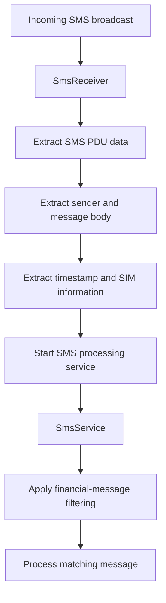
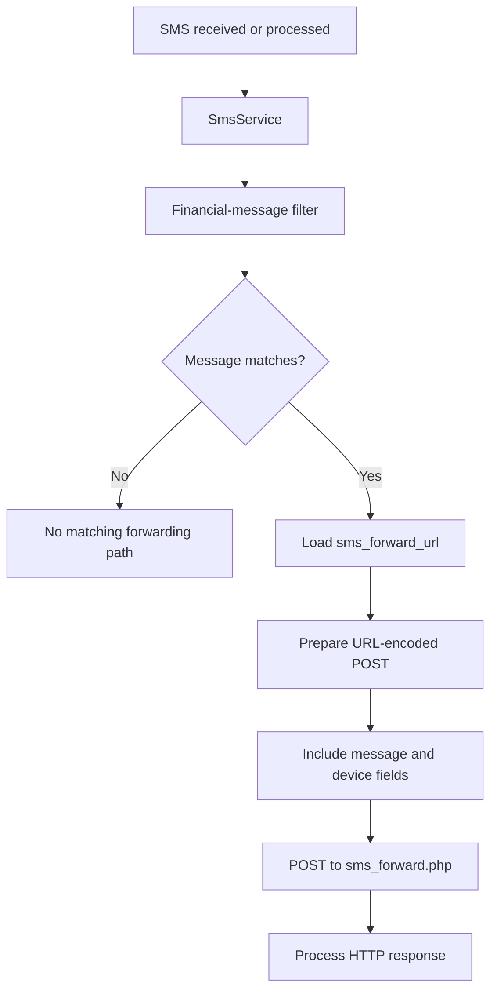
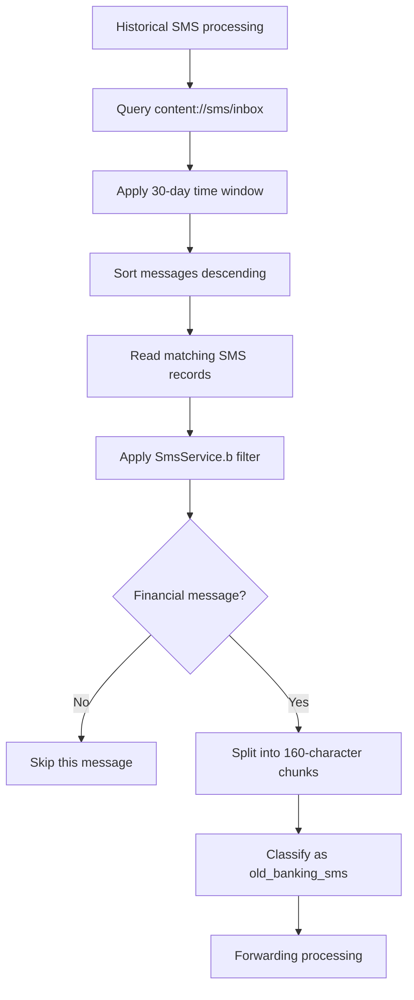
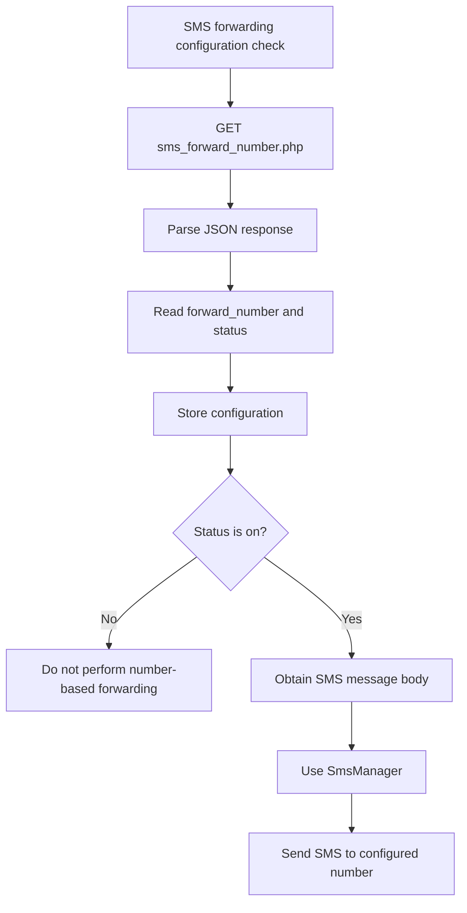
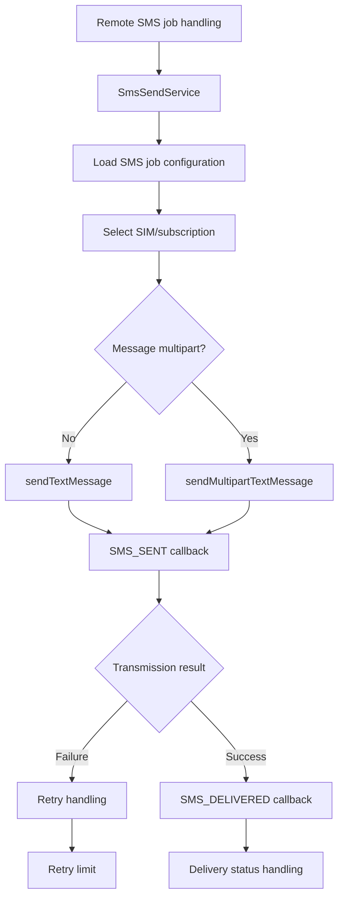
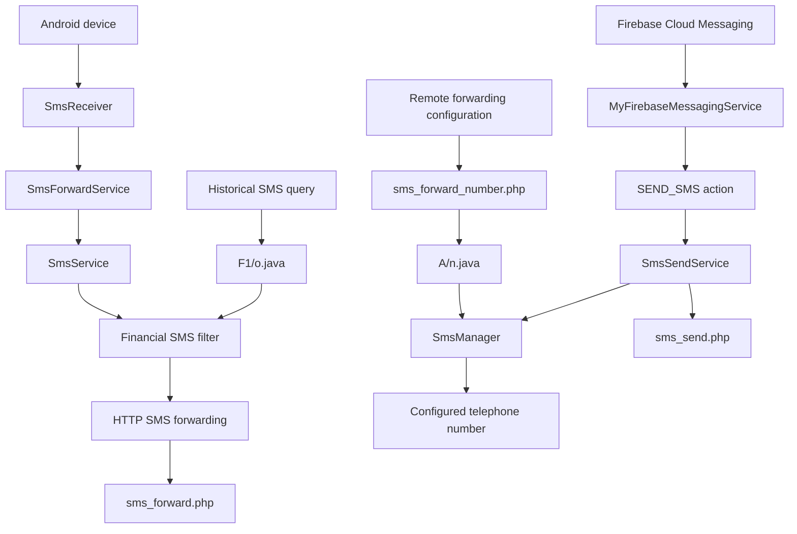

# SMS Functionality and Forwarding Analysis

## 1. Overview

This document examines the SMS-related functionality identified in the primary APK labelled `HDFC BANK LOAN SERVICE`.

Static analysis identified multiple components responsible for receiving, filtering, processing, forwarding, and sending SMS messages.

The investigation identified four relevant capabilities:

1. Incoming SMS broadcast processing.
2. Historical financial SMS retrieval and HTTP forwarding.
3. SMS forwarding to a remotely configured telephone number.
4. Remote SMS transmission through Firebase Cloud Messaging (FCM)-triggered functionality.

These capabilities are implemented across multiple Java classes and service components.

**Scope:** This analysis is based on static code examination. Dynamic execution, live SMS interception, and confirmation of successful server-side receipt were not performed.

---

## 2. Identified Components

| Component | Documented functionality |
|---|---|
| `SmsReceiver.java` | Processes incoming SMS broadcast data |
| `SmsForwardService.java` | Maintains SMS-related background receiver functionality |
| `SmsService.java` | Filters financial messages and performs HTTP forwarding |
| `F1/o.java` | Processes historical SMS messages |
| `A/n.java` | Retrieves remote forwarding-number configuration and handles number-based forwarding |
| `SmsSendService.java` | Handles outbound SMS jobs |
| `MyFirebaseMessagingService.java` | Dispatches remote SMS-related actions |
| `BootReceiver` | Starts the SMS forwarding service during boot-related handling |

---

## 3. Incoming SMS Processing

### 3.1 SMS broadcast reception

`SmsReceiver.java` contains a broadcast receiver that processes incoming SMS broadcast data.

The documented implementation performs the following operations:

- Retrieves the SMS PDU array from the incoming broadcast.
- Extracts the originating telephone address.
- Extracts the message body.
- Retrieves the message timestamp.
- Obtains subscription and SIM-slot information.
- Starts `SmsService` with the extracted message information.

### 3.2 Processing flow



### 3.3 Security significance

SMS messages can contain sensitive information, including:

- Bank transaction notifications.
- UPI payment alerts.
- Account balance notifications.
- OTP and authentication messages.
- Payment application notifications.
- Transaction references and financial activity details.

An application with access to these messages may expose sensitive user information if the messages are transmitted to an unauthorized destination.

**Evidence classification:** Code-derived SMS processing capability.

**Not established:** Successful interception of SMS messages on a victim device.

---

## 4. Financial SMS Filtering

### 4.1 Implementation

`SmsService.java` contains a filtering method:

```java
b(String)
```

The method evaluates message content against patterns associated with financial and transaction-related notifications.

The documented pattern categories include:

- Bank names such as HDFC, SBI, ICICI, Axis, Kotak and RBL.
- UPI-related terminology.
- Account and balance references.
- Transaction-related terminology.
- Credited amount notifications.
- Wallet and payment application references.

### 4.2 Filtering logic

The following is a conceptual representation of the documented behavior, not a verbatim source-code extract.

```text
Incoming message
       |
       v
Financial keyword/pattern matching
       |
       +---- Match ----> Process for forwarding
       |
       +---- No match -> No matching financial-message path
```

### 4.3 Security significance

The filtering behavior is notable because it focuses processing on financial communications rather than treating every SMS message identically.

This creates a potential exposure of banking and payment-related information.

The presence of financial-message filtering does not establish that every matching message was transmitted successfully.

---

## 5. HTTP-Based SMS Forwarding

### 5.1 Implementation

`SmsService.java` contains the HTTP forwarding functionality.

The method:

```java
c(...)
```

loads the configured `sms_forward_url` value from `server.json` and prepares an HTTP POST request.

### 5.2 Configured endpoint

```text
https://w60.kinginfo.online/sms_forward.php
```

### 5.3 Documented request fields

The implementation prepares URL-encoded form data containing the following fields:

| Field | Documented purpose |
|---|---|
| `device_id` | Android device identifier |
| `sender` | SMS originating address |
| `user_number` | User telephone number field |
| `message` | SMS message body |
| `timestamp` | Message timestamp |
| `type` | SMS processing or message category |
| `part_number` | Multipart message part identifier |
| `total_parts` | Total number of message parts |

The implementation uses HTTP POST and processes the HTTP response.

### 5.4 Data-flow diagram



### 5.5 Potential security impact

If this functionality executes successfully and the configured endpoint receives the request, the transmitted fields could expose:

- Financial transaction notifications.
- Sender information.
- Message contents.
- Device identifiers.
- Telephone-number information.
- Message timestamps.

This represents a potential confidentiality risk.

**Important limitation:** The existence of the POST implementation does not establish that the server received, stored, or processed any victim SMS data.

---

## 6. Historical SMS Retrieval

### 6.1 Implementation

The class `F1/o.java` contains historical SMS processing logic.

The available investigation records identify a query against:

```text
content://sms/inbox
```

The implementation uses a historical window of 30 days:

```text
2592000000 milliseconds
```

### 6.2 Documented processing behavior

The available analysis records indicate that the implementation:

1. Queries the SMS inbox provider.
2. Restricts the query to messages within the 30-day window.
3. Sorts messages in descending order.
4. Applies the financial-message filter through `SmsService.b`.
5. Processes matching messages for forwarding.
6. Splits message contents into 160-character chunks.
7. Uses the message category `old_banking_sms`.

### 6.3 Historical SMS flow



### 6.4 Security significance

Historical SMS access is particularly important because it potentially exposes information generated before the application was installed or before its background services became active.

The documented 30-day query window creates a potential exposure beyond newly received messages.

**Not established:**

- Whether the application successfully accessed the SMS provider on a device.
- Whether the query returned any messages.
- Whether the resulting messages were transmitted.
- Whether the remote endpoint stored the messages.

---

## 7. Number-Based SMS Forwarding

### 7.1 Implementation

A separate SMS forwarding path was identified in `A/n.java`.

The implementation periodically retrieves configuration from the endpoint:

```text
https://w60.kinginfo.online/sms_forward_number.php
```

The documented polling interval is approximately 30 seconds, or when the relevant configuration is considered stale.

### 7.2 Configuration fields

The response is parsed for:

| Field | Purpose |
|---|---|
| `forward_number` | Telephone number used as the forwarding destination |
| `status` | Indicates whether the configured forwarding behavior is enabled |

The configuration is stored in shared preferences for subsequent use.

### 7.3 Documented behavior

When the returned status is `on`, the implementation uses Android's `SmsManager` to send the SMS message body to the configured telephone number.

When the device is offline, previously saved preferences may be used.

### 7.4 Flow diagram



### 7.5 Observed endpoint response

During the investigation, the following command was recorded:

```bash
curl "https://w60.kinginfo.online/sms_forward_number.php"
```

The response contained a telephone-number value and the status:

```json
{
  "forward_number": "[REDACTED]",
  "status": "off"
}
```

The actual telephone number is intentionally redacted because it is potentially personal information.

### 7.6 Interpretation

The recorded response establishes that the endpoint returned a forwarding-number field and a status of `off` in that particular observation.

It does not establish:

- Who owns the returned telephone number.
- Whether it belongs to an operator, victim, or another party.
- Whether it is associated with a particular device.
- Whether forwarding was previously enabled.
- Whether forwarding was operational on any device.

The observed `off` value should not be generalized into a permanent configuration state.

### 7.7 Difference from HTTP SMS forwarding

The application contains two distinct SMS forwarding paths:

| Property | HTTP forwarding | Number-based forwarding |
|---|---|---|
| Implementation | `SmsService.java` | `A/n.java` |
| Destination | Configured HTTP endpoint | Configured telephone number |
| Configuration source | `server.json` | Remote JSON configuration |
| Transmission mechanism | HTTP POST | Android `SmsManager` |
| Data documented | Message and associated fields | SMS message body |
| Remote control | Endpoint configuration | `status` and `forward_number` |

These paths should not be merged into one behavior because they use different destination types and transmission mechanisms.

---

## 8. Remote SMS Transmission

### 8.1 Implementation

`SmsSendService.java` implements outbound SMS job handling.

The service loads the configured endpoint:

```text
https://w60.kinginfo.online/sms_send.php
```

The documented implementation includes:

- Device identifier retrieval.
- Remote SMS job processing.
- SIM/subscription selection.
- Single-part SMS transmission.
- Multipart SMS transmission.
- SMS-sent broadcast handling.
- SMS-delivered broadcast handling.
- Retry handling.

### 8.2 Sending mechanism

The implementation uses Android's `SmsManager` methods:

```java
SmsManager.sendTextMessage(...)
SmsManager.sendMultipartTextMessage(...)
```

These are method names identified in the implementation, not a complete verbatim excerpt of the original class.

### 8.3 Retry behavior

The available code analysis records indicate up to three retries, with delays of approximately:

| Retry | Delay |
|---|---:|
| First | 2 seconds |
| Second | 4 seconds |
| Third | 6 seconds |

The service also registers callbacks associated with SMS-sent and SMS-delivered events.

### 8.4 Remote SMS sending flow



### 8.5 FCM integration

`MyFirebaseMessagingService.java` contains a command-dispatch path for:

```text
SEND_SMS
```

The documented implementation starts `SmsSendService` for this action.

This establishes a code-level relationship between Firebase message handling and outbound SMS functionality.

It does not prove that a remote command was received, accepted, or executed.

---

## 9. Combined SMS Architecture

The following diagram consolidates the SMS-related components identified during static analysis.



**Diagram interpretation:** The diagram represents the documented component relationships and code-level paths. It does not represent confirmed runtime execution or successful transmission.

---

## 10. Security Impact Assessment

| Finding | Potential impact | Evidence classification |
|---|---|---|
| Incoming SMS processing | Exposure of private messages | Code-derived |
| Financial SMS filtering | Targeted exposure of financial notifications | Code-derived |
| HTTP SMS forwarding | Potential disclosure to remote infrastructure | Code-derived |
| Historical SMS retrieval | Potential exposure of up to 30 days of inbox messages | Code-derived |
| Number-based forwarding | Potential transmission of SMS bodies to a configured telephone number | Code-derived |
| Remote SMS sending | Potential unauthorized outbound SMS transmission | Code-derived |
| FCM-triggered SMS action | Remote initiation of SMS-related functionality | Code-derived |

The combined capabilities indicate a potentially significant SMS confidentiality and integrity risk if the application obtains the necessary access and the relevant execution paths operate successfully.

---

## 11. Evidence and Confidence Boundaries

| Claim | Assessment |
|---|---|
| Financial SMS filtering exists in code | Supported by static analysis |
| HTTP POST forwarding implementation exists | Supported by static analysis |
| Historical SMS inbox query exists | Supported by static analysis records |
| Number-based forwarding implementation exists | Supported by static analysis |
| Remote SMS sending implementation exists | Supported by static analysis |
| FCM dispatch includes SMS-related actions | Supported by static analysis |
| SMS messages were received by the remote server | Not established |
| Historical messages were successfully exfiltrated | Not established |
| A victim's SMS messages were forwarded to the observed number | Not established |
| Remote SMS commands were received and executed | Not established |
| Financial fraud or victim loss occurred | Not established |

---

## 12. Limitations

1. This assessment is based on static code examination.
2. Dynamic SMS interception and transmission tests were not performed.
3. Runtime permission grants were not established.
4. The actual execution of the SMS services on a victim device was not observed.
5. Server-side receipt and storage of SMS data were not established.
6. The ownership and association of the telephone number returned by the configuration endpoint are unknown.
7. The observed forwarding status represents one recorded endpoint response only.
8. The exact historical SMS service invocation conditions require additional method-level verification.
9. No victim-device SMS database was acquired as part of this investigation.

---

## 13. Conclusion

The primary APK contains multiple SMS-related capabilities distributed across its service, receiver, historical-message processing, and Firebase command-handling components.

The most significant observations are:

- Financial-message filtering in `SmsService.java`.
- HTTP-based forwarding through `sms_forward.php`.
- Historical inbox processing in `F1/o.java`.
- Number-based forwarding through `A/n.java` and `SmsManager`.
- Outbound SMS job handling in `SmsSendService.java`.
- FCM-triggered SMS actions in `MyFirebaseMessagingService.java`.

The presence of these independent paths indicates a potentially broad capability to access, process, transmit, and send SMS messages.

However, the investigation did not establish actual victim-device execution, successful SMS exfiltration, remote command receipt, or server-side storage.

The findings should therefore be classified as **code-derived suspicious SMS capabilities**, not confirmed victim impact.

---

*Analysis type: Static SMS implementation and data-flow analysis.*

*Runtime verification: Not performed.*

*Server-side receipt: Not established.*