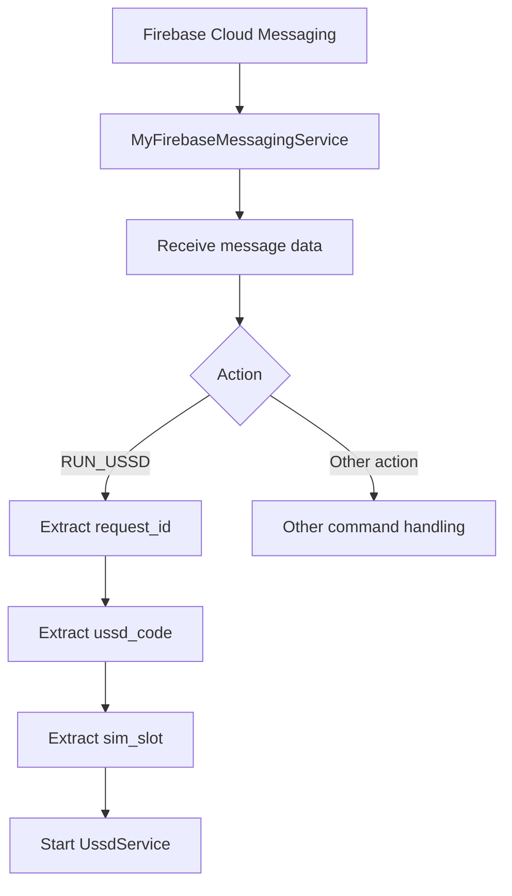
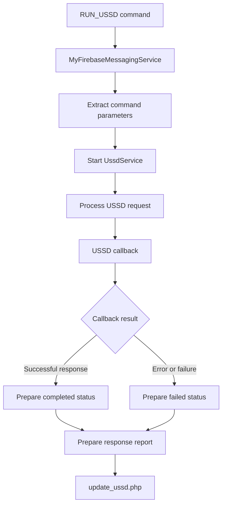

# USSD Command Execution Analysis

## 1. Overview

This document examines the USSD-related functionality identified in the primary APK labelled `HDFC BANK LOAN SERVICE`.

Static analysis identified two separate USSD-related implementation paths:

1. **Firebase-triggered USSD execution:** A remote message containing the `RUN_USSD` action is handled by `MyFirebaseMessagingService.java` and dispatched to `UssdService.java`.
2. **Call-forwarding USSD execution:** `CallService.java` constructs USSD strings for call-forwarding activation and deactivation.

This document focuses primarily on the Firebase-triggered command path.

USSD (Unstructured Supplementary Service Data) is a mobile-network communication mechanism commonly used for carrier services, account queries, and other network-operated functions.

**Investigation boundary:** The code-level command-handling capability was identified through static analysis. No live remote USSD command execution was observed.

---

## 2. Identified Components

| Component | Documented functionality |
|---|---|
| `MyFirebaseMessagingService.java` | Receives and dispatches Firebase message actions |
| `UssdService.java` | Handles USSD command-related processing and reporting |
| `CallService.java` | Implements separate call-forwarding USSD operations |
| `A/n.java` | Contains related device identification and remote communication functionality |

---

## 3. Firebase Command Dispatch

### 3.1 Identified command action

`MyFirebaseMessagingService.java` contains a command-dispatch path for:

```text
RUN_USSD
```

When this action is processed, the implementation reads command-related values and starts `UssdService`.

### 3.2 Documented command parameters

The implementation extracts the following fields:

| Parameter | Documented purpose |
|---|---|
| `request_id` | Identifies the USSD request |
| `ussd_code` | Contains the USSD string to be processed |
| `sim_slot` | Identifies the SIM-slot selection |

These parameters establish the structure of the command-handling path.

The available records do not establish the complete server-side command-generation process or the authentication and authorization checks performed before a command reaches the application.

### 3.3 Command dispatch flow



**Interpretation:** This represents the documented application-side dispatch path. It does not establish that a Firebase command was actually received from a remote controller.

---

## 4. UssdService Implementation

### 4.1 Service responsibilities

`UssdService.java` contains functionality associated with processing USSD requests and reporting their outcomes.

The available static-analysis records identify the following behavior:

1. Loads the configured `update_ussd_url`.
2. Retrieves the Android device identifier.
3. Processes the request identifier and USSD command.
4. Handles SIM-slot information.
5. Processes a callback result through `C0513q`.
6. Determines a completion or failure status.
7. Prepares a status report for the configured endpoint.

### 4.2 Configured reporting endpoint

```text
https://w60.kinginfo.online/update_ussd.php
```

This endpoint is referenced by the application's configuration and service implementation.

Its presence establishes a configured destination for USSD-related status reporting. It does not establish successful backend receipt or storage.

### 4.3 Reported fields

The documented implementation prepares the following fields:

| Field | Purpose |
|---|---|
| `device_id` | Android device identifier |
| `command_id` | Identifier associated with the command |
| `ussd_code` | USSD string associated with the operation |
| `sim_slot` | Selected SIM slot |
| `status` | Completion or failure status |
| `response` | Response information |
| `error` | Error information |

These fields indicate that the implementation is designed to associate an operation result with its originating command.

---

## 5. USSD Processing and Reporting Flow



**Important:** The diagram represents the documented command-processing and reporting architecture. The exact invocation path inside `UssdService.onStartCommand()` was not fully recovered because its JADX decompilation failed.

Therefore, the precise relationship between service startup and the underlying telephony invocation remains subject to Smali-level verification.

---

## 6. Callback and Result Handling

The investigation identified a callback implementation associated with `UssdService.java`:

```text
C0513q
```

The callback processes the result of the USSD operation and determines whether the operation should be reported as completed or failed.

The service prepares a report containing response and error information.

This distinction matters because a command being dispatched to a service is not equivalent to successful execution.

The following stages must be considered separately:

| Stage | Meaning |
|---|---|
| Command received | Application receives a Firebase message |
| Command dispatched | Application starts the relevant service |
| USSD request attempted | A telephony operation is initiated |
| Callback received | Android provides a response or error |
| Result classified | Application determines a completion or failure status |
| Status reported | Application attempts to transmit the result |
| Backend receipt | Remote infrastructure receives and processes the report |

Only the application-side implementation of these stages is documented by the available static-analysis records. Successful execution and backend receipt remain unverified.

---

## 7. Relationship with Call-Forwarding USSD

The application contains another USSD-related implementation in `CallService.java`.

These two paths must remain analytically separate.

| Property | Firebase-triggered USSD | Call-forwarding USSD |
|---|---|---|
| Main component | `UssdService.java` | `CallService.java` |
| Trigger | `RUN_USSD` Firebase action | Remote call-forwarding configuration |
| Command source | `ussd_code` field | Constructed from call status and destination number |
| SIM selection | `sim_slot` command parameter | `sim_slot` configuration |
| Reporting endpoint | `update_ussd.php` | `update_call_forward.php` |
| Purpose | General USSD command handling | Call-forwarding activation/deactivation |
| Runtime execution | Not established | Not established |

### Call-forwarding command strings

The separate `CallService.java` implementation constructs:

```text
**21*<number>#
##21#
```

These commands belong to the call-forwarding implementation and should not be presented as the complete set of commands handled by `UssdService`.

The available records do not establish that every Firebase-triggered USSD command is related to call forwarding.

---

## 8. Security Impact Assessment

A remotely configurable USSD mechanism can create significant security risks when commands are executed without the device owner's knowledge or authorization.

Potential security implications include:

| Potential impact | Explanation |
|---|---|
| Unauthorized carrier-service operations | Remote commands could request network-operated services |
| Exposure of telecom account information | Some USSD services return account or service information |
| Call-routing manipulation | Certain commands may affect call-forwarding settings |
| User privacy risk | USSD operations may expose information about mobile subscriptions |
| SIM-specific operations | A selected SIM subscription may be targeted |
| Remote control capability | Firebase messages may trigger application-side operations |

The actual impact depends on the command supplied, device support, carrier implementation, and user authorization.

These are potential risks, not confirmed consequences of this investigation.

---

## 9. Evidence and Confidence Boundaries

| Claim | Assessment |
|---|---|
| `RUN_USSD` action exists in command dispatch | Supported by static analysis |
| `request_id` is extracted | Supported by static analysis |
| `ussd_code` is extracted | Supported by static analysis |
| `sim_slot` is extracted | Supported by static analysis |
| `UssdService` is started for the action | Supported by static analysis |
| `update_ussd_url` is loaded | Supported by static analysis |
| Callback-based result handling exists | Supported by static analysis |
| Completion/failure reporting is implemented | Supported by static analysis |
| A remote Firebase command was received | Not established |
| A USSD command was executed on a victim device | Not established |
| A carrier-side operation succeeded | Not established |
| The reporting server received or stored the result | Not established |

---

## 10. Limitations

1. The exact `UssdService.onStartCommand()` execution path was not fully recovered from JADX.
2. Smali-level verification is required to establish the precise telephony invocation path.
3. No live Firebase command was sent or received during the investigation.
4. No live USSD operation was performed.
5. Device-level SIM and carrier behavior was not tested.
6. No victim-device telephony state was acquired.
7. The reporting endpoint's backend implementation was not examined.
8. Successful command execution and server-side receipt were not established.
9. Dynamic analysis was not performed.

---

## 11. Conclusion

The primary APK contains a Firebase-triggered USSD command-handling path.

`MyFirebaseMessagingService.java` processes the `RUN_USSD` action, extracts a request identifier, USSD string, and SIM-slot parameter, and starts `UssdService.java`.

The service contains functionality for preparing operation results and reporting completion or failure information to the configured `update_ussd.php` endpoint.

A separate USSD implementation exists in `CallService.java` for remotely configurable call-forwarding operations.

Together, these components demonstrate suspicious remote telecom-operation capabilities at the code level. However, the investigation does not establish that a remote command was received, executed, or successfully applied by a mobile carrier.

The findings should therefore be classified as **code-derived remote USSD command-handling capability**, with runtime and carrier-side impact unconfirmed.

---

*Analysis type: Static USSD command-dispatch and service analysis.*

*Runtime execution: Not performed.*

*Carrier-side operation: Not established.*