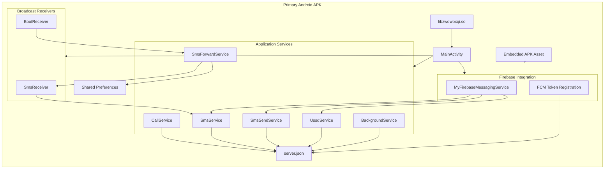
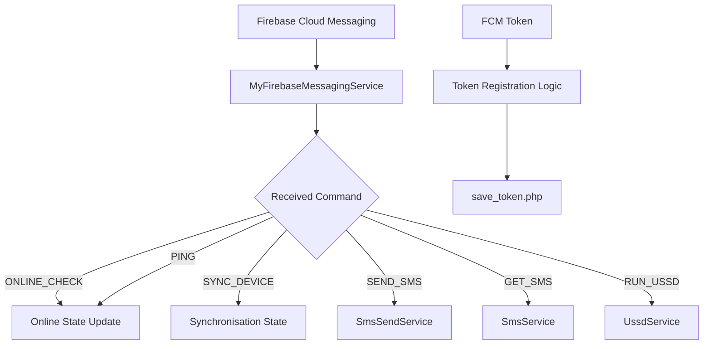
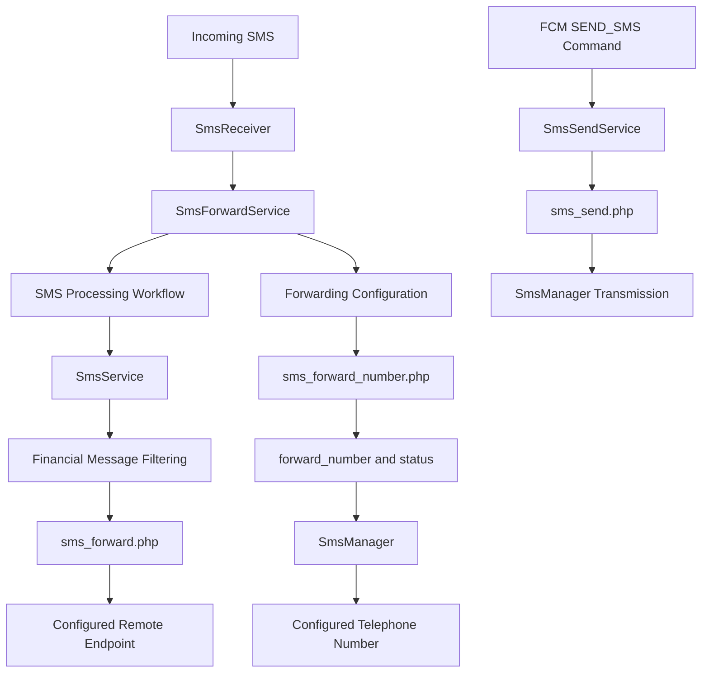
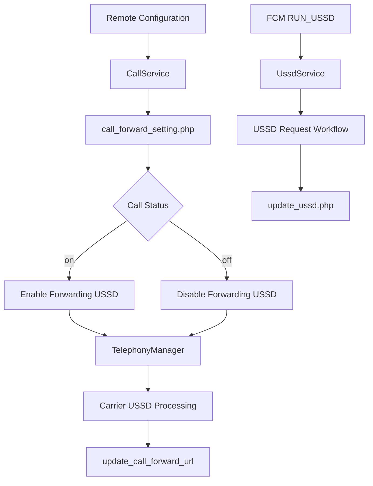
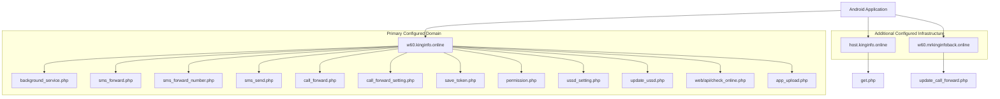
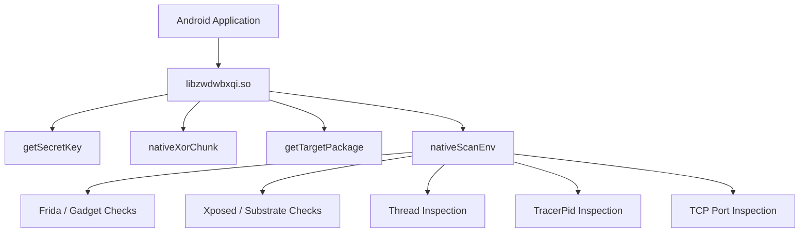
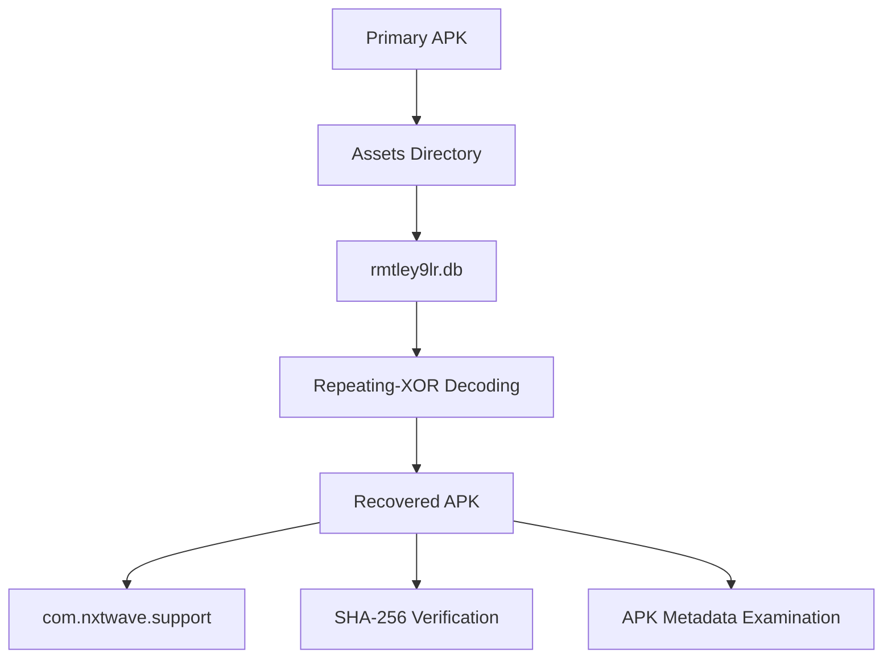

# Android Application Architecture

## 1. Overview

This document illustrates the architecture identified during static examination of the primary Android APK.

The architecture represents the relationship between:

- Android application components.
- Background services and broadcast receivers.
- Firebase Cloud Messaging.
- SMS and telephony functionality.
- Remote HTTP endpoints.
- Embedded application artifacts.

The diagram is reconstructed from application configuration, Java decompilation, and Smali inspection. It is not a runtime-captured architecture.

## 2. High-Level Application Architecture

## 3. Component Responsibilities

| Component | Identified responsibility |
|---|---|
| `MainActivity` | Application entry point and service startup logic |
| `SmsService` | Financial SMS filtering and HTTP forwarding |
| `SmsForwardService` | SMS broadcast monitoring and forwarding workflow |
| `SmsReceiver` | Processes incoming SMS broadcast information |
| `SmsSendService` | Remote SMS transmission |
| `CallService` | Retrieves and processes call-forwarding configuration |
| `UssdService` | Handles USSD-related command workflow |
| `BackgroundService` | Device and SIM information reporting |
| `BootReceiver` | Starts SMS forwarding service after boot |
| `MyFirebaseMessagingService` | Processes incoming FCM command messages |
| `server.json` | Stores remote endpoint configuration |
| `libzwdwbxqi.so` | Native functionality including environment checks |
| Embedded APK asset | Contains a separately recovered APK |

## 4. Firebase Command Architecture

The application uses Firebase Cloud Messaging as a command-dispatch mechanism.

The diagram represents command handlers identified in `MyFirebaseMessagingService.java`. It does not establish successful command delivery or execution.

## 5. SMS Processing Architecture

The application contains two distinct SMS forwarding paths and a separate remote SMS transmission service.

The two forwarding paths should not be conflated:

1. HTTP-based forwarding of filtered financial SMS messages.
2. SMS-body forwarding through a remotely configured telephone number.

`SmsSendService` implements a separate remote SMS transmission workflow.

## 6. Call-Forwarding and USSD Architecture

The application contains these USSD-related code paths. Actual carrier acceptance and successful call redirection were not verified.

## 7. Remote Infrastructure Architecture

The diagram represents configured endpoint relationships, not verified backend implementation or data flow during execution.

## 8. Native Library Architecture

The primary APK contains:

`libzwdwbxqi.so`

The library is a stripped ARM64 native library with JNI-related functions identified during static examination.

These checks are consistent with instrumentation and debugging-environment detection.

Their actual runtime effect was not tested.

## 9. Embedded APK Relationship

The primary APK contains an asset named:

`rmtley9lr.db`

After repeating-XOR decoding, the asset was recovered as an APK with package name:

`com.nxtwave.support`

Both APKs share the same signing certificate.

The architecture does not assert that the embedded APK is installed or executed by the primary application.

## 10. Architecture Assessment

The examined application contains multiple interconnected subsystems:

- SMS collection and forwarding.
- Remote SMS transmission.
- FCM command dispatch.
- Call-forwarding configuration.
- USSD operations.
- Device information reporting.
- Background service management.
- Native environment detection.
- Embedded APK storage.

The configuration-driven endpoint structure provides a common reference for the application's remote communication functionality.

## 11. Limitations

- Architecture reconstructed from static evidence.
- Dynamic execution was not performed.
- Actual runtime service interactions were not captured.
- FCM message delivery was not established.
- Backend implementation was not examined.
- Embedded APK execution linkage was not established.
- Successful SMS, USSD, or call-forwarding operations were not verified.

**Diagram classification:** Static architecture reconstruction  
**Primary artifact:** `com.sec.android.app.finance.kaxqj68`  
**Dynamic analysis:** Not performed