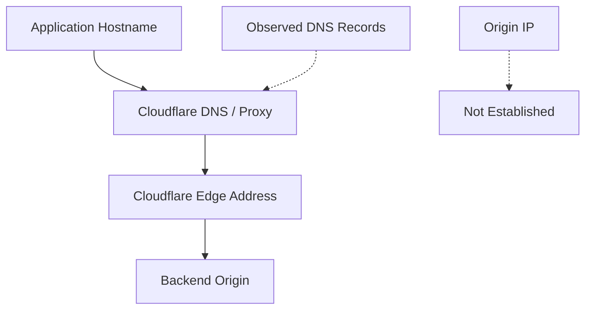

# C2 Infrastructure Map

## 1. Overview

This document visualizes the remote infrastructure referenced by the examined Android application.

The map is reconstructed from:

- `server.json`
- `web_server.json`
- Firebase configuration
- Static code references
- DNS observations
- HTTP endpoint assessment
- TLS and certificate-transparency intelligence

It represents configured infrastructure relationships, not a captured runtime network session.

## 2. High-Level Infrastructure Map

```mermaid
flowchart TB
    APK["Android APK"]

    CFG["server.json"]
    WCFG["web_server.json"]
    FCM["Firebase Configuration"]

    APK --> CFG
    APK --> WCFG
    APK --> FCM

    subgraph PRIMARY["Primary Configured Infrastructure"]
        W60["w60.kinginfo.online"]

        W60 --> BG["background_service.php"]
        W60 --> SMS["sms_forward.php"]
        W60 --> SMSN["sms_forward_number.php"]
        W60 --> SEND["sms_send.php"]
        W60 --> CALL["call_forward.php"]
        W60 --> CALLS["call_forward_setting.php"]
        W60 --> TOKEN["save_token.php"]
        W60 --> PERM["permission.php"]
        W60 --> ONLINE["check_online.php"]
        W60 --> USSD["ussd_setting.php"]
        W60 --> USSDU["update_ussd.php"]
        W60 --> APP["app_upload.php"]
    end

    subgraph CONFIG["Configuration Infrastructure"]
        HOST["host.kinginfo.online"]
        GET["get.php"]
        HOST --> GET
    end

    subgraph SECONDARY["Secondary Configured Infrastructure"]
        BACK["w60.mrkinginfoback.online"]
        UPDATE["update_call_forward.php"]
        BACK --> UPDATE
    end

    subgraph MESSAGING["Messaging Infrastructure"]
        FIREBASE["Firebase Cloud Messaging"]
        COMMANDS["Command Dispatcher"]
        FIREBASE --> COMMANDS
    end

    CFG --> W60
    WCFG --> HOST
    CFG --> BACK
    FCM --> FIREBASE
```

## 3. Endpoint Classification

### 3.1 Device and application status

| Endpoint | Configured purpose |
|---|---|
| `background_service.php` | Device and background status reporting |
| `web/api/check_online.php` | Online-status checking |
| `save_token.php` | FCM token registration |

### 3.2 SMS operations

| Endpoint | Configured purpose |
|---|---|
| `sms_forward.php` | Financial SMS forwarding |
| `sms_forward_number.php` | Forwarding-number configuration |
| `sms_send.php` | Remote SMS transmission |

### 3.3 Telephony operations

| Endpoint | Configured purpose |
|---|---|
| `call_forward.php` | Call-forwarding-related operation |
| `call_forward_setting.php` | Call-forwarding configuration |
| `update_call_forward.php` | Call-forwarding status update |
| `ussd_setting.php` | USSD configuration |
| `update_ussd.php` | USSD status reporting |

### 3.4 Additional application configuration

| Endpoint | Configured purpose |
|---|---|
| `permission.php` | Permission configuration |
| `app_upload.php` | Application upload-related functionality |
| `get.php` | Web configuration retrieval |

## 4. Firebase Infrastructure Relationship

The application contains the following Firebase identifiers:

| Attribute | Value |
|---|---|
| Project ID | `fcmtoken-af5a6` |
| Sender ID | `705898731` |
| App ID | `1:705898731153:web:130e5565c49b143bfb9130` |

The FCM integration is associated with command handlers for:

- `ONLINE_CHECK`
- `SYNC_DEVICE`
- `PING`
- `SEND_SMS`
- `GET_SMS`
- `RUN_USSD`

The Firebase configuration and HTTP endpoint configuration represent separate communication components.

No Firebase Realtime Database URL was recovered.

## 5. DNS and Network Observations

The following addresses were observed for primary infrastructure subdomains:

| Record | Observed address |
|---|---|
| A | `104.21.3.189` |
| A | `172.67.131.27` |
| AAAA | `2606:4700:3031::6815:3bd` |
| AAAA | `2606:4700:3037::ac43:831b` |

These addresses are Cloudflare-associated edge addresses.

The backend origin address was not established from these DNS observations.

The diagram is conceptual and does not establish the exact routing or backend topology.

## 6. Infrastructure Audit Observations

The endpoint audit was recorded at:

`2026-11-04T13:02:38Z`

| Observation | Result |
|---|---:|
| HTTP 200 responses | 12 |
| DNS resolution errors | 1 |
| Failed hostname | `w60.mrkinginfoback.online` |

An HTTP 200 response indicates that an HTTP response was returned. It does not prove successful application operations or backend data storage.

## 7. Certificate Intelligence

The certificate investigation recorded:

| Attribute | Result |
|---|---:|
| Cert Spotter records collected | 229 |
| Unique certificate IDs | 229 |
| Unique DNS names | 167 |
| Numbered `w` hostnames | 143 |
| Repeated hostnames with two records | 37 |

The observed repeated certificate records showed an average issuance gap of approximately 58.73 days.

This pattern is consistent with automated certificate renewal and key rotation, but it does not establish common ownership or malicious activity.

## 8. Infrastructure Relationship Assessment

| Relationship | Evidence | Assessment |
|---|---|---|
| APK to primary service hostname | `server.json` | Direct configuration reference |
| APK to configuration hostname | `web_server.json` | Direct configuration reference |
| APK to secondary hostname | `server.json` | Direct configuration reference |
| APK to Firebase project | Firebase configuration and FCM code | Direct configuration relationship |
| Primary subdomains to Cloudflare | DNS and HTTP observations | Observed infrastructure relationship |
| All infrastructure to one operator | No conclusive evidence | Not established |

## 9. Investigation Limitations

- No runtime network capture was performed.
- Backend source code was unavailable.
- Server-side data storage was not established.
- Cloudflare edge addresses were not verified as origin addresses.
- Infrastructure ownership and operator identity remain undetermined.
- Certificate-transparency collection was incomplete.
- Endpoint responses do not establish successful application-level operations.

## 10. Conclusion

The application references a multi-endpoint infrastructure architecture that supports device reporting, SMS functionality, telephony operations, configuration retrieval, and FCM integration.

The collected DNS, TLS, certificate, and HTTP observations provide supporting infrastructure context.

The available evidence establishes application-to-infrastructure configuration relationships, but does not establish backend ownership, successful runtime communication, or operator attribution.

**Classification:** Suspicious application-associated configured infrastructure  
**Attribution:** Undetermined  
**Runtime communication:** Not established