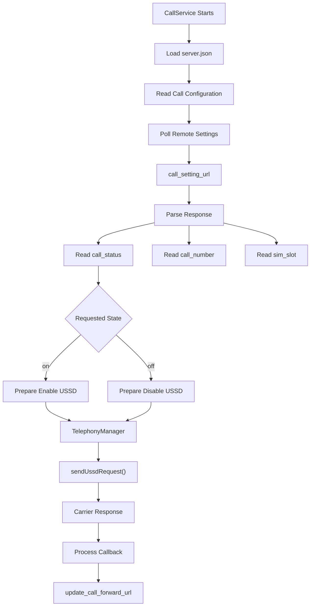
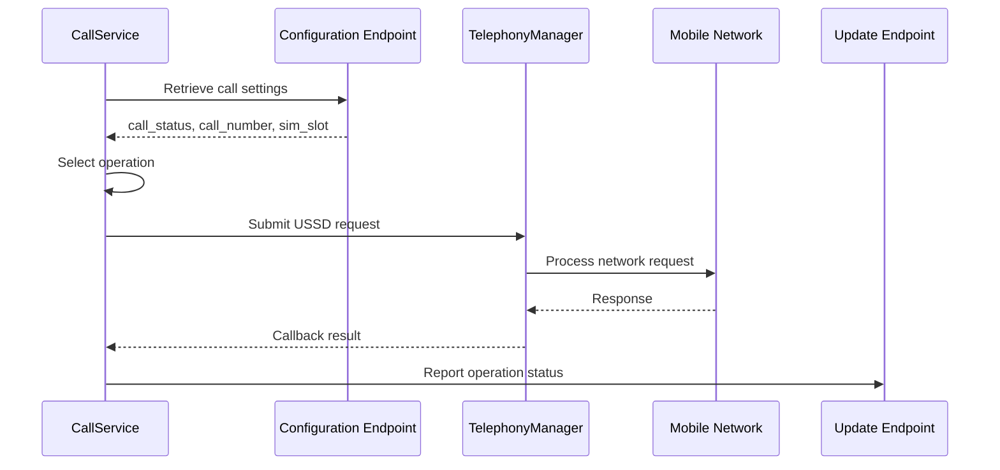

# Call Forwarding Manipulation Flow

## 1. Overview

This document describes the call-forwarding functionality identified during static examination of the Android application.

The primary component is:

`CallService.java`

The implementation retrieves remote call-forwarding configuration, processes the configured state, and uses Android telephony APIs to submit USSD requests.

The analysis identified two principal operations:

- Enabling call forwarding.
- Disabling call forwarding.

## 2. Identified Configuration

The service references the following configuration values:

| Configuration | Purpose |
|---|---|
| `call_setting_url` | Retrieves remote call-forwarding settings |
| `update_call_forward_url` | Reports call-forwarding operation status |
| Android device ID | Identifies the device in requests |
| `call_status` | Indicates the requested forwarding state |
| `call_number` | Configured forwarding number |
| `sim_slot` | SIM/subscription selection |

Configured endpoints:

```text
https://w60.kinginfo.online/call_forward_setting.php

https://w60.mrkinginfoback.online/update_call_forward.php
```

## 3. High-Level Workflow



*This is a static reconstruction of the implementation, not a runtime-captured session.*

## 4. Remote Configuration Retrieval

`CallService.java` periodically checks the configured call-forwarding settings endpoint.

The observed polling interval is approximately five seconds.

The request includes the device identifier:

```text
call_setting_url?device_id=<device_id>
```

The response is processed for:

- `call_status`
- `call_number`
- `sim_slot`

The application uses these values to determine the intended call-forwarding operation.

## 5. USSD Operations

The following USSD strings were identified in the implementation:

| Requested state | USSD string |
|---|---|
| Enable forwarding | `**21*<number>#` |
| Disable forwarding | `##21#` |

These are the strings represented in the examined code. Actual carrier behaviour depends on network support, SIM configuration, device permissions, and telephony conditions.

## 6. Android Telephony Integration

The implementation uses:

```java
TelephonyManager.createForSubscriptionId(...).sendUssdRequest(...)
```

The API is used for subscription-specific USSD request handling.

The identified implementation includes callback handling for the returned response.

### Processing sequence



The sequence represents the code-derived workflow. It does not establish that the carrier accepted the request.

## 7. Status Reporting

The service contains logic for reporting the operation result to:

```text
https://w60.mrkinginfoback.online/update_call_forward.php
```

The endpoint is configured as the call-forwarding update destination.

During the recorded infrastructure assessment, this hostname failed DNS resolution.

This observation does not establish its historical availability or whether the application has an alternative reporting path.

## 8. Security Implications

Call-forwarding manipulation can affect the confidentiality and availability of voice communications.

If successfully activated without the device owner's authorisation, forwarding could redirect incoming calls to another number.

Potential consequences include:

- Interception of incoming voice calls.
- Exposure of sensitive conversations.
- Interference with normal communication.
- Potential disruption of account-recovery or verification workflows that rely on voice calls.

These are potential consequences, not confirmed impacts from this investigation.

## 9. Evidence Limitations

The investigation established the following:

- Remote call-forwarding configuration retrieval logic exists.
- The code contains enable and disable USSD strings.
- Subscription-specific telephony API usage is present.
- Callback and status-reporting logic is present.

The investigation did not establish:

- Successful USSD execution.
- Carrier acceptance.
- Actual call-forwarding activation.
- Successful redirection of incoming calls.
- Successful backend status storage.
- Victim-device impact.

## 10. Conclusion

Static examination identified a remote call-forwarding workflow in `CallService.java`.

The implementation retrieves remote settings, processes the requested forwarding state, submits a USSD request through Android telephony APIs, and contains callback-based status reporting.

The functionality represents a potentially sensitive telephony-control capability.

However, successful call-forwarding activation or redirection was not demonstrated.

**Analysis type:** Static code examination  
**Primary component:** `CallService.java`  
**Dynamic verification:** Not performed  
**Runtime impact:** Not established

**Related documents:** `analysis/call-forwarding-analysis.md`, `analysis/ussd-analysis.md`, `infrastructure/endpoint-observations.md`.