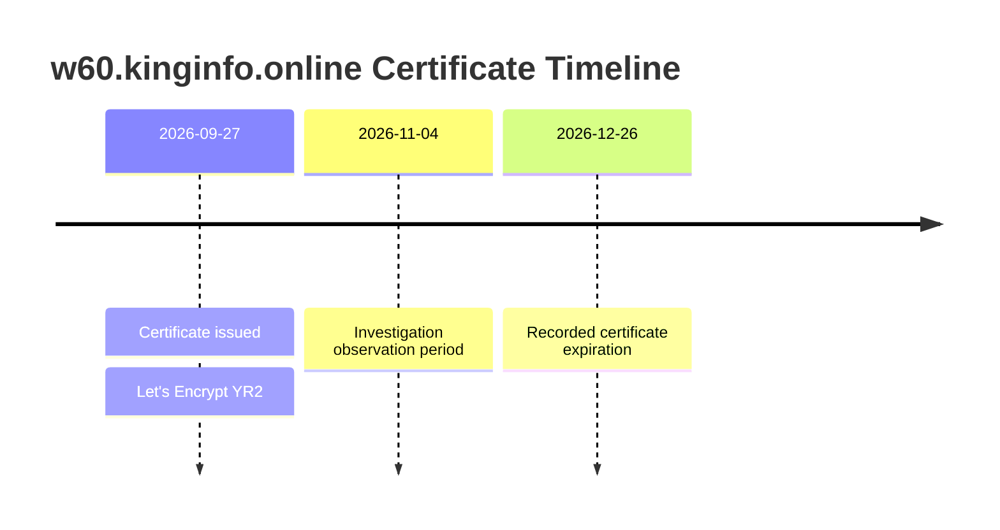
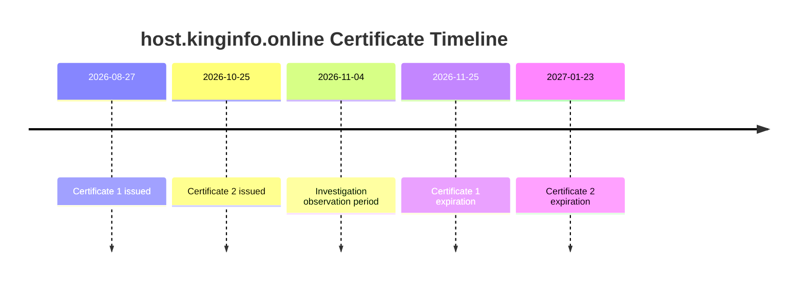
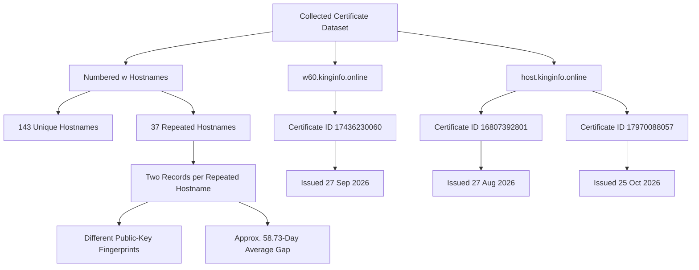

# TLS Certificate Timeline and Infrastructure Observations

## 1. Overview

This document presents the certificate-transparency observations collected during the investigation of infrastructure referenced by the Android application.

The analysis focused on:

- Certificate issuance and expiration.
- Certificate identifiers.
- DNS names associated with certificates.
- Public-key SHA-256 fingerprints.
- Repeated certificate records for numbered hostnames.
- Certificate relationships involving `w60.kinginfo.online` and `host.kinginfo.online`.

The timeline represents collected certificate metadata. It does not establish domain ownership, backend relationships, or malicious intent.

## 2. Certificate Collection Summary

The collected Cert Spotter dataset contained:

| Metric | Observed result |
|---|---:|
| Certificate records | 229 |
| Unique certificate IDs | 229 |
| Unique DNS names | 167 |
| Numbered `w` hostnames | 143 |
| Repeated hostnames with two records | 37 |

The collection covered three populated pages:

- Page 1: 100 records
- Page 2: 100 records
- Page 3: 29 records
- Page 4: 0 records

The fourth page returned an empty response with a `Retry-After: 3600` header. The collection should therefore be treated as incomplete rather than exhaustive.

## 3. Numbered Hostname Observations

The collected records contained numbered hostnames ranging from `w1` through `w144`, with `w2` absent from the observed dataset.

There were 143 unique numbered hostnames.

Among the collected hostname-certificate records:

- 180 hostname-certificate records were observed.
- 37 hostnames appeared in two certificate records.
- Each of those 37 repeated hostnames had two different public-key SHA-256 fingerprints.
- The average issuance gap between repeated records was approximately 58.73 days.
- The observed minimum gap was approximately 58.45 days.
- The observed maximum gap was approximately 59.05 days.

This pattern is consistent with automated certificate renewal and key rotation.

It does not establish common ownership, common administration, or malicious activity.

## 4. Certificate Timeline: `w60.kinginfo.online`

The collected certificate record for `w60.kinginfo.online` contained:

| Attribute | Value |
|---|---|
| Certificate ID | `17436230060` |
| Issued | `2026-09-27 02:07:17 UTC` |
| Expires | `2026-12-26 02:07:16 UTC` |
| Revoked | `false` |
| Certificate authority | Let's Encrypt |
| Intermediate | YR2 |
| Certificate SHA-256 | `63d72c5c9a96756ef7d88f6c2965d2b6962ab744dbae983159eafb1808b39321` |
| Public-key SHA-256 | `78439e520243b864cc5e082ed503d61fdbdbf67358b764c1f505e538d441a3ca` |
| Observed SAN | `w60.kinginfo.online` |

### Timeline

The expiration date is the recorded certificate metadata, not a claim that the certificate remained valid or was actively deployed throughout that period.

## 5. Certificate Timeline: `host.kinginfo.online`

Two certificate records were observed for `host.kinginfo.online`.

| Attribute | Certificate 1 | Certificate 2 |
|---|---|---|
| Certificate ID | `16807392801` | `17970088057` |
| Issued | 2026-08-27 | 2026-10-25 |
| Expires | 2026-11-25 | 2027-01-23 |
| Certificate authority | Let's Encrypt | Let's Encrypt |
| Intermediate | YR2 | YR2 |
| Public-key SHA-256 | `4319b47dce7fac5770cb1c605aafa2d6a8cdf51ce027bf8820833b72cca74654` | `81d0ade030edb4c739a49947d740a4abc419cad3cefd2f78765d1b5d555fd6ff` |

### Timeline

The two records contain different public-key fingerprints, indicating that the observed certificates did not use the same public key.

## 6. Public-Key Comparison

The collected public-key fingerprints for the two `host.kinginfo.online` certificates did not match the observed public-key fingerprints in the numbered `w` hostname timeline.

This is a comparison of the collected records only.

It does not establish that the hostnames are operated by different entities or that they have no other infrastructure relationship.

## 7. Certificate Relationship Diagram

## 8. Interpretation

The collected records support the following observations:

1. The investigated hostnames have associated publicly recorded TLS certificates.
2. Multiple numbered `w` hostnames appeared in the collected certificate dataset.
3. Thirty-seven numbered hostnames had two observed certificate records.
4. Repeated records showed different public-key fingerprints.
5. The average issuance gap for those repeated records was approximately 58.73 days.
6. The two observed `host.kinginfo.online` certificates used different public keys.
7. Neither observed `host.kinginfo.online` public-key fingerprint matched the collected numbered-hostname timeline fingerprints.

The renewal pattern is consistent with automated certificate issuance and key rotation. It should not be treated as proof of shared ownership or coordinated malicious infrastructure.

## 9. Collection Limitations

- The certificate dataset was not exhaustive.
- The fourth page returned no records during collection.
- The crt.sh request returned HTTP 502.
- Certificate-transparency records do not establish current deployment.
- Certificate issuance does not establish domain ownership.
- A matching certificate or public key does not independently establish common operation.
- A different public key does not prove that two domains are unrelated.

## 10. Conclusion

The certificate-transparency investigation identified 229 certificate records and 167 unique DNS names in the collected dataset.

Repeated numbered hostnames exhibited an approximately 59-day issuance interval and different public-key fingerprints. The investigated `w60.kinginfo.online` and `host.kinginfo.online` certificates were also documented separately.

These observations provide infrastructure context for the APK investigation. They do not independently establish malicious hosting, common ownership, or operator attribution.

**Collection status:** Partial dataset  
**Certificate authority observed:** Let's Encrypt  
**Ownership attribution:** Not established  
**Infrastructure attribution:** Not established

**Related documents:** `infrastructure/tls-analysis.md`, `infrastructure/dns-analysis.md`, `infrastructure/domain-intelligence.md`, `diagrams/c2-infrastructure-map.md`.