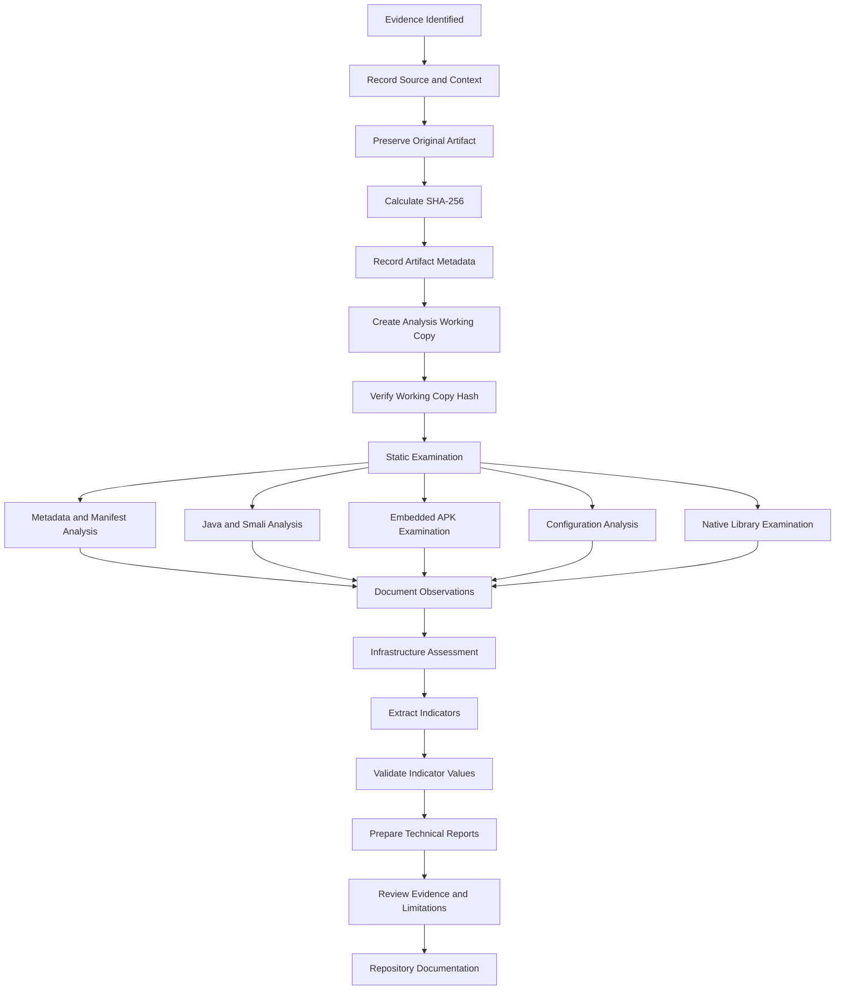
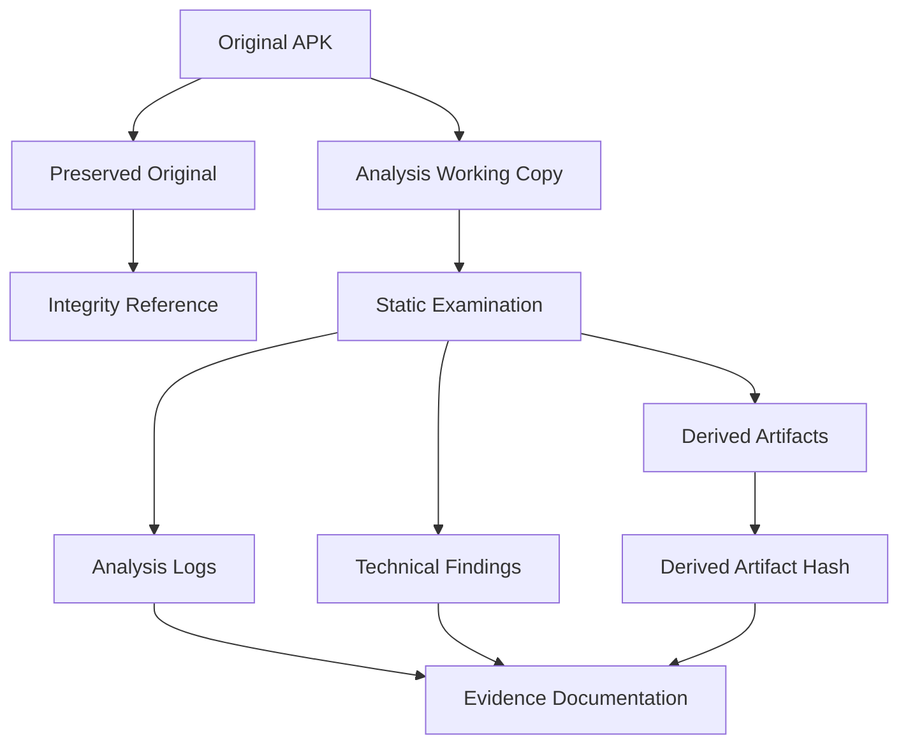
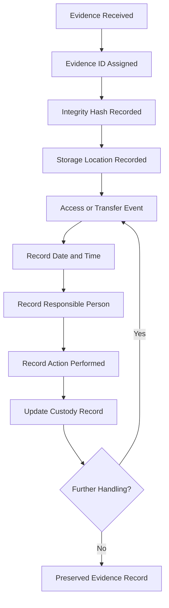

# Digital Evidence Lifecycle

## 1. Overview

This document illustrates the evidence-management lifecycle followed during the Android APK investigation.

The lifecycle covers artifact identification, integrity verification, examination, documentation, IOC extraction, and reporting.

The objective is to maintain traceability between the original artifacts, derived examination results, and final investigative conclusions.

## 2. Evidence Lifecycle Diagram

## 3. Evidence Categories

| Category | Examples |
|---|---|
| Original artifacts | Primary APK |
| Derived artifacts | Decoded embedded APK |
| Metadata | Package name, version and SDK information |
| Cryptographic evidence | APK SHA-256 and certificate fingerprint |
| Code evidence | Java and Smali observations |
| Configuration evidence | `server.json`, `web_server.json`, Firebase configuration |
| Infrastructure evidence | DNS, TLS, certificate and HTTP observations |
| Analytical outputs | IOC files, diagrams and technical reports |

## 4. Artifact Integrity

Cryptographic hashing provides a mechanism for verifying artifact identity.

The investigation recorded the following SHA-256 values:

| Artifact | SHA-256 |
|---|---|
| Primary APK | `08cfe1f957d7539320eaaa97f1d6838182f5df57e6f875d00dc3060e432d35af` |
| Embedded APK | `13f93b8c70881f9414944fdc55811bfc627dbec966f023c664eb98782690cb4c` |

A hash calculated from an artifact should be compared with its recorded reference value whenever the artifact is copied or transferred.

## 5. Original Evidence and Working Copies

The original evidence should remain unchanged during analysis.

Derived artifacts, including decoded APKs and extracted configuration files, should be identified separately from original evidence.

## 6. Evidence Documentation

Each evidence item should have a unique identifier and sufficient information to establish its origin and handling history.

Recommended fields include:

| Field | Purpose |
|---|---|
| Evidence ID | Unique evidence reference |
| Filename | Original or derived filename |
| Evidence type | APK, configuration, log, report or other |
| Source | Origin or acquisition context |
| SHA-256 | Cryptographic integrity reference |
| Acquisition timestamp | Time evidence was received or acquired |
| Examiner | Person handling the evidence |
| Storage location | Controlled evidence location |
| Notes | Relevant handling or examination details |

Refer to `evidence/evidence-register.md` for the investigation's evidence inventory.

## 7. Chain of Custody

Every evidence transfer or handling event should be documented.

A chain-of-custody record should reflect actual events. Planned or recommended handling steps must not be presented as completed actions.

## 8. Evidence Integrity and Preservation

Recommended evidence-handling practices:

1. Preserve the original artifact.
2. Record its original filename and source context.
3. Calculate a cryptographic hash.
4. Use a working copy for analysis.
5. Verify derived artifacts independently.
6. Record extraction and transformation methods.
7. Preserve relevant logs and reports.
8. Record evidence access and transfer events.
9. Maintain an independent backup for critical evidence where feasible.
10. Restrict access to sensitive information.

## 9. Derived Evidence

The investigation produced or documented several categories of derived information:

- Decoded embedded APK.
- APK metadata records.
- Java and Smali analysis observations.
- Extracted endpoint configuration.
- Firebase configuration observations.
- DNS and TLS intelligence.
- HTTP endpoint observations.
- IOC catalogue.
- Mermaid architecture and workflow diagrams.
- Technical investigation reports.

Derived evidence should retain a reference to the source artifact and the method used to produce it.

## 10. Public and Restricted Information

Not all investigation data is appropriate for public distribution.

The endpoint response from `sms_forward_number.php` contained a telephone-number field. The number has been redacted from public documentation.

Sensitive information should be preserved separately in appropriately restricted evidence storage.

Public repository files should contain only the minimum information required to communicate the technical findings.

## 11. Evidence Limitations

The lifecycle diagram documents the evidence-management model. It is not a claim that every recommended handling step was independently performed or verified.

The investigation must distinguish:

- Original artifacts from derived artifacts.
- Recorded events from recommended procedures.
- Direct observations from analytical conclusions.
- Static code capabilities from runtime-confirmed behaviour.

The chain-of-custody record should only contain handling events supported by actual records.

## 12. Conclusion

A structured evidence lifecycle supports the reproducibility and defensibility of a digital investigation.

Preservation, hashing, working-copy separation, traceable analysis, and accurate documentation help maintain the integrity of investigative conclusions.

**Evidence status:** Artifact and analysis documentation prepared  
**Chain-of-custody principle:** Record actual handling events only  
**Sensitive information:** Restricted and redacted from public documentation