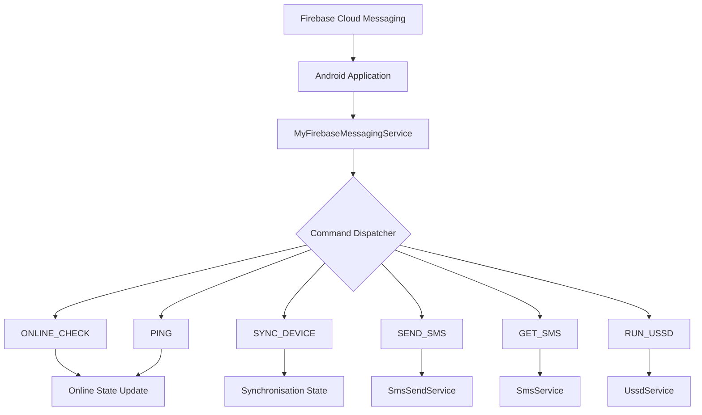
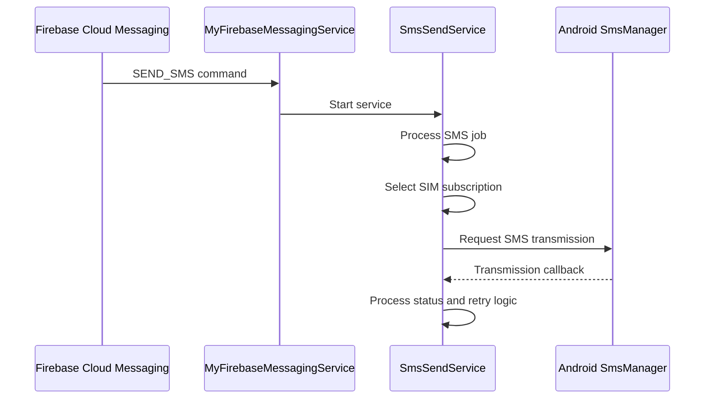
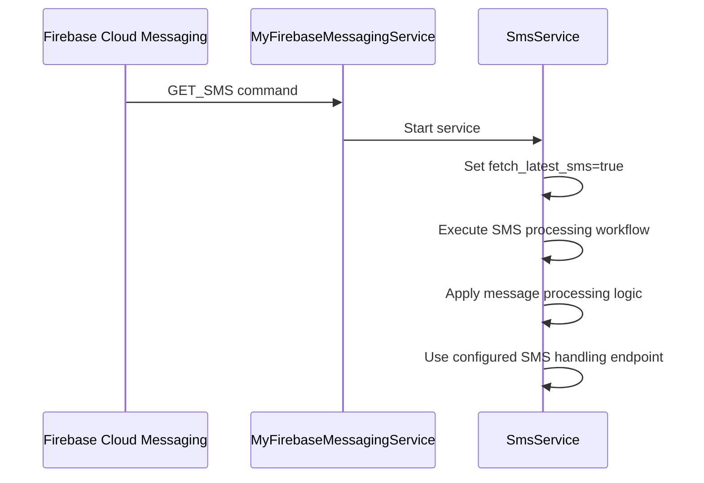
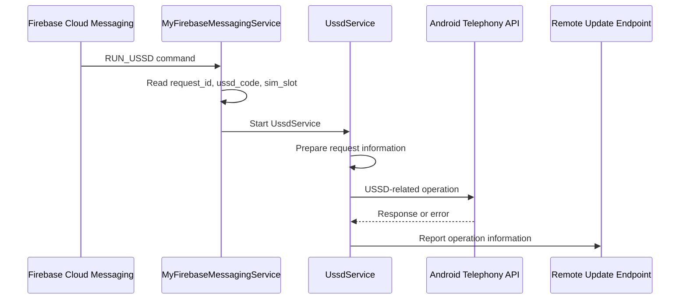
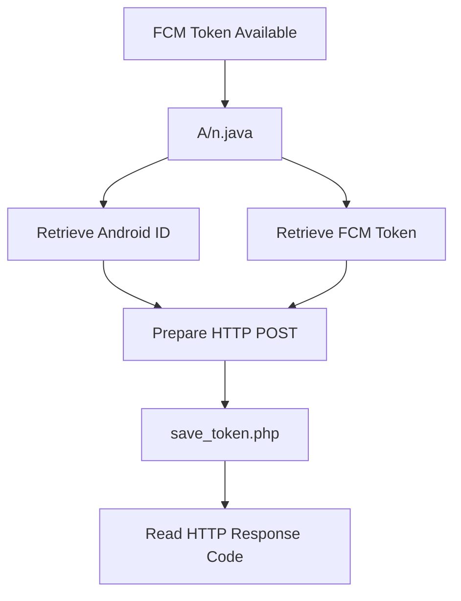

# Firebase Cloud Messaging Command Flow

## 1. Overview

This document describes the Firebase Cloud Messaging (FCM) integration identified in the primary Android APK.

The application contains an FCM-based command-dispatch implementation that handles multiple command identifiers associated with device status, synchronisation, SMS operations, and USSD functionality.

The primary component is:

`MyFirebaseMessagingService.java`

The architecture below is reconstructed from static code examination.

## 2. Recovered Firebase Configuration

| Attribute | Value |
|---|---|
| Firebase project ID | `fcmtoken-af5a6` |
| Sender ID | `705898731` |
| Firebase App ID | `1:705898731153:web:130e5565c49b143bfb9130` |
| API key | Redacted |

No Firebase Realtime Database URL was recovered.

## 3. High-Level FCM Architecture



The diagram describes command-handling relationships identified in the application code. It does not establish actual FCM delivery.

## 4. Command Classification

| Command | Identified handling | Associated component |
|---|---|---|
| `ONLINE_CHECK` | Updates online state | FCM service |
| `SYNC_DEVICE` | Updates synchronisation state | FCM service |
| `PING` | Updates online state | FCM service |
| `SEND_SMS` | Starts remote SMS transmission | `SmsSendService` |
| `GET_SMS` | Starts SMS service with `fetch_latest_sms=true` | `SmsService` |
| `RUN_USSD` | Processes USSD request parameters | `UssdService` |

## 5. SEND_SMS Command Flow



The implementation includes SMS-sent and SMS-delivered broadcast handling and retry logic.

The sequence represents the code-derived workflow, not a captured runtime session.

## 6. GET_SMS Command Flow



The command handler starts `SmsService` with the `fetch_latest_sms` flag.

The exact runtime retrieval results and remote receipt of any messages were not established.

## 7. RUN_USSD Command Flow



The precise invocation path inside `UssdService.onStartCommand()` was not fully recovered through JADX and requires Smali verification.

This sequence therefore represents the identified command-handling and reporting workflow, not proof of successful USSD execution.

## 8. FCM Token Registration

The application contains token-registration logic in `A/n.java`.

The identified request fields include:

| Field | Purpose |
|---|---|
| `device_id` | Device identifier |
| `fcm_token` | Firebase Cloud Messaging token |

Configured endpoint:

```text
https://w60.kinginfo.online/save_token.php
```

### Registration flow



The implementation demonstrates request construction and response handling. It does not prove backend storage.

## 9. Security Assessment

The FCM implementation provides a potential remote command-dispatch channel.

The security implications arise from its association with:

- SMS transmission.
- SMS retrieval.
- Device status handling.
- USSD operations.
- Token registration.

The combination of remote messaging and sensitive Android functionality warrants investigation.

However, FCM is a legitimate Android messaging technology. Its presence alone is not evidence of malware.

The concern comes from the specific command handlers and their association with sensitive operations in this application.

## 10. Evidence Limitations

The investigation did not establish:

- Successful FCM message delivery.
- The identity of any command sender.
- Successful execution of a remote command.
- Successful SMS transmission.
- Successful USSD execution.
- Backend token storage.
- Victim-device compromise.

**Conclusion:** Static examination identified six command identifiers and their associated application handling logic. The implementation represents a potential remote command channel, but actual command delivery and runtime impact remain unverified.

**Related documents:** `analysis/fcm-analysis.md`, `analysis/sms-analysis.md`, `analysis/ussd-analysis.md`, `infrastructure/firebase-analysis.md`.