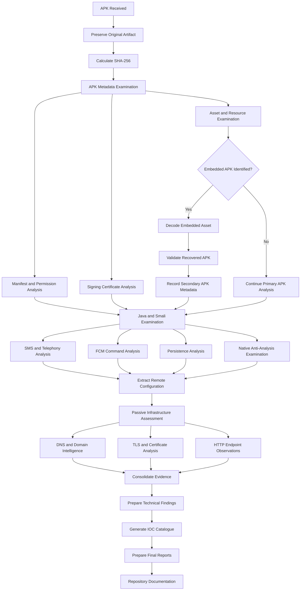

# Investigation Workflow

## Overview

This diagram represents the major stages followed during the Android APK and infrastructure investigation.

The workflow covers artifact identification, APK examination, embedded APK recovery, static code analysis, infrastructure intelligence, evidence documentation, and final reporting.

Dynamic analysis was outside the scope of the completed investigation.

## Investigation Process

## Investigation Phases

| Phase | Activities | Output |
|---|---|---|
| 01. Acquisition | Preserve APK and calculate hash | Artifact identity |
| 02. Metadata | Package, SDK and certificate examination | APK metadata |
| 03. Embedded artifact | Asset decoding and APK validation | Secondary APK |
| 04. Static analysis | Java, Smali, manifest and native library examination | Technical findings |
| 05. Infrastructure | Configuration, DNS, TLS and endpoint observations | Infrastructure intelligence |
| 06. Evidence | Record artifacts and handling information | Evidence register |
| 07. IOC extraction | Consolidate hashes, domains and identifiers | IOC catalogue |
| 08. Reporting | Document findings, confidence and limitations | Investigation reports |

## Scope Boundary

The completed workflow represents static examination and passive infrastructure assessment.

The following activities were not performed:

- Dynamic APK execution.
- Live application traffic capture.
- Victim-device acquisition.
- Backend database examination.
- Successful data-exfiltration verification.
- Infrastructure operator attribution.

## Important Evidence Principle

Every conclusion must be traceable to an artifact, code observation, or recorded infrastructure observation.

A code-derived capability must not be presented as confirmed runtime behaviour.

**Investigation status:** Static analysis and passive infrastructure assessment documented.