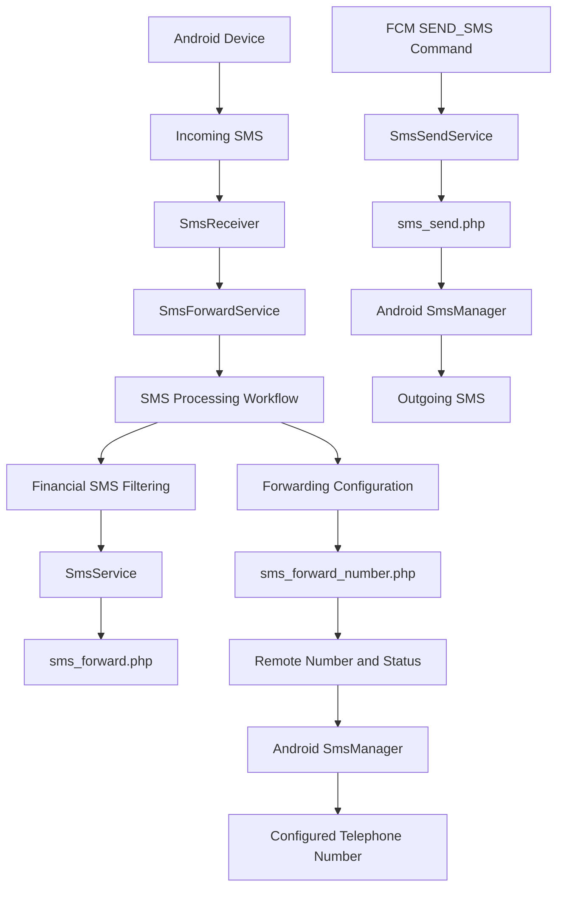
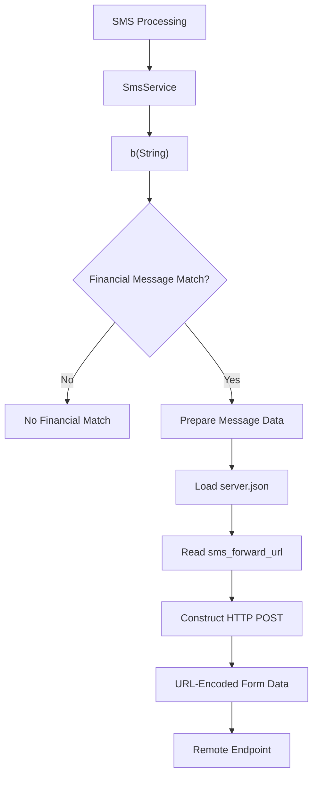
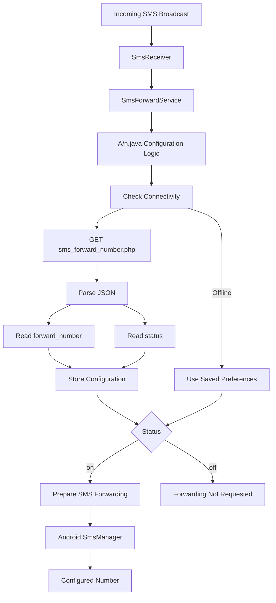
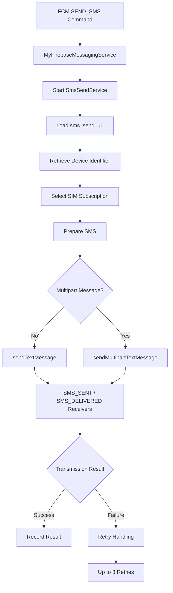

# SMS Forwarding and Transmission Flow

## 1. Overview

This document illustrates the SMS-related functionality identified during static examination of the primary Android APK.

Three distinct mechanisms were identified:

1. Financial SMS filtering and HTTP forwarding.
2. SMS forwarding through a remotely configured telephone number.
3. Remote SMS transmission through `SmsSendService`.

These mechanisms are documented separately because they use different components and transmission paths.

## 2. High-Level SMS Architecture



*This diagram represents code-derived relationships. It does not demonstrate successful message delivery.*

## 3. Mechanism 1 — Financial SMS Filtering and HTTP Forwarding

### 3.1 Relevant component

`SmsService.java`

The implementation includes financial and transaction-related message filtering.

Identified patterns include references to:

- Banking institutions.
- Account notifications.
- Balance information.
- Transaction and credit messages.
- UPI notifications.
- Wallet and payment applications.

### 3.2 Processing flow



### 3.3 HTTP request fields

The method `c(...)` constructs a request containing:

| Parameter | Description |
|---|---|
| `device_id` | Device identifier |
| `sender` | SMS sender |
| `user_number` | User number field |
| `message` | SMS body |
| `timestamp` | Message timestamp |
| `type` | Message category |
| `part_number` | Multipart message part |
| `total_parts` | Total multipart message parts |

Configured endpoint:

```text
https://w60.kinginfo.online/sms_forward.php
```

**Security significance:** This implementation could transmit sensitive financial SMS content to configured remote infrastructure if executed with the required permissions and connectivity.

**Evidence boundary:** Request construction and transmission logic were identified. Successful server-side receipt or storage was not established.

## 4. Mechanism 2 — Configurable Telephone Number Forwarding

### 4.1 Relevant components

- `SmsForwardService.java`
- `SmsReceiver.java`
- `A/n.java`

The service registers for SMS-received broadcasts. The receiver extracts incoming SMS information and passes it into the service workflow.

### 4.2 Remote configuration

The application retrieves forwarding configuration from:

```text
https://w60.kinginfo.online/sms_forward_number.php
```

The response fields identified in the implementation are:

| Field | Purpose |
|---|---|
| `forward_number` | Configured forwarding number |
| `status` | Forwarding state |

### 4.3 Processing flow



The configuration logic checks connectivity periodically, approximately every 30 seconds or when the stored configuration is considered stale.

When forwarding is enabled, the implementation uses Android SMS functionality to forward the message body.

When connectivity is unavailable, previously stored preferences may be used.

### 4.4 Recorded endpoint response

A response collected during the investigation contained:

```json
{
  "forward_number": "[REDACTED]",
  "status": "off"
}
```

The telephone number is redacted because its ownership and association were not established.

The observed `off` value describes that particular response. It does not prove that all SMS forwarding functionality in the application was disabled.

## 5. Mechanism 3 — Remote SMS Transmission

### 5.1 Relevant component

`SmsSendService.java`

The application contains functionality for processing remote SMS transmission jobs.

Identified operations include:

- Device identifier retrieval.
- SIM/subscription selection.
- SMS message transmission.
- Multipart SMS handling.
- SMS-sent and SMS-delivered broadcast registration.
- Retry handling.

### 5.2 Processing flow



The implementation contains retry delays of approximately 2, 4, and 6 seconds.

Configured endpoint:

```text
https://w60.kinginfo.online/sms_send.php
```

**Security significance:** The service contains functionality capable of sending SMS messages through Android telephony APIs.

**Evidence boundary:** The implementation does not establish that a remote command was received or that a message was successfully transmitted.

## 6. Comparison of SMS Mechanisms

| Characteristic | HTTP forwarding | Number-based forwarding | Remote SMS transmission |
|---|---|---|---|
| Main component | `SmsService` | `SmsForwardService` / `A/n.java` | `SmsSendService` |
| Trigger | SMS processing workflow | Incoming SMS workflow | FCM `SEND_SMS` command |
| Data direction | Device to HTTP endpoint | Device to configured number | Application to SMS recipient |
| Transport | HTTP POST | Android SMS | Android SMS |
| Configuration | `sms_forward_url` | `sms_forward_number` | `sms_send_url` |
| Purpose | Financial SMS forwarding | SMS-body forwarding | Remote SMS sending |

## 7. Security Implications

The three mechanisms create different risks:

### Confidentiality

Financial SMS content may contain transaction information, account notifications, and authentication-related messages.

### Integrity

Remote SMS transmission could be misused to send messages without the device owner's informed approval.

### Availability and telephony control

Unwanted SMS activity may create costs or interfere with normal device usage.

### Operational concerns

The combination of HTTP forwarding and telephone-number forwarding creates multiple potential communication paths.

These risks depend on actual execution, permissions, device conditions, and remote configuration.

## 8. Evidence Limitations

- Dynamic SMS monitoring was not performed.
- Successful HTTP SMS forwarding was not established.
- Successful telephone-number forwarding was not established.
- The ownership of the returned forwarding number is unknown.
- Successful remote SMS transmission was not established.
- Server-side message storage was not established.

**Conclusion:** Static analysis identified three distinct SMS-related mechanisms. Their code-derived capabilities are documented, but actual victim-device impact remains unverified.

**Related documents:** `analysis/sms-analysis.md`, `analysis/fcm-analysis.md`, `analysis/persistence-analysis.md`.