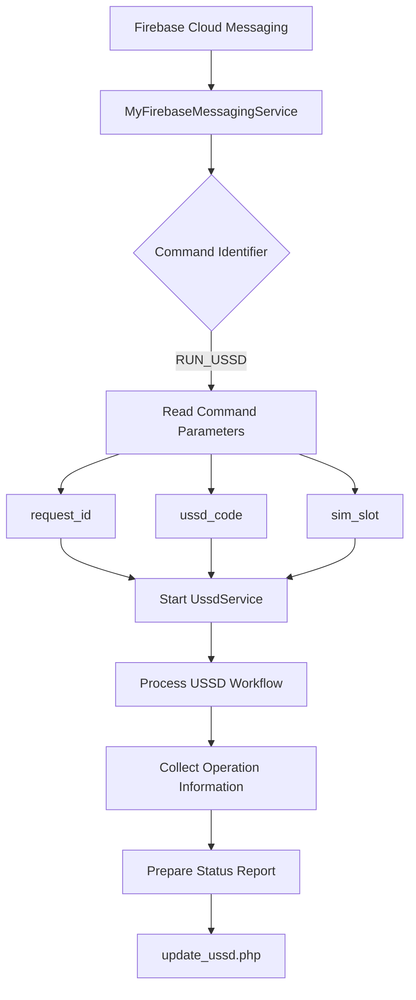
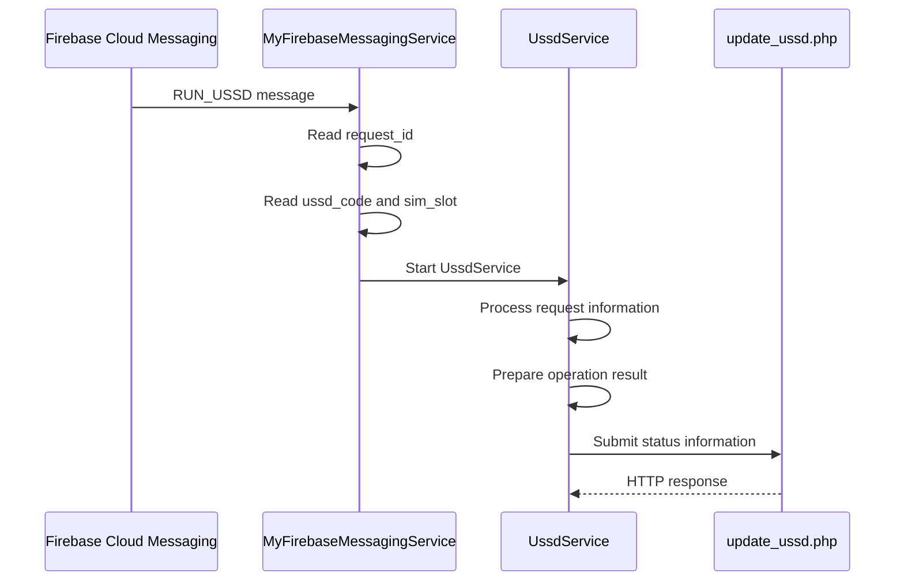

# Remote USSD Command Execution Flow

## 1. Overview

This document describes the USSD-related command workflow identified during static examination of the Android application.

The workflow connects Firebase Cloud Messaging command handling with `UssdService.java`.

The application processes command parameters and contains logic for reporting operation status to configured remote infrastructure.

A separate USSD implementation also exists in `CallService.java` for call-forwarding operations.

These two code paths are documented separately.

## 2. Identified Components

| Component | Responsibility |
|---|---|
| `MyFirebaseMessagingService.java` | Receives and dispatches `RUN_USSD` command |
| `UssdService.java` | Processes USSD-related command information |
| `CallService.java` | Uses USSD functionality for call-forwarding operations |
| `server.json` | Stores the remote update endpoint |
| `update_ussd.php` | Configured USSD status-reporting endpoint |

## 3. Command Parameters

The `RUN_USSD` handler processes the following values:

| Parameter | Description |
|---|---|
| `request_id` | Request identifier |
| `ussd_code` | USSD string |
| `sim_slot` | SIM/subscription selection |

The service also handles reporting fields including:

| Field | Description |
|---|---|
| `device_id` | Device identifier |
| `command_id` | Command identifier |
| `ussd_code` | Processed USSD string |
| `sim_slot` | SIM slot |
| `status` | Operation status |
| `response` | Response information |
| `error` | Error information |

## 4. High-Level Command Flow



*This diagram represents the statically identified command-handling and reporting path.*

## 5. Detailed Command Sequence



The precise internal invocation path within `UssdService.onStartCommand()` was not fully recovered through JADX. Further Smali verification would be required to document the complete telephony API call path with confidence.

Therefore, this sequence must not be interpreted as proof that the USSD request was successfully executed.

## 6. Status Reporting

The configured endpoint is:

```text
https://w60.kinginfo.online/update_ussd.php
```

The service contains reporting fields associated with:

- Device identity.
- Command identity.
- USSD request information.
- SIM selection.
- Operation status.
- Response information.
- Error information.

The callback implementation includes logic for identifying completed or failed operations based on response information.

The presence of this reporting functionality does not establish successful backend storage.

## 7. Relationship with Call Forwarding

The investigation identified another USSD-related implementation in:

`CallService.java`

This component uses:

```java
TelephonyManager.createForSubscriptionId(...).sendUssdRequest(...)
```

It processes call-forwarding configuration and submits the corresponding USSD request.

The distinction is important:

| Characteristic | `UssdService` | `CallService` |
|---|---|---|
| Initiation | FCM `RUN_USSD` command | Remote call-forwarding configuration |
| Main purpose | General USSD command workflow | Call-forwarding manipulation |
| Request information | `request_id`, `ussd_code`, `sim_slot` | `call_status`, `call_number`, `sim_slot` |
| Reporting endpoint | `update_ussd.php` | `update_call_forward_url` |
| Runtime success | Not established | Not established |

## 8. Security Implications

USSD operations can interact with mobile network services and carrier-specific functionality.

If a remote USSD command is executed without the device owner's knowledge or authorisation, it could potentially:

- Change telephony-related settings.
- Interact with carrier service menus.
- Initiate sensitive network operations.
- Affect normal mobile communication.

The actual consequences depend on the requested USSD code, carrier behaviour, device support, and user authorisation.

The application’s USSD command handling is therefore a significant security-relevant capability.

## 9. Evidence Limitations

The investigation established:

- A `RUN_USSD` command handler.
- Extraction of `request_id`, `ussd_code`, and `sim_slot`.
- Startup of `UssdService`.
- Status-reporting fields.
- Callback-related completion and failure handling.
- A separate USSD implementation in `CallService`.

The investigation did not establish:

- Actual FCM command delivery.
- Successful USSD execution.
- Carrier response for a real device.
- Successful modification of network services.
- Successful backend storage.
- Victim-device impact.

The exact USSD invocation path in `UssdService.onStartCommand()` remains a verification limitation.

## 10. Conclusion

Static examination identified an FCM-triggered USSD command workflow and a separate call-forwarding USSD implementation.

The application contains functionality for processing remote USSD parameters and reporting operation information to configured infrastructure.

These capabilities may affect sensitive telephony operations if successfully executed.

However, no successful remote USSD execution or victim-device impact was established.

**Analysis type:** Static code examination  
**Primary component:** `UssdService.java`  
**Related component:** `CallService.java`  
**Dynamic verification:** Not performed  
**Runtime impact:** Not established

**Related documents:** `analysis/ussd-analysis.md`, `analysis/call-forwarding-analysis.md`, `analysis/fcm-analysis.md`.