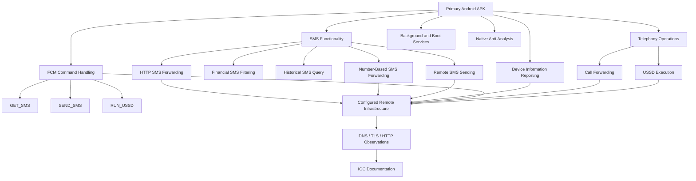

# Investigation Findings

## 1. Purpose

This document records the technical findings identified during the investigation of the Android application labelled **HDFC BANK LOAN SERVICE**.

The findings are based on static APK analysis, Java and Smali inspection, native library examination, configuration extraction and passive infrastructure intelligence.

Each finding distinguishes between code-derived functionality, configuration evidence, infrastructure observations and behaviour that has not been independently verified.

## 2. Finding Classification

The following evidence classifications are used throughout this document.

| Classification | Meaning |
|---|---|
| Code-derived | Functionality identified through Java, Smali or native code examination |
| Configuration-derived | Values and endpoints extracted from application configuration |
| Infrastructure-observed | Information collected through DNS, TLS, certificate or HTTP observations |
| Runtime-unverified | Functionality identified in code but not executed or independently demonstrated |
| Attribution-unverified | Ownership or operator identity not established |

**Important:** Confidence in the presence of code or configuration does not establish successful execution or real-world impact.

---

## 3. Primary Application Findings

### FIND-001: Financial SMS Identification and Filtering

**Category:** SMS Collection  
**Evidence type:** Code-derived  
**Confidence:** High — code presence

The application contains financial SMS identification logic in `SmsService.java`.

The implementation uses predefined patterns to identify messages associated with financial institutions and payment-related activity.

Identified matching categories include:

- Banking institutions such as HDFC, SBI, ICICI, Axis, Kotak and RBL.
- UPI-related messages.
- Account and balance notifications.
- Transaction and credited-amount notifications.
- Wallet and payment application references.

The method `b(String)` performs message matching against the configured patterns.

**Security significance:**

Financial SMS messages can contain sensitive transaction information, account-related notifications and other financial context. Their automated identification creates a potential privacy and financial-security risk.

**Verification limitation:**

The presence of filtering logic does not establish that messages were successfully collected or transmitted from a real device.

### FIND-002: Historical SMS Collection

**Category:** SMS Collection  
**Evidence type:** Code-derived  
**Confidence:** High — identified query and filtering logic

The application contains historical SMS processing logic in `F1/o.java`.

The examined implementation:

- Queries the Android inbox through `content://sms/inbox`.
- Uses a recent 30-day time window.
- Sorts retrieved messages in descending order.
- Applies financial SMS filtering.
- Processes matching messages using the SMS service.
- Uses the message type `old_banking_sms`.
- Splits messages into chunks of up to 160 characters.

**Security significance:**

If successfully executed with sufficient permissions, this functionality could expose previously received financial SMS messages rather than being limited to newly arriving messages.

**Verification limitation:**

Actual historical SMS collection from a victim device was not demonstrated.

### FIND-003: HTTP-Based SMS Forwarding

**Category:** Data Transmission  
**Evidence type:** Code-derived and configuration-derived  
**Confidence:** High — code and configured endpoint

The application contains HTTP-based SMS transmission functionality in `SmsService.java`.

The examined method `c(...)` loads the `sms_forward_url` value from `server.json` and constructs an HTTP POST request.

The identified form fields include:

| Parameter | Purpose |
|---|---|
| `device_id` | Device identifier |
| `sender` | SMS sender information |
| `user_number` | Associated user number |
| `message` | SMS message content |
| `timestamp` | Message timestamp |
| `type` | Message category |
| `part_number` | Current message segment |
| `total_parts` | Total message segments |

The configured endpoint is:

`https://w60.kinginfo.online/sms_forward.php`

**Security significance:**

If successfully executed, the functionality could transmit sensitive SMS content and associated metadata to remote infrastructure.

**Verification limitation:**

The HTTP request implementation and endpoint configuration were identified. Successful transmission, server-side receipt and storage were not established.

### FIND-004: Separate Phone-Number-Based SMS Forwarding

**Category:** SMS Forwarding  
**Evidence type:** Code-derived and configuration-derived  
**Confidence:** High — code presence

A second SMS forwarding mechanism was identified separately from HTTP-based SMS transmission.

The examined code in `A/n.java`:

- Periodically checks the configured forwarding endpoint.
- Retrieves a `forward_number` and `status` value.
- Stores the configuration in shared preferences.
- Checks whether forwarding is enabled.
- Uses Android's `SmsManager` API to transmit SMS message content to the configured number.
- Can use previously saved configuration when connectivity is unavailable.

The configured endpoint is:

`https://w60.kinginfo.online/sms_forward_number.php`

**Security significance:**

This mechanism represents a separate transmission path that could send SMS message content to a configured telephone number.

**Verification limitation:**

A GET response collected during the investigation returned a phone-number value with status `off`. The number is intentionally redacted from this public-facing documentation.

The ownership and association of the returned number are unknown. The response does not establish that SMS forwarding was enabled or that any message was transmitted.

### FIND-005: Remote SMS Sending

**Category:** Remote Device Operations  
**Evidence type:** Code-derived  
**Confidence:** High — code presence

The application contains an SMS sending service in `SmsSendService.java`.

The examined implementation includes:

- Loading the configured `sms_send_url`.
- Retrieving device identification information.
- Processing remote SMS jobs.
- Selecting a SIM or subscription.
- Using `SmsManager.sendTextMessage`.
- Supporting multipart SMS transmission.
- Registering SMS sent and delivery result receivers.
- Retry handling with up to three retry attempts.

The FCM `SEND_SMS` command handler initiates this service.

**Security significance:**

If the service receives valid instructions and has the required permissions, it could be used to initiate outgoing SMS messages from the device.

**Verification limitation:**

No successful remote command delivery or outgoing SMS transmission was demonstrated.

---

## 4. Firebase Cloud Messaging Findings

### FIND-006: FCM-Based Remote Command Handling

**Category:** Command and Control  
**Evidence type:** Code-derived  
**Confidence:** High — command handlers identified

The examined `MyFirebaseMessagingService.java` implementation contains multiple command handlers.

| Command | Identified code-derived operation |
|---|---|
| `ONLINE_CHECK` | Updates online status |
| `SYNC_DEVICE` | Initiates device synchronisation |
| `PING` | Performs an availability-related operation |
| `SEND_SMS` | Starts the SMS sending service |
| `GET_SMS` | Starts the SMS collection service |
| `RUN_USSD` | Starts the USSD service |

The `RUN_USSD` handler processes parameters including:

- `request_id`
- `ussd_code`
- `sim_slot`

The service also contains functionality for processing and uploading an FCM registration token.

**Security significance:**

FCM provides a remote messaging mechanism. The identified handlers could allow an external messaging system to initiate sensitive operations on a device if commands are successfully delivered and accepted.

**Verification limitation:**

The investigation identified command-dispatch logic. It did not establish that the application received commands from an operator or successfully executed them.

### FIND-007: FCM Token Registration

**Category:** Device Registration  
**Evidence type:** Code-derived and configuration-derived  
**Confidence:** High — code presence

The examined implementation in `A/n.java` contains functionality for registering the device's FCM token.

The identified POST parameters include:

- `device_id`
- `fcm_token`

The configured endpoint is:

`https://w60.kinginfo.online/save_token.php`

**Security significance:**

Token registration can associate an application installation with a remote messaging infrastructure, potentially enabling targeted message delivery.

**Verification limitation:**

The request implementation was identified, but successful registration or backend storage was not established.

---

## 5. Device Information Collection

### FIND-008: Background Device Information Reporting

**Category:** Device Information Collection  
**Evidence type:** Smali and configuration-derived  
**Confidence:** High — implementation identified

The examined `BackgroundService.smali` contains functionality for collecting and transmitting device-related information.

The HTTP POST implementation includes:

| Parameter | Description |
|---|---|
| `device_name` | Device name |
| `device_model` | Device model |
| `device_id` | Device identifier |
| `sim1_carrier` | First SIM carrier |
| `sim2_carrier` | Second SIM carrier |
| `sim1_number` | First SIM phone number |
| `sim2_number` | Second SIM phone number |
| `created_at` | Device creation timestamp |
| `last_seen` | Last-seen timestamp |
| `status` | Online status |
| `battery` | Battery information |

The configured endpoint is:

`https://w60.kinginfo.online/background_service.php`

The examined code uses an HTTP connection, constructs a form-encoded POST body and retrieves a response code.

**Security significance:**

If successfully executed, this functionality could disclose device and SIM-related information to remote infrastructure.

**Verification limitation:**

The presence of request construction and transmission logic does not establish successful server-side receipt or storage.

---

## 6. Call Forwarding and USSD Findings

### FIND-009: Remote Call-Forwarding Configuration

**Category:** Telephony Operations  
**Evidence type:** Code-derived and configuration-derived  
**Confidence:** High — implementation identified

The examined `CallService.java` contains functionality for retrieving and applying call-forwarding configuration.

The implementation:

- Loads the configured call-setting endpoint.
- Retrieves device-specific configuration.
- Processes `call_status`, `call_number` and `sim_slot`.
- Constructs USSD commands for enabling and disabling call forwarding.
- Uses `TelephonyManager.createForSubscriptionId(...)`.
- Invokes `sendUssdRequest(...)` on supported Android versions.
- Reports operation status to a configured update endpoint.

Identified command patterns include:

| Operation | USSD pattern |
|---|---|
| Enable call forwarding | `**21*<number>#` |
| Disable call forwarding | `##21#` |

Configured endpoints include:

- `https://w60.kinginfo.online/call_forward_setting.php`
- `https://w60.mrkinginfoback.online/update_call_forward.php`

**Security significance:**

If successfully executed and supported by the carrier, this functionality could alter call-forwarding settings on a device.

**Verification limitation:**

No successful call-forwarding change was demonstrated. The configured secondary update hostname also failed DNS resolution during the recorded infrastructure observation.

### FIND-010: Remote USSD Command Execution

**Category:** Telephony Operations  
**Evidence type:** Code-derived and configuration-derived  
**Confidence:** High — service and reporting logic identified

The application contains a dedicated `UssdService.java`.

The examined implementation includes:

- Loading the configured USSD update endpoint.
- Reading device and command identifiers.
- Processing USSD command parameters.
- Handling SIM-slot information.
- Reporting execution status.
- Reporting response or error information.

The configured reporting endpoint is:

`https://w60.kinginfo.online/update_ussd.php`

The FCM `RUN_USSD` handler initiates the service.

**Security significance:**

USSD commands can interact with carrier-provided services. Depending on the command, carrier and device support, this functionality could initiate sensitive telephony operations.

**Verification limitation:**

Successful USSD execution and carrier-side effects were not established.

---

## 7. Persistence and Anti-Analysis Findings

### FIND-011: Boot and Background Service Mechanisms

**Category:** Persistence  
**Evidence type:** Code-derived  
**Confidence:** High — service and receiver code identified

The application contains a background service architecture involving:

- `SmsForwardService.java`
- `SmsReceiver.java`
- `BootReceiver`
- Main activity service initialization.

The examined code includes a receiver registered for `android.provider.Telephony.SMS_RECEIVED` and boot-related service startup functionality.

**Security significance:**

These mechanisms could allow SMS-related background functionality to operate beyond ordinary foreground application use, subject to Android lifecycle, permission and platform restrictions.

**Verification limitation:**

Persistence behaviour across actual device reboots was not dynamically tested.

### FIND-012: Native Anti-Analysis Checks

**Category:** Anti-Analysis  
**Evidence type:** Native library inspection  
**Confidence:** High — indicators present in binary

The primary APK includes the native ARM64 library:

`libzwdwbxqi.so`

The library is stripped and contains JNI exports including:

- `getSecretKey`
- `nativeXorChunk`
- `getTargetPackage`
- `nativeScanEnv`

The `nativeScanEnv` functionality contains checks associated with:

- `/proc/self/maps`
- Frida-related process and library indicators.
- Xposed and Substrate indicators.
- Gadget-related indicators.
- `/proc/net/tcp` and `/proc/net/tcp6`.
- Ports `27042` and `27043`.
- Debugger tracing through `TracerPid`.

**Security significance:**

These checks are consistent with anti-analysis functionality intended to identify instrumentation or debugging environments.

**Verification limitation:**

The effectiveness and runtime consequences of these checks were not evaluated.

---

## 8. Embedded APK Findings

### FIND-013: Encrypted Embedded APK

**Category:** Application Packaging  
**Evidence type:** Archive and static analysis  
**Confidence:** High — embedded artifact identified and decoded

The primary APK contains an asset named:

`rmtley9lr.db`

The asset was identified as a repeating-XOR encrypted payload and decoded into a secondary APK.

The decoded APK has the following identity:

| Attribute | Value |
|---|---|
| Package | `com.nxtwave.support` |
| Version | `1.0` |
| Minimum SDK | 25 |
| Target SDK | 34 |
| SHA-256 | `13f93b8c70881f9414944fdc55811bfc627dbec966f023c664eb98782690cb4c` |

The secondary APK shares the same signing certificate as the primary APK.

ZIP integrity verification passed, with 986 archive entries identified. Unusual absolute-style and backslash-containing archive paths were also observed.

**Security significance:**

An encrypted embedded APK is an important artifact for further investigation because it may contain additional application functionality or resources.

**Verification limitation:**

The existence of the secondary APK and shared signing certificate does not prove that the primary application installs, loads or executes the secondary APK. The unusual archive paths alone do not establish path traversal.

---

## 9. Infrastructure Findings

### FIND-014: Configured C2 Infrastructure

**Category:** Command and Control Infrastructure  
**Evidence type:** Configuration-derived  
**Confidence:** High — configured values identified

The primary application's configuration references the following infrastructure:

| Domain | Identified role |
|---|---|
| `w60.kinginfo.online` | Primary configured application endpoints |
| `host.kinginfo.online` | Secondary configured endpoint |
| `w60.mrkinginfoback.online` | Call-forwarding update endpoint |

The configuration includes PHP endpoints for:

- Background device reporting.
- SMS forwarding.
- SMS forwarding-number retrieval.
- SMS sending.
- Call-forwarding settings and updates.
- Permission-related operations.
- FCM token registration.
- Online-status checking.
- USSD settings and updates.
- Application upload functionality.

**Security significance:**

The configuration demonstrates that the application was designed to communicate with multiple remote services.

**Verification limitation:**

Configured infrastructure does not independently establish server ownership, operational intent, successful communication or malicious operator identity.

### FIND-015: Firebase Project Configuration

**Category:** Cloud Messaging Infrastructure  
**Evidence type:** Configuration-derived  
**Confidence:** High — configuration identified

The application contains Firebase project configuration with the following identifiers:

| Attribute | Value |
|---|---|
| Project ID | `fcmtoken-af5a6` |
| Sender ID | `705898731` |
| Application ID | `1:705898731153:web:130e5565c49b143bfb9130` |

The API key is intentionally excluded from public documentation.

No Firebase Realtime Database URL was recovered during the investigation.

**Security significance:**

The Firebase configuration provides context for the application's messaging integration and remote command-handling architecture.

**Verification limitation:**

The presence of Firebase identifiers does not prove control of the project, successful device registration or successful command delivery.

---

## 10. Infrastructure Observations

### FIND-016: DNS and Cloudflare Edge Resolution

**Category:** Infrastructure Intelligence  
**Evidence type:** Infrastructure-observed  
**Confidence:** High — observed DNS response

During the recorded collection period, `w60.kinginfo.online` and `host.kinginfo.online` resolved to Cloudflare edge addresses.

Observed IPv4 addresses:

- `104.21.3.189`
- `172.67.131.27`

Observed IPv6 addresses:

- `2606:4700:3031::6815:3bd`
- `2606:4700:3037::ac43:831b`

The recorded DNS observation timestamp was `2026-11-03 14:49:33 UTC`.

**Interpretation:**

These addresses represent observed Cloudflare edge resolution. They must not be reported as confirmed origin-server IP addresses.

### FIND-017: Domain Registration Intelligence

**Category:** Infrastructure Intelligence  
**Evidence type:** RDAP observation  
**Confidence:** High — registration record observed

The RDAP record for `kinginfo.online` indicated:

- Registration date: `2026-06-25 06:26 UTC`
- Expiration date: `2027-06-25`
- Registrar: PDR Ltd / PublicDomainRegistry
- Nameservers: Cloudflare

An abuse-contact entity associated with the registrar was present in the RDAP response.

This entity must not be misidentified as the domain registrant or application operator.

The RDAP lookup for `mrkinginfoback.online` returned HTTP 404, and DNS NXDOMAIN was observed during collection.

**Interpretation:**

The absence of a returned registration record or DNS resolution at collection time does not establish the domain's complete historical status.

### FIND-018: Certificate Transparency Observations

**Category:** TLS and Certificate Intelligence  
**Evidence type:** Infrastructure-observed  
**Confidence:** High — collected records; dataset completeness limited

The collected Cert Spotter dataset contained:

| Metric | Observation |
|---|---:|
| Total records | 229 |
| Unique certificate IDs | 229 |
| Unique DNS names | 167 |
| Hostname-certificate records | 180 |
| Unique numbered `w` hostnames | 143 |

The observed numbered hostnames covered `w1` through `w144`, with `w2` absent from the collected dataset.

The collection included repeated hostname records with differing public-key fingerprints, consistent with certificate renewal or key rotation patterns.

For `w60.kinginfo.online`, one observed certificate record contained:

| Attribute | Value |
|---|---|
| Certificate ID | `17436230060` |
| Issued | `2026-09-27 02:07:17 UTC` |
| Expires | `2026-12-26 02:07:16 UTC` |
| CA | Let's Encrypt YR2 |
| Revoked | False |

The collection was not exhaustive. A later page request returned an empty result with a retry-after interval.

**Interpretation:**

Certificate issuance patterns provide infrastructure context but do not establish malicious hosting, common ownership or a relationship between all observed hostnames.

### FIND-019: HTTP Endpoint Response Observations

**Category:** Endpoint Intelligence  
**Evidence type:** HTTP observation  
**Confidence:** High — responses observed during collection

During the endpoint audit recorded at `2026-11-04 13:02:38 UTC`:

- Twelve configured endpoints returned HTTP 200.
- The configured `w60.mrkinginfoback.online/update_call_forward.php` endpoint failed DNS resolution.
- Cloudflare response headers were observed.
- Google Trust Services was observed as the TLS certificate issuer.
- HSTS was observed with `max-age=31536000`.
- Cloudflare edge identifiers represented multiple locations.

**Interpretation:**

An HTTP 200 response confirms that an endpoint returned a successful HTTP status during the observation. It does not establish successful application operations, backend processing, data persistence or the endpoint's intended function.

---

## 11. Consolidated Finding Relationship

The following diagram connects the principal code-derived capabilities with their configured infrastructure.

*This diagram depicts relationships inferred from examined code and configuration. It does not represent verified runtime execution or confirmed server-side data receipt.*

---

## 12. Overall Assessment

The examined application contains multiple code paths associated with sensitive Android device operations.

The most significant findings concern:

1. Financial SMS identification and forwarding.
2. Historical SMS query and processing.
3. Remote SMS transmission.
4. FCM-based command handling.
5. Device and SIM information reporting.
6. USSD and call-forwarding functionality.
7. Background service and boot-related mechanisms.
8. Native anti-analysis checks.
9. Embedded secondary APK recovery.
10. Multiple configured remote infrastructure endpoints.

Taken together, these findings support classifying the application as **highly suspicious and potentially unauthorised financial-service impersonation software**.

However, successful execution, victim impact, server-side data receipt, infrastructure ownership and operator attribution remain unverified.

## 13. Related Documentation

- [Executive Summary](executive-summary.md)
- [Investigation Scope](investigation-scope.md)
- [Methodology](methodology.md)
- [Limitations](limitations.md)
- [Timeline](timeline.md)
- [Static Analysis Report](../reports/static-analysis-report.md)
- [C2 Infrastructure Report](../reports/c2-infrastructure-report.md)
- [IOC Directory](../iocs/indicators.md)

---

**Document:** Investigation Findings  
**Project:** HDFC Android APK Investigation  
**Assessment type:** Static Analysis and Infrastructure Intelligence  
**Status:** Documented