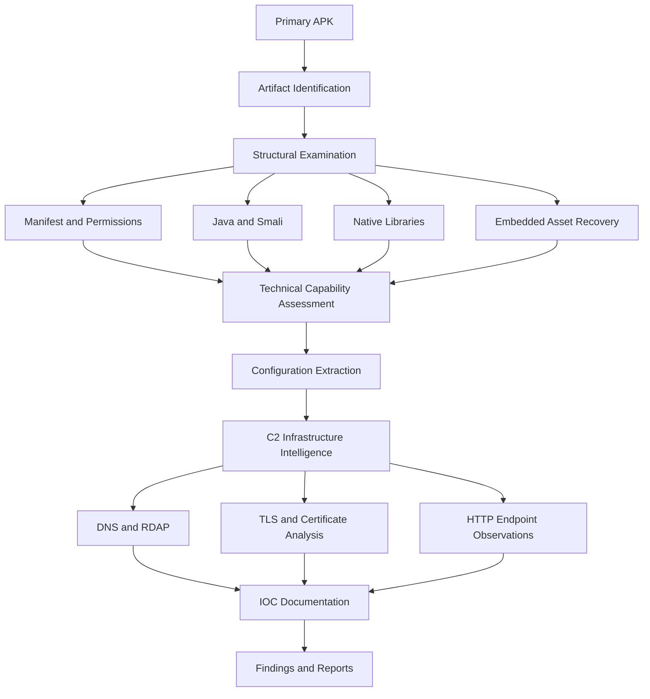

# Investigation Scope

## 1. Document Purpose

This document defines the scope, objectives, boundaries, methodology coverage and exclusions of the investigation conducted on a suspicious Android application labelled **HDFC BANK LOAN SERVICE**.

The investigation focuses on identifying potentially harmful Android application capabilities, examining internal application components, recovering embedded artifacts, analysing configured remote infrastructure and documenting relevant indicators.

The assessment was conducted through static application analysis, reverse engineering and passive infrastructure intelligence.

This document establishes the boundaries within which all investigation findings should be interpreted.

---

## 2. Case Identification

| Attribute | Details |
|---|---|
| Investigation title | HDFC Android APK Investigation |
| Target platform | Android |
| Application label | HDFC BANK LOAN SERVICE |
| Package name | `com.sec.android.app.finance.kaxqj68` |
| Application version | `2.9.65` |
| Investigation type | Android Malware Analysis |
| Additional focus | Digital Forensics and C2 Infrastructure Intelligence |
| Primary approach | Static Analysis |
| Infrastructure approach | Passive Intelligence and Endpoint Observation |
| Dynamic analysis | Excluded |
| Investigation status | Documented investigation phase |

### Primary Artifact

- Filename: Original APK examined during the investigation.
- Package: `com.sec.android.app.finance.kaxqj68`
- SHA-256:

```text
08cfe1f957d7539320eaaa97f1d6838182f5df57e6f875d00dc3060e432d35af
```

### Secondary Artifact

An embedded encrypted asset was recovered and decoded into a secondary APK.

- Original asset: `rmtley9lr.db`
- Decoded package: `com.nxtwave.support`
- Version: `1.0`
- SHA-256:

```text
13f93b8c70881f9414944fdc55811bfc627dbec966f023c664eb98782690cb4c
```

The secondary artifact was examined separately. Its presence does not establish an installation or execution relationship with the primary APK.

---

## 3. Investigation Objectives

The investigation was designed to achieve the following objectives:

1. Establish the identity and cryptographic fingerprint of the primary APK.
2. Examine the Android manifest, permissions and application components.
3. Identify security-sensitive functionality through Java and Smali analysis.
4. Investigate financial SMS identification, collection and forwarding mechanisms.
5. Examine remote SMS transmission functionality.
6. Analyse Firebase Cloud Messaging integration and command handlers.
7. Identify device information collection and reporting mechanisms.
8. Investigate call-forwarding and USSD-related functionality.
9. Examine background services and boot-related persistence mechanisms.
10. Identify native anti-analysis functionality.
11. Recover and examine the embedded secondary APK.
12. Extract configured C2 domains and endpoint references.
13. Examine DNS records, domain registration information and TLS certificates.
14. Document endpoint response observations.
15. Extract and organise relevant indicators of compromise.
16. Produce structured technical documentation while preserving evidentiary limitations.

---

## 4. Scope of Examination

The investigation covered the following technical areas.

### 4.1 APK Identification and Structural Analysis

Activities included:

- Package identification.
- Application version examination.
- SDK compatibility information.
- Signing certificate examination.
- SHA-256 fingerprint calculation.
- APK archive inspection.
- Embedded asset identification.
- Secondary APK recovery and identification.

### 4.2 Android Manifest and Permissions

The examination included:

- Application permissions.
- Declared services.
- Broadcast receivers.
- Application components.
- Background execution-related declarations.
- Telephony and SMS-related permission requirements.

The presence of a declared permission does not establish that the permission was granted or used successfully on a device.

### 4.3 Java and Smali Analysis

The investigation examined application logic associated with:

- SMS filtering and processing.
- Historical SMS queries.
- HTTP-based SMS transmission.
- Phone-number-based SMS forwarding.
- Remote SMS sending.
- FCM command handling.
- Device information reporting.
- Call-forwarding configuration.
- USSD operations.
- Background service execution.

### 4.4 Native Library Analysis

The native ARM64 library was examined to identify:

- Exported JNI symbols.
- Native functionality.
- Anti-debugging indicators.
- Instrumentation detection.
- Frida-related indicators.
- Xposed and Substrate-related indicators.
- Process and network inspection logic.

### 4.5 Firebase Analysis

The investigation examined:

- Firebase project identifiers.
- FCM configuration.
- Messaging service implementation.
- Remote command dispatch logic.
- FCM token registration functionality.

Firebase backend access, project ownership and actual message delivery were not established.

### 4.6 C2 Infrastructure Intelligence

The investigation examined configured infrastructure references associated with:

- `w60.kinginfo.online`
- `host.kinginfo.online`
- `w60.mrkinginfoback.online`

Activities included:

- Configuration-based endpoint identification.
- DNS resolution observations.
- RDAP registration examination.
- TLS certificate inspection.
- Certificate Transparency dataset examination.
- HTTP endpoint response observations.

Infrastructure observations were limited to the collection period.

---

## 5. Investigation Methodology

The investigation followed a structured static-analysis and passive-intelligence workflow.



The workflow represents the examination process. It does not imply that the application was executed or that remote operations succeeded.

---

## 6. Evidence Sources

The following evidence categories were considered within the investigation.

| Evidence source | Investigation purpose |
|---|---|
| Primary APK | Application identification and static analysis |
| Android manifest | Permission and component examination |
| Decompiled Java code | Application functionality analysis |
| Smali code | Verification of implementation details |
| Native ARM64 library | Native functionality and anti-analysis examination |
| Embedded encrypted asset | Secondary APK recovery |
| `server.json` | Configured remote endpoint identification |
| Firebase configuration | FCM project and messaging analysis |
| DNS observations | Domain resolution intelligence |
| RDAP records | Domain registration intelligence |
| TLS certificates | Certificate and hostname examination |
| Certificate Transparency records | Historical certificate observations |
| HTTP responses | Endpoint response observations |

The provenance, integrity and handling details of retained artifacts should be recorded in the evidence register and chain-of-custody documentation.

---

## 7. Explicit Exclusions

The following activities were outside the scope of this investigation.

| Excluded activity | Reason |
|---|---|
| Dynamic malware execution | Investigation limited to static analysis |
| Live victim-device acquisition | No such acquisition was conducted in this phase |
| Memory forensics | No memory image was acquired |
| Live FCM command testing | Actual command delivery was not investigated |
| Controlled SMS transmission testing | No successful SMS transmission was demonstrated |
| Live USSD execution | Carrier-side execution was not tested |
| Call-forwarding modification | No actual forwarding change was performed or verified |
| Backend database access | Server-side storage and internal databases were not examined |
| Origin-server identification | Cloudflare edge resolution does not establish the origin |
| Exploitation of remote infrastructure | Not part of the investigation |
| Vulnerability exploitation | No exploitation was conducted |
| Threat actor attribution | Available evidence was insufficient |
| Financial loss assessment | No confirmed victim-impact evidence was acquired |

These exclusions are intentional boundaries, not findings that the corresponding activities or impacts did not occur.

---

## 8. Operational and Safety Boundaries

The investigation followed these handling principles:

- Preserve the original APK as evidence.
- Use working copies for examination where practical.
- Record cryptographic hashes for examined artifacts.
- Avoid modifying original evidence.
- Redact personal information and sensitive identifiers from public documentation.
- Do not publish credentials, authentication tokens or private evidence.
- Distinguish passive infrastructure observations from active testing.
- Avoid unauthorised access to remote systems.
- Maintain a clear record of the sources supporting each finding.

The repository is intended for defensive security research, malware analysis and digital-forensics documentation.

---

## 9. Assumptions and Constraints

The following constraints apply:

1. Static code examination identifies implementation logic, not necessarily executed behaviour.
2. Android operating-system restrictions and permission states may affect application functionality.
3. Carrier support and network conditions may affect USSD and call-forwarding operations.
4. Remote endpoints may change, become unavailable or return different responses over time.
5. DNS and TLS observations represent specific collection times.
6. Cloudflare edge IP addresses must not be treated as verified origin-server addresses.
7. Infrastructure relationships do not independently establish common ownership.
8. The presence of an embedded APK does not establish that it was installed or executed.
9. The available evidence does not establish victim compromise or financial loss.

---

## 10. Assessment Boundaries

All conclusions in this investigation are limited to the examined artifacts and collected observations.

The following distinctions must be maintained:

| Assessment level | What the investigation establishes |
|---|---|
| Code capability | Functionality identified in examined application code |
| Configuration | Values and remote endpoints embedded in application configuration |
| Infrastructure observation | DNS, TLS, registration and HTTP observations collected |
| Runtime behaviour | Not established |
| Server-side processing | Not established |
| Victim impact | Not established |
| Threat actor attribution | Not established |

The application is assessed as highly suspicious and potentially unauthorised financial-service impersonation software based on the available technical evidence. This is an investigative assessment rather than an official determination by HDFC Bank.

---

## 11. Scope Conclusion

This investigation focused on understanding the internal capabilities and configured remote infrastructure of a suspicious Android application.

The examination covered APK structure, application code, native functionality, embedded artifacts, SMS operations, FCM command handling, device information collection, telephony functionality and associated infrastructure intelligence.

The investigation was intentionally limited to static analysis and passive infrastructure observations.

No claims of confirmed device compromise, successful data exfiltration, server-side data storage or threat actor identity are made.

The documented scope provides the foundation for interpreting all subsequent technical findings and reports.

---

## 12. Related Documentation

- [Executive Summary](executive-summary.md)
- [Investigation Findings](findings.md)
- [Methodology](methodology.md)
- [Limitations](limitations.md)
- [Investigation Timeline](timeline.md)
- [Evidence Register](../evidence/evidence-register.md)
- [Chain of Custody](../evidence/chain-of-custody.md)
- [Static Analysis Report](../reports/static-analysis-report.md)
- [C2 Infrastructure Report](../reports/c2-infrastructure-report.md)

---

**Document:** Investigation Scope  
**Project:** HDFC Android APK Investigation  
**Assessment:** Static Android APK Analysis and Infrastructure Intelligence  
**Status:** Documented