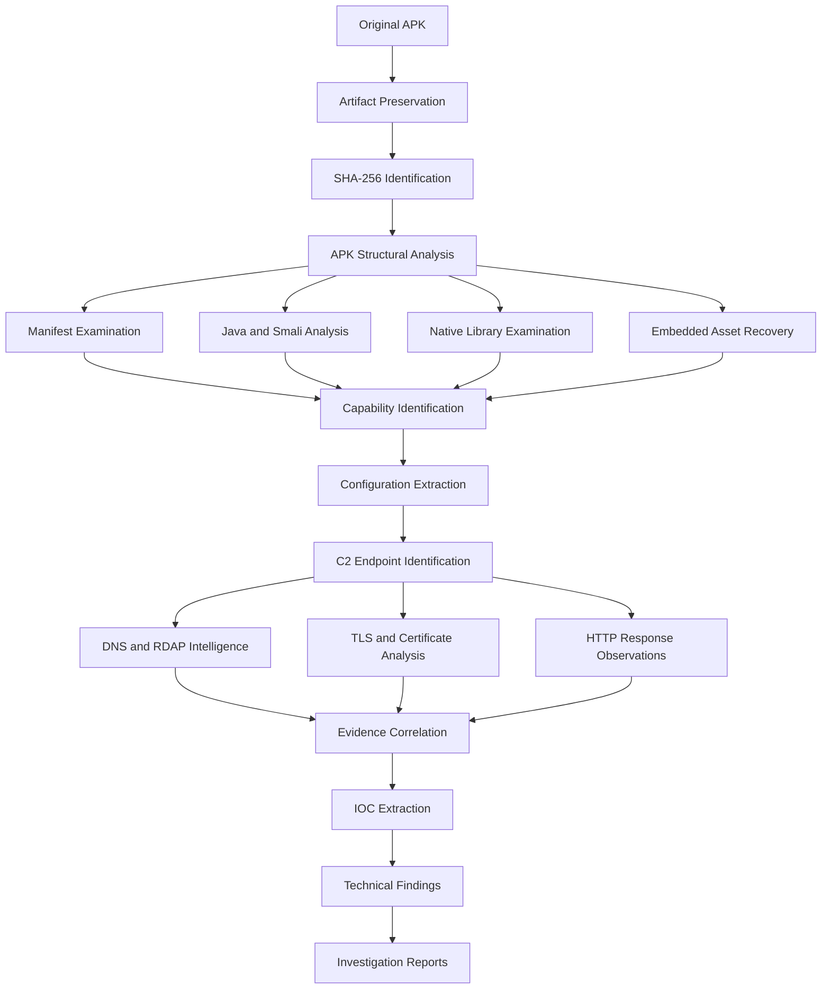
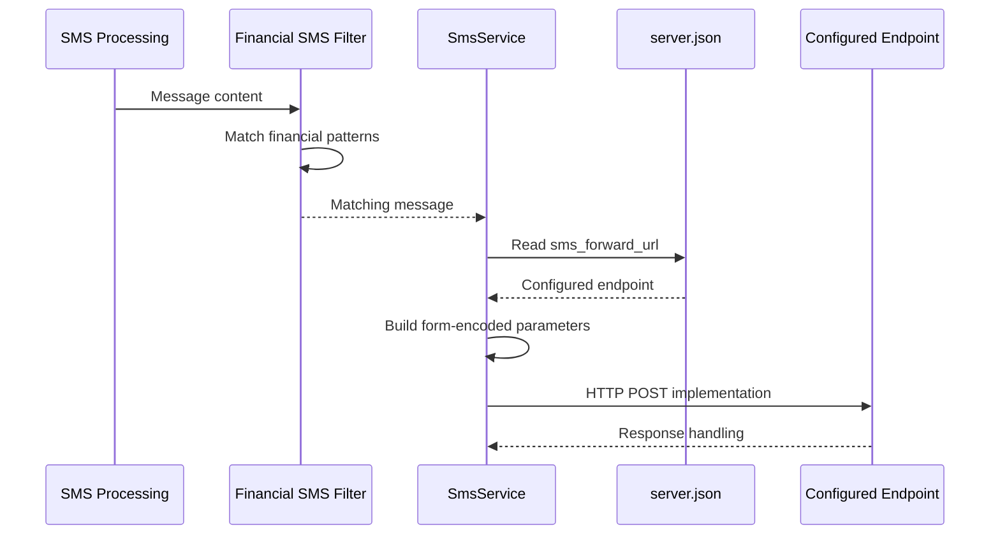
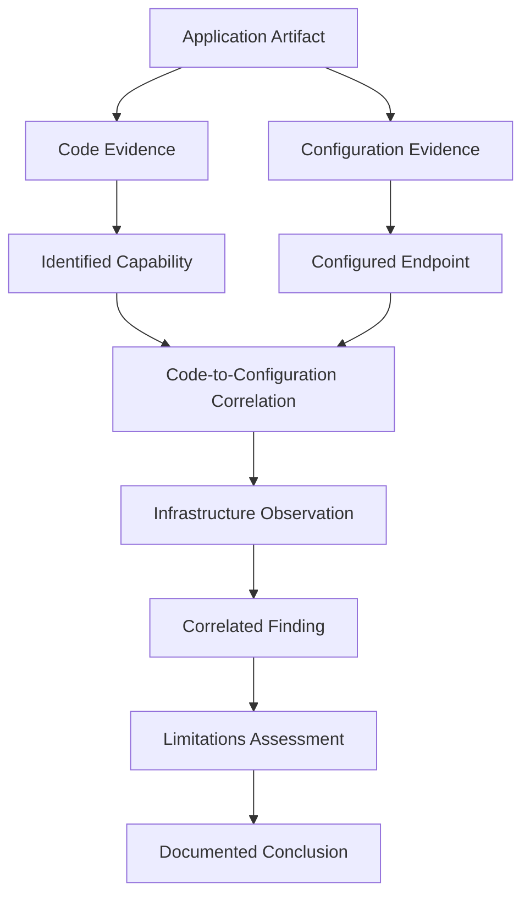

# Investigation Methodology

## 1. Introduction

This document describes the methodology followed during the investigation of the Android application labelled **HDFC BANK LOAN SERVICE**.

The investigation combined Android application reverse engineering, static code examination, embedded artifact recovery, native library inspection, configuration analysis and passive infrastructure intelligence.

The primary objective was to identify potentially harmful application capabilities, understand their implementation, identify configured remote infrastructure and preserve technically verifiable findings.

The methodology was designed around four principles:

1. Preserve the integrity of examined artifacts.
2. Identify functionality through code-level evidence.
3. Correlate application configuration with infrastructure observations.
4. Distinguish implemented capabilities from verified runtime behaviour.

**Investigation approach:** Static analysis and passive infrastructure intelligence.

**Dynamic analysis:** Not performed.

---

## 2. Investigation Architecture

The investigation followed a structured examination process.



*The workflow represents the examination methodology, not the execution of the application's functionality.*

---

## 3. Artifact Identification and Preservation

### 3.1 Primary APK Identification

The primary application was identified using its package metadata, version information and signing certificate.

| Attribute | Value |
|---|---|
| Application label | HDFC BANK LOAN SERVICE |
| Package | `com.sec.android.app.finance.kaxqj68` |
| Version | `2.9.65` |
| Minimum SDK | 24 |
| Target SDK | 37 |
| Signing certificate CN | `editor` |
| Signing key type | RSA 2048 |

### 3.2 Cryptographic Hashing

SHA-256 was used to identify the examined APK artifact.

Reference command:

```bash
sha256sum suspicious.apk
```

Recorded primary APK hash:

```text
08cfe1f957d7539320eaaa97f1d6838182f5df57e6f875d00dc3060e432d35af
```

The hash provides a reproducible identifier for the examined artifact. It can be used to verify whether another copy is byte-for-byte identical.

### 3.3 Signing Certificate Examination

The APK signing certificate was examined to identify its certificate subject and cryptographic properties.

The certificate subject was:

```text
CN=editor
```

The certificate used RSA 2048.

Recorded certificate SHA-256:

```text
6215f00baa4bf18bab5792fc796bfc5555917240f14f7c7e672d956888d75c96
```

A self-signed or locally generated certificate does not independently establish maliciousness. Certificate information is treated as an artifact-identification attribute.

### 3.4 Evidence Preservation

The original APK should remain unchanged during analysis.

The preservation workflow follows these principles:

- Maintain an original copy.
- Perform analysis on a separate working copy.
- Record SHA-256 hashes.
- Preserve original filenames and available timestamps.
- Record extraction and analysis activities.
- Maintain an evidence register.
- Avoid modifying original evidence.

---

## 4. APK Structural Examination

### 4.1 Archive Inspection

The APK archive was examined to identify its internal structure, application resources, executable components and embedded assets.

Reference commands:

```bash
file suspicious.apk
unzip -l suspicious.apk
```

The examination focused on:

- `AndroidManifest.xml`
- `classes.dex`
- Additional DEX files, if present.
- `lib/`
- `assets/`
- `res/`
- Application resources.
- Embedded archives and encrypted assets.

### 4.2 Manifest Examination

The Android manifest was examined to identify application metadata, declared permissions, services and broadcast receivers.

Tools used in the investigation workflow included APKTool and JADX.

Reference command:

```bash
apktool d suspicious.apk -o apktool-output
```

The decoded manifest was then examined for:

- Package identity.
- Application components.
- Service declarations.
- Broadcast receiver declarations.
- Permission declarations.
- Background execution-related configuration.
- SMS and telephony-related functionality.

A declared permission was treated as evidence of an application requirement or capability, not proof that the permission was granted on a device.

### 4.3 Decompiled Source Examination

JADX was used to inspect application code and understand its implementation.

Reference command:

```bash
jadx -d jadx-output suspicious.apk
```

The examination focused on:

- Service classes.
- Broadcast receivers.
- Network communication methods.
- SMS processing methods.
- Firebase messaging handlers.
- Telephony operations.
- Background service initialization.

Where JADX output was incomplete or unavailable, Smali inspection was used to examine the underlying implementation.

---

## 5. Java and Smali Code Analysis

Code-level analysis was one of the principal components of this investigation.

The objective was to identify sensitive functionality and trace how application components interact.

### 5.1 SMS Analysis

The investigation examined the following components:

| Component | Examination purpose |
|---|---|
| `SmsService.java` | Financial SMS filtering and HTTP forwarding |
| `SmsReceiver.java` | Incoming SMS broadcast processing |
| `SmsForwardService.java` | SMS receiver and background service functionality |
| `SmsSendService.java` | Outgoing SMS transmission |
| `F1/o.java` | Historical SMS processing |
| `A/n.java` | Remote forwarding-number configuration and related operations |

#### Financial SMS Filtering

The method `b(String)` in `SmsService.java` was identified as a financial-message matching function.

The examined logic uses predefined patterns associated with:

- Banking institutions.
- UPI.
- Account notifications.
- Balance notifications.
- Transaction messages.
- Wallets and payment applications.

The methodology involved identifying the matching function and tracing where its result was used.

#### Historical SMS Query

The historical SMS implementation in `F1/o.java` was examined for its content-provider query.

The identified query source was:

```text
content://sms/inbox
```

The examined logic included:

- A recent 30-day time window.
- Descending timestamp ordering.
- Financial SMS filtering.
- Processing with the type `old_banking_sms`.
- Splitting messages into chunks of up to 160 characters.

This established the presence of historical inbox-query logic, not successful collection from an actual device.

#### HTTP SMS Forwarding

The method `c(...)` in `SmsService.java` was examined to understand the HTTP transmission structure.

The configured endpoint was:

```text
https://w60.kinginfo.online/sms_forward.php
```

The identified form parameters were:

```text
device_id
sender
user_number
message
timestamp
type
part_number
total_parts
```

The analysis traced the following sequence:



*The sequence describes the implementation identified in code. It does not represent an observed successful transmission.*

#### Number-Based SMS Forwarding

A separate mechanism was identified in `A/n.java`.

The examined logic:

1. Retrieves a forwarding configuration from the configured endpoint.
2. Parses `forward_number` and `status`.
3. Stores the configuration in shared preferences.
4. Checks whether forwarding is enabled.
5. Uses Android's `SmsManager` to send SMS message content to the configured number.

The relevant configured endpoint was:

```text
https://w60.kinginfo.online/sms_forward_number.php
```

This functionality was treated as a separate SMS transmission path from HTTP-based forwarding.

A phone-number value returned by the endpoint during collection was redacted because it may represent sensitive personal information. Its ownership and device association were not established.

#### Remote SMS Sending

`SmsSendService.java` was examined for:

- Remote job processing.
- SIM and subscription selection.
- `SmsManager.sendTextMessage`.
- Multipart SMS handling.
- SMS sent and delivery result receivers.
- Retry logic.

The implementation contained retry handling with up to three attempts.

The investigation did not demonstrate successful receipt of a remote SMS job or delivery of an outgoing message.

---

### 5.2 Firebase Cloud Messaging Analysis

The examination of `MyFirebaseMessagingService.java` focused on the application's remote command-handling logic.

The following command identifiers were identified:

| Command | Associated functionality |
|---|---|
| `ONLINE_CHECK` | Online-state operation |
| `SYNC_DEVICE` | Device synchronisation |
| `PING` | Availability-related operation |
| `SEND_SMS` | Initiates SMS sending service |
| `GET_SMS` | Initiates SMS collection service |
| `RUN_USSD` | Initiates USSD service |

The command-handling structure was examined by tracing the incoming message action to the associated service initialization.

Conceptual command-dispatch representation:

```text
FCM Message
    |
    v
MyFirebaseMessagingService
    |
    +-- ONLINE_CHECK
    |
    +-- SYNC_DEVICE
    |
    +-- PING
    |
    +-- SEND_SMS
    |       |
    |       v
    |   SmsSendService
    |
    +-- GET_SMS
    |       |
    |       v
    |   SmsService
    |
    +-- RUN_USSD
            |
            v
        UssdService
```

The command names and service relationships above are based on the examined implementation.

No actual FCM message delivery or successful remote command execution was established.

### 5.3 FCM Token Registration

The implementation in `A/n.java` was examined for token registration.

The identified request parameters included:

```text
device_id
fcm_token
```

The configured endpoint was:

```text
https://w60.kinginfo.online/save_token.php
```

The presence of token-registration logic was documented as part of the remote messaging architecture.

Successful backend registration was not established.

---

## 6. Device Information Collection Analysis

### 6.1 Background Service Inspection

The source-level decompilation of the background service was incomplete. Therefore, Smali inspection was used to examine the implementation.

The examined component was:

```text
BackgroundService.smali
```

The analysis identified an HTTP POST implementation that collected and transmitted device-related fields.

| Parameter | Identified purpose |
|---|---|
| `device_name` | Device name |
| `device_model` | Device model |
| `device_id` | Device identifier |
| `sim1_carrier` | First SIM carrier |
| `sim2_carrier` | Second SIM carrier |
| `sim1_number` | First SIM number |
| `sim2_number` | Second SIM number |
| `created_at` | Creation timestamp |
| `last_seen` | Last-seen timestamp |
| `status` | Online status |
| `battery` | Battery information |

The configured endpoint was:

```text
https://w60.kinginfo.online/background_service.php
```

The Smali examination covered:

- Connectivity checks.
- Configuration loading.
- HTTP connection initialization.
- POST parameter construction.
- Form-encoded body transmission.
- Response-code retrieval.
- Connection disconnection.

The code established the presence of a transmission implementation, not successful backend processing.

---

## 7. Telephony and USSD Analysis

### 7.1 Call-Forwarding Functionality

`CallService.java` was examined to identify how call-forwarding settings were retrieved and applied.

The analysis identified:

- Remote configuration retrieval.
- Device identifier usage.
- Call status parsing.
- Call number parsing.
- SIM-slot selection.
- USSD command construction.
- Telephony API invocation.
- Status reporting.

The identified USSD command patterns were:

| Operation | Pattern |
|---|---|
| Enable call forwarding | `**21*<number>#` |
| Disable call forwarding | `##21#` |

The examined implementation used:

```java
TelephonyManager.createForSubscriptionId(...)
```

and:

```java
sendUssdRequest(...)
```

These API references establish the implementation approach. They do not prove that the carrier accepted or executed the request.

### 7.2 USSD Service Analysis

`UssdService.java` was examined for its command parameters and reporting logic.

The identified parameters included:

```text
device_id
command_id
ussd_code
sim_slot
status
response
error
```

The configured endpoint was:

```text
https://w60.kinginfo.online/update_ussd.php
```

The investigation also identified the `RUN_USSD` command handler in the FCM messaging service.

The exact internal invocation path of the USSD service was not fully recovered from JADX because `onStartCommand()` decompilation was unsuccessful.

This limitation was retained rather than assuming an unverified method call.

---

## 8. Persistence and Background Execution Analysis

The examination covered:

- `SmsForwardService.java`
- `SmsReceiver.java`
- `BootReceiver`
- Main activity service initialization.

The analysis identified:

- A receiver for `android.provider.Telephony.SMS_RECEIVED`.
- Background SMS service functionality.
- Boot-related service startup logic.
- Service initialization associated with the application.

The investigation focused on component declarations and code-level invocation relationships.

No physical-device reboot test was performed. Therefore, successful persistence after reboot was not established.

---

## 9. Native Library Examination

### 9.1 Library Identification

The primary APK contained the native ARM64 library:

```text
libzwdwbxqi.so
```

The library was stripped.

The examination identified JNI exports including:

```text
getSecretKey
nativeXorChunk
getTargetPackage
nativeScanEnv
```

### 9.2 Anti-Analysis Inspection

The `nativeScanEnv` functionality was examined for environment-detection logic.

Identified checks included:

| Inspection target | Purpose |
|---|---|
| `/proc/self/maps` | Process memory-map inspection |
| `/proc/net/tcp` | TCP connection inspection |
| `/proc/net/tcp6` | IPv6 TCP connection inspection |
| `TracerPid` | Debugger tracing indicator |
| Frida-related strings | Instrumentation detection |
| Xposed indicators | Framework detection |
| Substrate indicators | Instrumentation detection |
| Ports `27042` and `27043` | Known instrumentation-related indicators |

The methodology was based on static binary inspection and identification of related strings and implementation references.

No runtime instrumentation test was conducted.

---

## 10. Embedded APK Recovery

### 10.1 Asset Identification

An asset named:

```text
rmtley9lr.db
```

was identified inside the primary application.

The asset was examined and identified as an encrypted APK payload using a repeating-XOR transformation.

### 10.2 Recovery and Validation

The recovery process involved:

1. Identifying the embedded asset.
2. Examining its structure.
3. Identifying the repeating-XOR transformation.
4. Decoding the payload.
5. Identifying the resulting APK structure.
6. Calculating its SHA-256 hash.
7. Examining package metadata.
8. Inspecting archive integrity.

### 10.3 Recovered Artifact

| Attribute | Value |
|---|---|
| Package | `com.nxtwave.support` |
| Version | `1.0` |
| Minimum SDK | 25 |
| Target SDK | 34 |
| SHA-256 | `13f93b8c70881f9414944fdc55811bfc627dbec966f023c664eb98782690cb4c` |

ZIP integrity verification passed, with 986 archive entries identified.

Unusual absolute-style and backslash-containing archive paths were observed and documented.

The secondary APK was treated as a separate artifact. No execution relationship with the primary application was assumed.

---

## 11. Configuration Extraction

The application configuration was examined to identify remote infrastructure references.

The primary configuration file was:

```text
server.json
```

The extracted endpoint categories included:

- Background device reporting.
- SMS forwarding.
- SMS forwarding-number retrieval.
- SMS sending.
- Application upload.
- Permission operations.
- FCM token registration.
- Online status checking.
- Call-forwarding configuration.
- USSD configuration and updates.

The following domains were identified:

```text
w60.kinginfo.online
host.kinginfo.online
w60.mrkinginfoback.online
```

The configuration also contained Firebase project identifiers.

Sensitive API-key material was excluded from public documentation.

### Configuration-to-Code Correlation

The methodology did not rely solely on finding URLs inside configuration files.

Where possible, configuration values were correlated with their use in application code.

For example:

| Configuration value | Code-level correlation |
|---|---|
| `sms_forward_url` | `SmsService.java` |
| `sms_forward_number` | `A/n.java` |
| `save_token.php` | FCM token registration logic |
| `background_service.php` | `BackgroundService.smali` |
| `call_setting_url` | `CallService.java` |
| `update_ussd_url` | `UssdService.java` |

This correlation helps distinguish endpoints that are merely present in an artifact from endpoints referenced by identifiable functionality.

---

## 12. Infrastructure Intelligence Methodology

Infrastructure examination was conducted to understand the externally configured services and their observed network characteristics.

### 12.1 DNS Examination

DNS observations were collected for the identified domains.

Reference commands:

```bash
dig A w60.kinginfo.online
dig AAAA w60.kinginfo.online
dig A host.kinginfo.online
```

The examination recorded:

- IPv4 resolution.
- IPv6 resolution.
- Resolution status.
- Collection timestamp.
- Observed DNS infrastructure.

Cloudflare edge addresses were documented as edge resolution, not verified origin-server addresses.

### 12.2 RDAP Examination

Domain registration information was examined through RDAP records.

The methodology considered:

- Registration dates.
- Expiration dates.
- Registrar information.
- Nameservers.
- Available entity roles.
- Abuse-contact information.

Registrar-related abuse contacts were not treated as domain registrants or application operators.

### 12.3 TLS Certificate Examination

TLS certificate information was examined for the configured domains.

Reference command for certificate inspection:

```bash
openssl s_client -connect w60.kinginfo.online:443 \
  -servername w60.kinginfo.online </dev/null
```

The analysis considered:

- Certificate issuer.
- Subject information.
- Validity period.
- Subject Alternative Names.
- Certificate fingerprints.
- TLS-related response information.

The presence of a valid TLS certificate was not treated as evidence that a service was legitimate or malicious.

### 12.4 Certificate Transparency Analysis

Certificate Transparency records were collected and examined using Cert Spotter observations.

The collected dataset contained:

| Metric | Result |
|---|---:|
| Total certificate records | 229 |
| Unique certificate IDs | 229 |
| Unique DNS names | 167 |
| Hostname-certificate records | 180 |
| Unique numbered `w` hostnames | 143 |

The dataset was not exhaustive.

Repeated hostname observations and public-key fingerprint changes were examined as certificate lifecycle indicators.

These patterns were not treated as proof of common ownership or malicious infrastructure.

### 12.5 HTTP Endpoint Observations

Configured endpoint responses were examined during the recorded collection period.

The observations included:

- HTTP response status.
- Response headers.
- Server-related headers.
- TLS issuer information.
- HSTS presence.
- Cloudflare edge identifiers.
- DNS resolution failures.

One endpoint response returned a JSON object containing a forwarding number and an `off` status. The personal information was redacted in public documentation.

The request command recorded during the investigation was:

```bash
curl "https://w60.kinginfo.online/sms_forward_number.php"
```

The recorded response established what the endpoint returned to that request at collection time.

It did not establish ownership of the returned number, a device association or actual forwarding activity.

### 12.6 Endpoint Response Interpretation

The investigation followed this interpretation standard:

| Observation | What it establishes |
|---|---|
| HTTP 200 | An HTTP response with status 200 was returned |
| TLS certificate | A certificate was presented for the connection |
| DNS resolution | A hostname resolved at collection time |
| JSON response | The endpoint returned structured data |
| DNS failure | Resolution failed during that observation |

None of these observations independently proves successful application operations or backend data persistence.

---

## 13. IOC Extraction and Documentation

Indicators were extracted from the examined application and infrastructure observations.

The IOC documentation uses structured formats:

| File | Purpose |
|---|---|
| `hashes.json` | Cryptographic artifact identifiers |
| `domains.json` | Domain-related indicators |
| `indicators.csv` | Consolidated machine-readable IOC register |
| `indicators.md` | Human-readable indicator documentation |

The CSV schema is:

```csv
indicator_id,indicator_type,indicator,context,source,first_observed_utc,last_observed_utc,confidence,classification,sensitivity,verification_status,notes
```

Indicators are classified according to their evidence source and verification status.

Sensitive personal information, API keys and credentials are excluded from public IOC records.

A domain or IP address is not automatically labelled malicious solely because it appears in the application's configuration.

---

## 14. Evidence Validation and Correlation

Findings were evaluated using multiple evidence sources wherever available.

The validation approach included:

1. Identifying the relevant artifact.
2. Recording its cryptographic fingerprint.
3. Locating the relevant Java, Smali or native implementation.
4. Identifying the associated configuration value.
5. Correlating the implementation with its configured endpoint.
6. Recording independent infrastructure observations where available.
7. Documenting unresolved questions and limitations.
8. Assigning an evidence-based confidence description.

### Evidence Correlation Model



Correlation strengthens the technical explanation, but it does not independently prove successful runtime behaviour.

---

## 15. Tools and Technologies

The investigation workflow used the following tools and technologies.

| Tool / Technology | Purpose |
|---|---|
| JADX | Java decompilation and code examination |
| APKTool | APK decoding and manifest examination |
| Smali inspection | Low-level Android bytecode examination |
| SHA-256 utilities | Cryptographic artifact identification |
| ZIP utilities | APK archive and embedded artifact inspection |
| ELF inspection utilities | Native library examination |
| `dig` | DNS observations |
| RDAP | Domain registration intelligence |
| OpenSSL | TLS certificate examination |
| Cert Spotter | Certificate Transparency observations |
| `curl` | HTTP endpoint response observations |
| JSON and CSV | Structured evidence and IOC documentation |
| Mermaid | Investigation diagrams and visual documentation |

Tool versions and exact command outputs should be added to the evidence records when the original environment logs are available.

---

## 16. Reproducibility and Evidence Integrity

The methodology is intended to support reproducibility while preserving original evidence.

The following practices apply:

- Preserve original APK artifacts.
- Use working copies for examination.
- Record SHA-256 hashes.
- Maintain an evidence register.
- Record relevant timestamps.
- Preserve source references for technical findings.
- Document tool versions when available.
- Retain relevant command outputs where permitted.
- Redact sensitive information before publication.
- Avoid treating historical infrastructure observations as current facts.

Reference integrity-checking command:

```bash
sha256sum suspicious.apk
```

To compare a previously recorded hash against a working artifact:

```bash
echo "08cfe1f957d7539320eaaa97f1d6838182f5df57e6f875d00dc3060e432d35af  suspicious.apk" \
  | sha256sum -c -
```

A successful verification reports:

```text
suspicious.apk: OK
```

This confirms that the file matches the recorded SHA-256 value.

---

## 17. Methodological Limitations

The methodology was restricted to static analysis and passive infrastructure intelligence.

The following were not performed:

- Dynamic malware execution.
- Live victim-device acquisition.
- Memory acquisition.
- Runtime FCM command testing.
- Controlled SMS transmission testing.
- Live USSD execution.
- Call-forwarding modification.
- Backend database examination.
- Remote infrastructure exploitation.

Consequently, the methodology establishes implementation details and infrastructure observations, not confirmed victim impact or successful remote operations.

---

## 18. Conclusion

The investigation methodology combined artifact identification, reverse engineering, application code analysis, embedded APK recovery, native library examination and infrastructure intelligence.

Java, Smali and native code examination provided evidence of multiple security-sensitive capabilities within the primary application.

Configuration extraction and infrastructure observations provided additional context about the application's remote communication architecture.

The findings were documented with explicit evidence classifications and limitations to ensure that code-derived functionality was not confused with confirmed runtime behaviour.

This methodology provides the technical foundation for the investigation's findings, indicators and consolidated reports.

---

## Related Documentation

- [Executive Summary](executive-summary.md)
- [Investigation Scope](investigation-scope.md)
- [Investigation Findings](findings.md)
- [Investigation Limitations](limitations.md)
- [Investigation Timeline](timeline.md)
- [Evidence Register](../evidence/evidence-register.md)
- [Chain of Custody](../evidence/chain-of-custody.md)
- [Static Analysis Report](../reports/static-analysis-report.md)
- [C2 Infrastructure Report](../reports/c2-infrastructure-report.md)

---

**Document:** Investigation Methodology  
**Project:** HDFC Android APK Investigation  
**Assessment Type:** Android Static Analysis and Infrastructure Intelligence  
**Status:** Documented