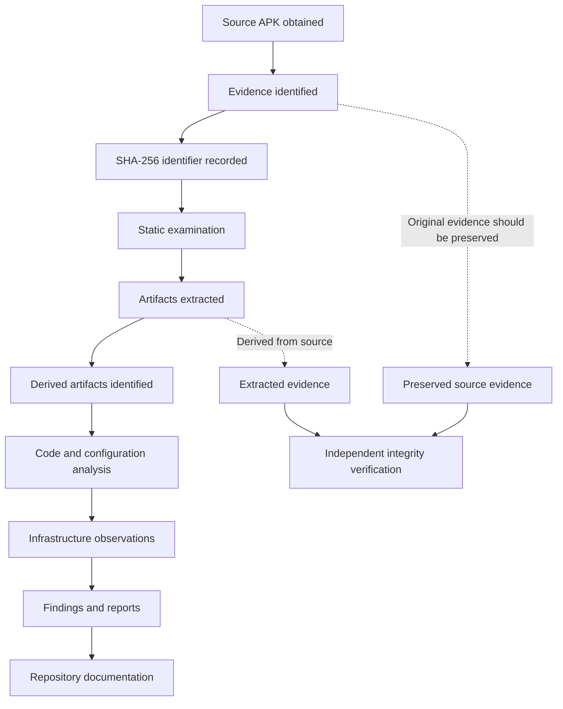

# Chain of Custody

## 1. Purpose

This document records the known handling, preservation, verification, and analytical use of digital evidence associated with the HDFC-branded Android APK investigation.

Its purpose is to:

- Document the available evidence provenance and integrity information.
- Identify the evidence items used during the investigation.
- Distinguish original evidence from derived or analytical artifacts.
- Record known custody limitations and missing historical information.
- Establish handling recommendations for any subsequent transfer or independent examination.

**Important:** This document is a retrospective reconstruction based on the investigation records available at the time of documentation. It is not a substitute for a contemporaneous, signed chain-of-custody form.

---

## 2. Investigation Identification

| Field | Value |
|---|---|
| Investigation | HDFC-Branded Android APK Investigation |
| Primary evidence | Android APK |
| Investigation type | Static APK analysis and passive infrastructure intelligence |
| Analysis approach | Static analysis, Smali review, configuration extraction, and infrastructure observation |
| Dynamic analysis | Not performed |
| Repository | `hdfc-android-apk-investigation` |
| Evidence register | [`evidence-register.md`](./evidence-register.md) |
| Investigation status | Documented static investigation phase |

---

## 3. Evidence Handling Principles

The following principles govern the interpretation and handling of the evidence documented in this repository.

1. **Preservation:** Original evidence should be retained without modification.
2. **Integrity:** Cryptographic hashes should be used to identify and verify evidence files.
3. **Traceability:** Evidence items should have unique identifiers and documented relationships.
4. **Reproducibility:** Analytical steps should be documented sufficiently for independent review.
5. **Separation:** Original evidence, working copies, extracted artifacts, and analytical outputs must remain distinguishable.
6. **Confidentiality:** Personal information, credentials, tokens, and sensitive identifiers must not be unnecessarily disclosed.
7. **Transparency:** Missing custody information must be identified rather than reconstructed through assumptions.

---

## 4. Evidence Classification

Evidence in this investigation is classified into the following categories.

| Classification | Description | Example |
|---|---|---|
| Original evidence | Source files obtained for examination | Primary APK |
| Derived evidence | Artifacts extracted or decoded from source evidence | Embedded APK, extracted configuration |
| Analytical artifacts | Outputs generated during examination | Decompiled Java, Smali, metadata |
| Infrastructure observations | Results of passive or non-invasive endpoint and domain observations | DNS, RDAP, TLS and HTTP responses |
| Reporting artifacts | Documents and structured findings produced during analysis | Reports, IOC files, diagrams |

Derived evidence must retain a reference to its source evidence item. Its hash identifies the derived artifact, not the original source.

---

## 5. Known Evidence Integrity Records

The following cryptographic identifiers are available in the investigation records.

| Evidence item | Description | SHA-256 |
|---|---|---|
| Primary APK | HDFC BANK LOAN SERVICE | `08cfe1f957d7539320eaaa97f1d6838182f5df57e6f875d00dc3060e432d35af` |
| Embedded APK | Decoded APK extracted from `rmtley9lr.db` | `13f93b8c70881f9414944fdc55811bfc627dbec966f023c664eb98782690cb4c` |
| Primary signing certificate | Certificate associated with primary APK | `6215f00baa4bf18bab5792fc796bfc5555917240f14f7c7e672d956888d75c96` |

**Interpretation:** These values are recorded identifiers from the investigation. Their inclusion in this document does not independently establish when the hashes were calculated, who calculated them, or whether the original files remained unchanged throughout every subsequent handling event.

The certificate fingerprint identifies the signing certificate, not the APK file itself.

---

## 6. Retrospective Evidence Lifecycle

The following diagram represents the known logical progression of evidence through the investigation. It does not assert undocumented physical transfers or custody events.



---

## 7. Retrospective Custody Event Register

The following table records the known investigation stages. Exact timestamps, physical transfer details, and individual handler identities were not consistently retained in the available records.

| Event ID | Event | Available record | Custody status |
|---|---|---|---|
| COC-001 | Source APK obtained | APK was available for examination | Exact acquisition timestamp and transfer details not recorded |
| COC-002 | Primary APK identified | Package name, version and SHA-256 documented | Identification recorded |
| COC-003 | Embedded APK extracted | `rmtley9lr.db` decoded into a secondary APK | Extraction relationship documented |
| COC-004 | Static analysis performed | Decompiled source, Smali and configuration examined | Analytical activity documented |
| COC-005 | Infrastructure observations collected | DNS, RDAP, TLS and HTTP observations recorded | Observation details documented separately |
| COC-006 | Findings consolidated | Findings and IOC records prepared | Reporting activity documented |
| COC-007 | Repository documentation prepared | Investigation materials organized in GitHub repository | Documentation activity recorded |

### Missing historical custody details

The available records do not establish all of the following:

- Exact date and time of initial evidence acquisition.
- Original source location and acquisition method.
- Identity and signature of the person who initially acquired the APK.
- Every individual who possessed or accessed the evidence.
- Exact dates and times of physical or electronic transfers.
- Transfer method, destination, and recipient acknowledgement.
- Whether write protection was used during initial acquisition.
- Whether the original evidence was continuously stored read-only.
- A contemporaneous signed custody form.

These details are marked **Not recorded** rather than inferred.

---

## 8. Original and Derived Evidence Separation

The investigation contains multiple levels of evidence.

| Level | Evidence | Relationship |
|---|---|---|
| Level 1 | Primary APK | Original source evidence |
| Level 2 | `rmtley9lr.db` | Embedded encrypted asset within the primary APK |
| Level 3 | Decoded secondary APK | Derived from the embedded asset |
| Level 4 | Decompiled Java and Smali | Analytical representations of APK contents |
| Level 5 | Extracted configuration and metadata | Derived analytical artifacts |
| Level 6 | Findings, IOCs and reports | Interpretations and documentation |

The decoded secondary APK must not be treated as an independently acquired original APK. It is a derived artifact whose provenance depends on the primary APK and the extraction procedure.

Decompiled Java is a representation generated by a decompiler. Smali is a disassembly representation. Neither should be confused with the original compiled DEX bytecode.

---

## 9. Integrity Verification Procedure

For any future examination or transfer, integrity should be verified using SHA-256.

### Linux verification

```bash
sha256sum primary.apk
sha256sum decoded_secondary.apk
```

Compare the resulting values with the recorded hashes in the evidence register.

### Windows PowerShell verification

```powershell
Get-FileHash .\primary.apk -Algorithm SHA256
Get-FileHash .\decoded_secondary.apk -Algorithm SHA256
```

### Verification record template

| Field | Value |
|---|---|
| Evidence ID | To be completed |
| File name | To be completed |
| Verification date/time (UTC) | Not recorded |
| Verification operator | Not recorded |
| Expected SHA-256 | Refer to evidence register |
| Calculated SHA-256 | To be completed |
| Result | Pending independent verification |
| Notes | Record any mismatch or verification issue |

A matching SHA-256 value supports the conclusion that the compared files are byte-for-byte identical, subject to the reliability of the recorded reference hash and verification process.

A matching hash does not independently prove the original acquisition method, historical custody, or authenticity of the source.

---

## 10. Evidence Handling Controls

The following controls are recommended for any continued handling of this evidence.

| Control | Required practice |
|---|---|
| Original preservation | Retain the original APK without modification |
| Working copies | Perform analysis on verified working copies |
| Hashing | Calculate SHA-256 before and after relevant transfers |
| Access control | Restrict access to authorized investigators |
| Transfer documentation | Record sender, recipient, timestamp, method and purpose |
| Storage | Use access-controlled storage with adequate backup |
| Sensitive information | Redact personal data, tokens and credentials from public reports |
| Derived artifacts | Record source evidence ID and extraction method |
| Audit trail | Preserve commands, tool versions, logs and analysis outputs |

For critical evidence, maintain a separate backup on another physical device. A second copy on the same physical SSD is not an independent physical backup.

---

## 11. Known Limitations

This chain-of-custody record has important limitations.

1. It is reconstructed from available investigation notes and artifacts.
2. It is not a contemporaneous signed custody document.
3. Complete acquisition and transfer timestamps are unavailable.
4. A complete list of evidence handlers is unavailable.
5. Continuous read-only preservation of the original APK has not been independently established.
6. The recorded hashes provide file identifiers but do not fill gaps in historical custody.
7. The infrastructure observations represent responses at the time of collection and may change over time.
8. No dynamic execution or victim-device acquisition was performed as part of this investigation.

Consequently, this document should be interpreted as a transparency-focused evidence-handling record, not as proof of an unbroken forensic chain of custody.

---

## 12. Conclusion

The investigation maintains identifiable evidence records for the primary APK, its embedded secondary APK, and associated analytical artifacts. SHA-256 identifiers are documented, and the relationship between original and derived artifacts is described.

However, the available records do not contain enough historical information to establish a complete, independently auditable chain of custody from initial acquisition through every subsequent handling event.

The distinction is important: **evidence integrity identifiers are available, but complete historical custody is not established.**

Any subsequent forensic examination, legal submission, or formal evidence transfer should include a new contemporaneous custody record, independent hash verification, handler identification, and documented transfer acknowledgements.

---

*Document status: Retrospective chain-of-custody reconstruction.*

*Classification: Technical investigation documentation. Sensitive identifiers and personal information should be redacted before public distribution.*