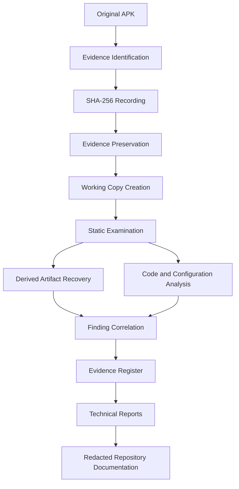

# Evidence Register

## 1. Purpose

This document maintains the evidence inventory for the HDFC Android APK investigation.

It records the artifacts, extracted files, application configuration, code-level evidence and infrastructure observations examined during the investigation.

The register provides a reference for identifying evidence sources, recording cryptographic hashes where available, documenting examination methods and linking evidence to technical findings.

This register distinguishes original artifacts from derived artifacts and external observations.

---

## 2. Case Information

| Attribute | Details |
|---|---|
| Case title | HDFC Android APK Investigation |
| Investigation type | Android Malware Analysis |
| Secondary focus | Digital Forensics and C2 Infrastructure Intelligence |
| Target platform | Android |
| Primary application | HDFC BANK LOAN SERVICE |
| Primary package | `com.sec.android.app.finance.kaxqj68` |
| Investigation approach | Static Analysis and Infrastructure Intelligence |
| Dynamic analysis | Not performed |
| Evidence register status | Documented |

---

## 3. Evidence Classification

The following classifications are used throughout this register.

| Classification | Description |
|---|---|
| Original artifact | Original application or file received for examination |
| Derived artifact | File recovered, decoded or extracted from another artifact |
| Code evidence | Decompiled Java, Smali or native implementation |
| Configuration evidence | Application configuration and embedded endpoint references |
| Infrastructure evidence | DNS, RDAP, TLS and HTTP observations |
| Analytical record | Findings, examination notes and technical interpretations |

---

## 4. Evidence Inventory

### 4.1 Primary Application Artifact

| Field | Details |
|---|---|
| Evidence ID | EVD-001 |
| Artifact | Primary Android APK |
| Application label | HDFC BANK LOAN SERVICE |
| Package | `com.sec.android.app.finance.kaxqj68` |
| Version | `2.9.65` |
| Evidence type | Original artifact |
| SHA-256 | `08cfe1f957d7539320eaaa97f1d6838182f5df57e6f875d00dc3060e432d35af` |
| Examination | APK metadata, manifest, code and archive analysis |
| Status | Examined |

### 4.2 Embedded Encrypted Asset

| Field | Details |
|---|---|
| Evidence ID | EVD-002 |
| Artifact | `rmtley9lr.db` |
| Parent artifact | EVD-001 |
| Evidence type | Embedded original asset |
| Transformation | Repeating-XOR decoding |
| SHA-256 | Not separately recorded |
| Examination | Asset identification and payload recovery |
| Status | Examined |

The original embedded asset should be preserved separately from its decoded output.

### 4.3 Recovered Secondary APK

| Field | Details |
|---|---|
| Evidence ID | EVD-003 |
| Artifact | Recovered secondary APK |
| Parent artifact | EVD-002 |
| Package | `com.nxtwave.support` |
| Version | `1.0` |
| Minimum SDK | 25 |
| Target SDK | 34 |
| Evidence type | Derived artifact |
| SHA-256 | `13f93b8c70881f9414944fdc55811bfc627dbec966f023c664eb98782690cb4c` |
| Examination | Package metadata and archive integrity |
| ZIP entries | 986 |
| ZIP integrity | Passed |
| Status | Examined |

The recovered APK shares the signing certificate identified in the primary APK. This does not establish an execution relationship between the two applications.

### 4.4 Application Configuration

| Field | Details |
|---|---|
| Evidence ID | EVD-004 |
| Artifact | `server.json` |
| Parent artifact | EVD-001 |
| Evidence type | Configuration evidence |
| Examination | Remote endpoint extraction |
| Status | Examined |

The configuration contains endpoint references associated with SMS operations, device reporting, call forwarding, USSD and other application functionality.

### 4.5 Decompiled Application Code

| Field | Details |
|---|---|
| Evidence ID | EVD-005 |
| Artifact | Decompiled Java source |
| Parent artifact | EVD-001 |
| Evidence type | Derived code evidence |
| Examination | Application logic and service relationships |
| Status | Examined |

Relevant components include:

- `SmsService.java`
- `SmsReceiver.java`
- `SmsForwardService.java`
- `SmsSendService.java`
- `MyFirebaseMessagingService.java`
- `CallService.java`
- `UssdService.java`
- `A/n.java`
- `F1/o.java`

### 4.6 Smali Evidence

| Field | Details |
|---|---|
| Evidence ID | EVD-006 |
| Artifact | Background service Smali |
| Parent artifact | EVD-001 |
| Evidence type | Derived code evidence |
| Examination | Device information reporting logic |
| Status | Examined |

The examination identified HTTP POST functionality and device-related information fields in `BackgroundService.smali`.

### 4.7 Native Library

| Field | Details |
|---|---|
| Evidence ID | EVD-007 |
| Artifact | `libzwdwbxqi.so` |
| Parent artifact | EVD-001 |
| Architecture | ARM64 |
| Evidence type | Derived native artifact |
| Examination | JNI exports and anti-analysis indicators |
| SHA-256 | Not separately recorded |
| Status | Examined |

Identified JNI exports include:

- `getSecretKey`
- `nativeXorChunk`
- `getTargetPackage`
- `nativeScanEnv`

### 4.8 Firebase Configuration

| Field | Details |
|---|---|
| Evidence ID | EVD-008 |
| Artifact | Firebase configuration |
| Parent artifact | EVD-001 |
| Evidence type | Configuration evidence |
| Examination | Project identification and FCM integration |
| Status | Examined |

The Firebase project identifier and sender information were recorded.

Sensitive API-key material is excluded from this public register.

### 4.9 DNS Observations

| Field | Details |
|---|---|
| Evidence ID | EVD-009 |
| Evidence type | Infrastructure observation |
| Source | DNS queries |
| Collection timestamp | 2026-11-03 14:49:33 UTC |
| Domains | `w60.kinginfo.online`, `host.kinginfo.online` |
| Examination | A and AAAA record observations |
| Status | Recorded |

Observed addresses were identified as Cloudflare edge resolution and were not treated as confirmed origin-server IPs.

### 4.10 RDAP Observations

| Field | Details |
|---|---|
| Evidence ID | EVD-010 |
| Evidence type | Infrastructure observation |
| Source | RDAP |
| Domain | `kinginfo.online` |
| Registration date | 2026-06-25 06:26 UTC |
| Registrar | PDR Ltd / PublicDomainRegistry |
| Examination | Registration and nameserver information |
| Status | Recorded |

Registrar-associated abuse contact information was not treated as registrant or operator identity.

### 4.11 TLS and Certificate Transparency Records

| Field | Details |
|---|---|
| Evidence ID | EVD-011 |
| Evidence type | Infrastructure observation |
| Source | TLS and Cert Spotter |
| Total collected records | 229 |
| Unique certificate IDs | 229 |
| Unique DNS names | 167 |
| Examination | Certificate lifecycle and hostname observations |
| Status | Recorded |

The collected dataset was not exhaustive.

### 4.12 HTTP Endpoint Observations

| Field | Details |
|---|---|
| Evidence ID | EVD-012 |
| Evidence type | Infrastructure observation |
| Collection timestamp | 2026-11-04 13:02:38 UTC |
| Source | HTTP endpoint audit |
| Successful HTTP responses | 12 |
| DNS resolution failures | 1 |
| Examination | HTTP status and response headers |
| Status | Recorded |

HTTP 200 responses were recorded as endpoint observations only. They do not establish successful application operations or backend data persistence.

Sensitive response information has been redacted from public documentation.

---

## 5. Evidence-to-Finding Mapping

The following table links evidence records to the corresponding investigation findings.

| Evidence ID | Related findings |
|---|---|
| EVD-001 | FIND-001 to FIND-019 |
| EVD-002 | FIND-013 |
| EVD-003 | FIND-013 |
| EVD-004 | FIND-003, FIND-004, FIND-005, FIND-008 to FIND-010, FIND-014 |
| EVD-005 | FIND-001 to FIND-007, FIND-009 to FIND-011 |
| EVD-006 | FIND-008 |
| EVD-007 | FIND-012 |
| EVD-008 | FIND-006, FIND-007, FIND-015 |
| EVD-009 | FIND-016 |
| EVD-010 | FIND-017 |
| EVD-011 | FIND-018 |
| EVD-012 | FIND-019 |

These mappings indicate supporting evidence categories. They do not imply that every finding is supported by every artifact.

---

## 6. Evidence Integrity

Cryptographic hashes are used to identify examined artifacts and support integrity verification.

Recorded SHA-256 values:

| Artifact | SHA-256 |
|---|---|
| Primary APK | `08cfe1f957d7539320eaaa97f1d6838182f5df57e6f875d00dc3060e432d35af` |
| Recovered secondary APK | `13f93b8c70881f9414944fdc55811bfc627dbec966f023c664eb98782690cb4c` |

The following information should be recorded for every retained artifact where available:

- Original filename.
- Evidence identifier.
- File size.
- SHA-256 hash.
- Acquisition or receipt timestamp.
- Source or origin.
- Storage location.
- Examination activity.
- Analyst or handler.
- Integrity verification result.

A hash value identifies the bytes of a file. It does not independently establish the file's origin, authenticity or chain of custody.

---

## 7. Evidence Handling Requirements

The following principles apply:

1. Preserve original artifacts separately from working copies.
2. Do not overwrite original evidence.
3. Calculate hashes before and after evidence transfer where possible.
4. Record timestamps using UTC.
5. Maintain evidence identifiers consistently across reports.
6. Document every relevant evidence transfer.
7. Record tools and procedures used during examination.
8. Redact sensitive information before repository publication.
9. Keep private evidence and original malware samples outside the public repository.
10. Maintain an independent backup of critical evidence where possible.

---

## 8. Evidence Not Acquired

The following evidence types were not acquired during this investigation phase:

| Evidence type | Status |
|---|---|
| Live victim-device image | Not acquired |
| Android physical acquisition | Not acquired |
| Android logical acquisition | Not acquired |
| Device memory dump | Not acquired |
| Runtime application logs | Not acquired |
| Live network PCAP | Not acquired |
| Verified backend database records | Not acquired |
| Confirmed victim SMS records | Not acquired |
| Carrier-side call-forwarding records | Not acquired |

The absence of these evidence sources limits conclusions regarding runtime execution and victim impact.

---

## 9. Evidence Lifecycle

*The diagram represents the intended evidence-handling and documentation lifecycle. It does not claim that every transfer or preservation event was independently logged.*

---

## 10. Register Limitations

This register was reconstructed from available investigation records.

Some original filenames, acquisition timestamps, file sizes, individual artifact hashes and transfer records were not available in the documented investigation context.

These fields are intentionally marked as unavailable or not recorded rather than inferred.

The register should be updated if additional original evidence metadata becomes available.

---

## 11. Conclusion

The evidence register provides a structured inventory of the primary APK, recovered secondary artifact, code evidence, configuration files and infrastructure observations examined during the investigation.

It links evidence categories to the corresponding technical findings and documents important integrity and handling requirements.

The register also identifies evidence that was not acquired, ensuring that conclusions remain within the limits of the available material.

---

## Related Documentation

- [Investigation Scope](../docs/investigation-scope.md)
- [Investigation Methodology](../docs/methodology.md)
- [Investigation Findings](../docs/findings.md)
- [Investigation Limitations](../docs/limitations.md)
- [Investigation Timeline](../docs/timeline.md)
- [Chain of Custody](chain-of-custody.md)
- [IOC Register](../iocs/indicators.md)

---

**Document:** Evidence Register  
**Project:** HDFC Android APK Investigation  
**Evidence classification:** Original, Derived, Code and Infrastructure Evidence  
**Status:** Documented