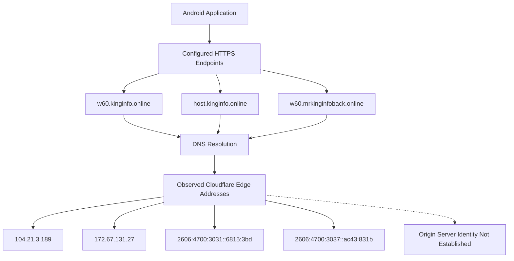

# DNS Infrastructure Analysis

## 1. Overview

This document examines the DNS infrastructure associated with the domains configured in the primary APK labelled `HDFC BANK LOAN SERVICE`.

The investigation identified remote service endpoints under the following domains:

- `kinginfo.online`
- `mrkinginfoback.online`

The application configuration references multiple subdomains, including:

- `w60.kinginfo.online`
- `host.kinginfo.online`
- `w60.mrkinginfoback.online`

DNS observations were collected to understand the publicly visible resolution behavior of the configured infrastructure.

The analysis focuses on DNS records, resolved addresses, Cloudflare involvement, hostname relationships, and collection limitations.

**Investigation boundary:** DNS resolution identifies the addresses returned by DNS at a particular observation time. It does not independently establish the physical location, ownership, or identity of the backend server.

---

## 2. Identified Infrastructure Domains

| Domain / Hostname | Identified role |
|---|---|
| `kinginfo.online` | Primary configured domain |
| `w60.kinginfo.online` | Main application service hostname |
| `host.kinginfo.online` | Additional configured service hostname |
| `mrkinginfoback.online` | Secondary configured domain |
| `w60.mrkinginfoback.online` | Call-forwarding status-reporting hostname |

### 2.1 Application endpoint relationship

The primary application configuration references multiple endpoints under `w60.kinginfo.online`.

Examples include:

```text
https://w60.kinginfo.online/background_service.php
https://w60.kinginfo.online/sms_forward.php
https://w60.kinginfo.online/sms_forward_number.php
https://w60.kinginfo.online/call_forward.php
https://w60.kinginfo.online/call_forward_setting.php
https://w60.kinginfo.online/sms_send.php
https://w60.kinginfo.online/app_upload.php
https://w60.kinginfo.online/permission.php
https://w60.kinginfo.online/save_token.php
https://w60.kinginfo.online/web/api/check_online.php
https://w60.kinginfo.online/ussd_setting.php
https://w60.kinginfo.online/update_ussd.php
```

The additional configuration references:

```text
https://host.kinginfo.online/get.php
```

The call-forwarding status-reporting configuration references:

```text
https://w60.mrkinginfoback.online/update_call_forward.php
```

These are configured application endpoints, not independently verified backend services.

---

## 3. DNS Resolution Observations

### 3.1 Collection timestamp

The recorded DNS observation timestamp is:

```text
2026-11-03 14:49:33 UTC
```

### 3.2 Resolved addresses

The following public IP addresses were observed for the configured Cloudflare-proxied hostnames.

| Record type | Observed value |
|---|---|
| A | `104.21.3.189` |
| A | `172.67.131.27` |
| AAAA | `2606:4700:3031::6815:3bd` |
| AAAA | `2606:4700:3037::ac43:831b` |

These addresses were associated with the observed Cloudflare edge resolution.

### 3.3 DNS interpretation

The resolved IPv4 and IPv6 addresses are consistent with Cloudflare-proxied infrastructure.

When a domain uses a reverse-proxy or CDN service, DNS resolution may return addresses belonging to the proxy network rather than the origin server.

Therefore:

- The observed IP addresses should not be classified as confirmed origin-server addresses.
- Multiple application endpoints resolving through the same proxy does not prove that they share the same backend.
- The actual origin infrastructure remains unconfirmed.

---

## 4. DNS Infrastructure Diagram



**Interpretation:** This diagram represents the observed DNS infrastructure relationship. It does not identify the origin server or establish that all configured hostnames share one backend.

---

## 5. Cloudflare Infrastructure

The observed DNS addresses and HTTP response headers indicate Cloudflare involvement in the publicly visible infrastructure.

Cloudflare may provide services such as:

- DNS resolution.
- Reverse proxying.
- TLS termination.
- CDN functionality.
- Traffic filtering.
- DDoS protection.

The investigation observed Cloudflare-related infrastructure indicators, but did not establish which specific services were enabled or how the origin infrastructure was configured.

### 5.1 Security significance

The use of a reverse proxy can make direct origin identification more difficult.

Consequently, the public DNS addresses alone are insufficient to attribute the infrastructure to a particular hosting provider or physical server.

Cloudflare's involvement must not be interpreted as evidence that Cloudflare owns, operates, or endorses the application backend.

---

## 6. Secondary Domain Resolution

The application configuration also references:

```text
w60.mrkinginfoback.online
```

During infrastructure collection, this hostname returned a DNS resolution error.

### 6.1 Observation

| Attribute | Observation |
|---|---|
| Hostname | `w60.mrkinginfoback.online` |
| Associated path | `/update_call_forward.php` |
| DNS result | Resolution error |
| Collection status | Hostname could not be resolved during the recorded observation |

### 6.2 Interpretation

The observation indicates that the hostname was not resolvable during the recorded collection.

Possible explanations include:

- The hostname was not configured in public DNS at that time.
- The relevant DNS records had been removed or expired.
- The domain or subdomain was temporarily unavailable.
- A DNS resolver or network issue affected the lookup.

The available evidence does not distinguish conclusively between these explanations.

It also does not establish that the hostname was unavailable when the APK was originally developed or used.

---

## 7. Domain-Level DNS Assessment

| Hostname | DNS observation | Assessment |
|---|---|---|
| `w60.kinginfo.online` | Cloudflare edge resolution observed | Public DNS resolution documented |
| `host.kinginfo.online` | Cloudflare edge infrastructure observed | Public DNS resolution documented |
| `w60.mrkinginfoback.online` | Resolution error observed | Unavailable during recorded lookup |

The observations provide an infrastructure snapshot rather than a permanent statement about domain availability.

DNS records can change over time due to hosting changes, proxy configuration, expiration, or administrative modifications.

---

## 8. Reproducibility: DNS Examination

The following commands can be used to reproduce DNS observations during a future authorized examination.

These are reference commands, not claims that every command was executed during the original collection.

### 8.1 Query A records

```bash
dig w60.kinginfo.online A
```

### 8.2 Query AAAA records

```bash
dig w60.kinginfo.online AAAA
```

### 8.3 Query nameservers

```bash
dig kinginfo.online NS
```

### 8.4 Query domain records

```bash
dig kinginfo.online ANY
```

Note: DNS providers may restrict or provide incomplete responses to `ANY` queries. Query specific record types for reliable examination.

### 8.5 Inspect DNS trace

```bash
dig +trace w60.kinginfo.online
```

### 8.6 Check resolution through a selected resolver

```bash
dig @1.1.1.1 w60.kinginfo.online A
```

Different recursive resolvers may return different results due to caching, geographic routing, and DNS configuration.

### 8.7 Record collection timestamps

```bash
date -u
```

For reproducibility, preserve the complete command output, resolver information, collection timestamp, and network context.

---

## 9. Security and Attribution Considerations

The DNS observations establish that the configured application infrastructure used publicly resolvable hostnames and Cloudflare-associated edge addresses during collection.

They do not establish:

- The origin server IP address.
- The physical location of the backend.
- The infrastructure operator's identity.
- The registrant's identity.
- A common owner for all related domains.
- A relationship between Cloudflare and the application developer.
- Whether the infrastructure was exclusively used by this application.

DNS resolution should therefore be treated as supporting infrastructure evidence, not standalone attribution evidence.

---

## 10. Evidence and Confidence Boundaries

| Claim | Assessment |
|---|---|
| Application configuration references `kinginfo.online` | Supported by configuration analysis |
| Application configuration references `mrkinginfoback.online` | Supported by configuration analysis |
| Cloudflare-associated addresses were observed | Supported by DNS and infrastructure observations |
| A and AAAA records were recorded | Supported by DNS collection |
| `w60.mrkinginfoback.online` returned a resolution error | Supported by recorded observation |
| Observed Cloudflare IPs are origin-server IPs | Not established |
| All hostnames share one backend | Not established |
| The domains share common ownership | Not established |
| A specific person operates the infrastructure | Not established |

---

## 11. Limitations

1. DNS observations represent the recorded collection time.
2. DNS records may change after collection.
3. Cloudflare proxying prevents direct attribution of observed edge addresses to an origin server.
4. Historical DNS data was not established by this observation alone.
5. The origin infrastructure was not independently identified.
6. The DNS resolution error for the secondary hostname does not establish permanent unavailability.
7. No ownership attribution is made from DNS information alone.

---

## 12. Conclusion

The primary APK references multiple application endpoints under `kinginfo.online` and `mrkinginfoback.online`.

DNS collection on 2026-11-03 at 14:49:33 UTC identified Cloudflare-associated IPv4 and IPv6 addresses for the observed infrastructure.

The secondary hostname `w60.mrkinginfoback.online` returned a DNS resolution error during the recorded observation.

These findings establish the publicly visible DNS characteristics of the configured infrastructure at the time of collection.

However, the actual origin server, backend ownership, and infrastructure operator identity remain unconfirmed.

The DNS observations provide a foundation for the subsequent domain-registration, certificate, TLS, and endpoint analyses.

---

*Analysis type: Passive DNS infrastructure examination.*

*Collection timestamp: 2026-11-03 14:49:33 UTC.*

*Origin attribution: Not established.*