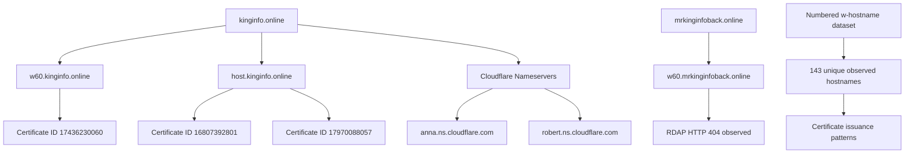

# Domain Intelligence and Infrastructure Relationships

## 1. Overview

This document examines the domain-registration and publicly observable infrastructure characteristics associated with the domains referenced by the primary APK labelled `HDFC BANK LOAN SERVICE`.

The investigation identified two principal domains:

- `kinginfo.online`
- `mrkinginfoback.online`

The analysis uses available RDAP records, DNS observations, and Certificate Transparency-related data to examine registration information, nameservers, certificate issuance patterns, and hostname relationships.

The objective is to establish observable infrastructure relationships without making unsupported claims about domain ownership, operator identity, or malicious attribution.

**Investigation boundary:** This is passive infrastructure intelligence. It does not establish control of the domains or access to their hosting accounts.

---

## 2. Investigated Domains

| Domain | Relationship to APK |
|---|---|
| `kinginfo.online` | Primary domain referenced by application endpoints |
| `mrkinginfoback.online` | Secondary domain referenced by call-forwarding status reporting |

### 2.1 Relevant hostnames

The following hostnames were identified in the application's configuration:

```text
w60.kinginfo.online
host.kinginfo.online
w60.mrkinginfoback.online
```

The primary application infrastructure uses several PHP endpoint paths under `w60.kinginfo.online`.

The secondary domain is referenced by:

```text
/update_call_forward.php
```

These relationships are derived from the application's configuration and should not be interpreted as proof that the domains share an operator.

---

## 3. RDAP Registration Analysis

### 3.1 `kinginfo.online`

The available RDAP observation recorded the following information:

| Attribute | Observed value |
|---|---|
| Domain | `kinginfo.online` |
| Registration date | 2026-06-25 06:26 UTC |
| Expiration date | 2027-06-25 |
| Registrar | PDR Ltd. |
| Registrar identity | PublicDomainRegistry |
| Nameserver 1 | `anna.ns.cloudflare.com` |
| Nameserver 2 | `robert.ns.cloudflare.com` |

### 3.2 Registration interpretation

The registration record establishes the domain's recorded registration and expiration information at the time of examination.

The domain uses Cloudflare nameservers, consistent with the Cloudflare-associated DNS and HTTP observations documented elsewhere in this investigation.

The registration date is useful as a temporal reference for infrastructure research. However, it does not establish when the APK was developed, when the infrastructure became operational, or when any suspicious activity began.

### 3.3 Abuse contact information

The RDAP response contained an entity named:

```text
Prabhat Kamat
```

This entity appeared in a nested registrar-related record with an abuse role.

The associated contact information included:

```text
abuse@publicdomainregistry.com
```

**Important distinction:** The available record identifies this entity in an abuse-contact context associated with the registrar. It does not establish that this person registered, owns, operates, or controls `kinginfo.online`.

The entity must not be attributed as the application developer or infrastructure operator.

---

## 4. RDAP Observation: `mrkinginfoback.online`

The available investigation records indicate that the RDAP lookup for:

```text
mrkinginfoback.online
```

returned HTTP 404.

### 4.1 Interpretation

The observed response means that the queried RDAP service did not return a domain registration record for that lookup.

This observation alone does not establish:

- That the domain never existed.
- That the domain was maliciously registered.
- That the domain was permanently deleted.
- That its previous registrant is known.
- That it is controlled by the same party as `kinginfo.online`.

Historical registration information would require separate historical domain intelligence.

---

## 5. Nameserver Analysis

The observed nameservers for `kinginfo.online` were:

```text
anna.ns.cloudflare.com
robert.ns.cloudflare.com
```

These are Cloudflare nameservers.

### 5.1 Security significance

Nameserver information can help identify the DNS provider used by a domain.

In this case, the nameserver information is consistent with the Cloudflare-associated edge addresses observed during DNS collection.

However, nameserver use is not a unique infrastructure fingerprint.

Many unrelated domains use Cloudflare, so shared use of the provider cannot establish common ownership or coordination.

---

## 6. Certificate Transparency Investigation

### 6.1 Collection source

Certificate-related hostname observations were collected through Cert Spotter.

The available dataset contained:

| Collection page | Records |
|---|---:|
| Page 1 | 100 |
| Page 2 | 100 |
| Page 3 | 29 |
| Page 4 | 0 |
| **Total returned** | **229** |

The combined dataset contained:

- 229 certificate records.
- 229 unique certificate IDs.
- 167 unique DNS names.

Page 4 returned an empty response with HTTP 200 and a `Retry-After: 3600` header.

Therefore, the available dataset should not be treated as a guaranteed exhaustive certificate history.

### 6.2 Why Certificate Transparency matters

Certificate Transparency records can provide information about publicly logged TLS certificates.

They can help investigators identify:

- Hostnames associated with certificates.
- Certificate issuance dates.
- Certificate validity periods.
- Certificate issuers.
- Public-key fingerprints.
- Repeated certificate issuance patterns.

A certificate record demonstrates that certificate information was publicly logged. It does not prove that a hostname served malicious content or that all hostnames in a certificate were controlled by the same application operator.

---

## 7. Numbered `w` Subdomain Pattern

### 7.1 Observed pattern

The collected certificate dataset contained a sequence of numbered hostnames following a pattern similar to:

```text
w1
w3
w4
...
w144
```

The observed dataset contained:

| Attribute | Observation |
|---|---:|
| Unique numbered `w` hostnames | 143 |
| Observed sequence range | `w1` through `w144` |
| Missing identifier in observed sequence | `w2` |
| Hostname-certificate records | 180 |

The count represents the observed dataset, not a verified inventory of every hostname that has ever existed.

### 7.2 Interpretation

The numbered hostname pattern is an infrastructure observation worth documenting.

It may indicate a naming convention or a larger hostname deployment structure.

However, the numbering alone does not establish:

- That every hostname is active.
- That every hostname belongs to the same application.
- That all hostnames share the same origin server.
- That all hostnames are malicious.
- That the domain owner controls every related service.

The pattern should be treated as a lead for infrastructure correlation, not an attribution conclusion.

---

## 8. Repeated Certificate Issuance Pattern

The available dataset contained 37 repeated hostnames, each associated with exactly two certificate records.

The investigation recorded that:

- The repeated hostname records used different public-key SHA-256 fingerprints.
- The average certificate issuance interval was approximately 58.73 days.
- The minimum observed interval was approximately 58.45 days.
- The maximum observed interval was approximately 59.05 days.

### 8.1 Interpretation

The approximately 59-day intervals and differing public-key fingerprints are consistent with periodic certificate renewal accompanied by key rotation.

This is an observed pattern, not proof of a specific certificate-management platform or automated deployment mechanism.

### 8.2 Security significance

Repeated certificate issuance can help reconstruct the visible history of a hostname.

However, certificate renewal patterns are common in legitimate hosting environments and should not be classified as malicious indicators by themselves.

---

## 9. `w60.kinginfo.online` Certificate Observation

The investigation identified the following certificate record for `w60`.

| Attribute | Observed value |
|---|---|
| Hostname | `w60.kinginfo.online` |
| Certificate ID | `17436230060` |
| Issued | 2026-09-27 02:07:17 UTC |
| Expires | 2026-12-26 02:07:16 UTC |
| Revoked | False |
| Issuer | Let's Encrypt YR2 |
| Certificate SHA-256 | `63d72c5c9a96756ef7d88f6c2965d2b6962ab744dbae983159eafb1808b39321` |
| Public-key SHA-256 | `78439e520243b864cc5e082ed503d61fdbdbf67358b764c1f505e538d441a3ca` |
| Observed SAN | `w60.kinginfo.online` |

### 9.1 Interpretation

The record documents a publicly observed certificate associated with `w60.kinginfo.online`.

The recorded issuer is Let's Encrypt YR2.

The certificate's presence supports the conclusion that certificate infrastructure was provisioned for the hostname.

It does not establish who requested the certificate or who controlled the application using it.

---

## 10. `host.kinginfo.online` Certificate Observations

Two certificate records were identified for:

```text
host.kinginfo.online
```

| Attribute | Certificate 1 | Certificate 2 |
|---|---|---|
| Certificate ID | `16807392801` | `17970088057` |
| Issued | 2026-08-27 | 2026-10-25 |
| Expires | 2026-11-25 | 2027-01-23 |
| Issuer | Let's Encrypt YR2 | Let's Encrypt YR2 |
| Public-key SHA-256 | `4319b47dce7fac5770cb1c605aafa2d6a8cdf51ce027bf8820833b72cca74654` | `81d0ade030edb4c739a49947d740a4abc419cad3cefd2f78765d1b5d555fd6ff` |

### 10.1 Public-key comparison

The public-key fingerprints of these two certificates differ.

The available comparison also found that neither fingerprint matches the public-key fingerprints in the observed numbered `w` hostname certificate timeline.

### 10.2 Interpretation

The differing public-key fingerprints indicate that the certificates do not use the same public key.

This observation does not establish that the hostnames use different physical servers, different operators, or unrelated infrastructure.

TLS certificates and public keys can be changed independently of the underlying hosting architecture.

---

## 11. Certificate and Domain Relationship Diagram



**Interpretation:** The diagram summarizes observed registration, hostname, and certificate relationships. It does not establish common ownership between the two principal domains.

---

## 12. Infrastructure Relationship Assessment

| Observation | Assessment |
|---|---|
| `kinginfo.online` uses Cloudflare nameservers | Supported by RDAP observation |
| `w60.kinginfo.online` has a recorded TLS certificate | Supported by certificate observation |
| `host.kinginfo.online` has two recorded certificates | Supported by certificate observations |
| Numbered `w` hostname pattern exists in collected dataset | Supported by dataset analysis |
| Repeated hostname certificates have different public keys | Supported by dataset analysis |
| Approximately 59-day repeated issuance pattern | Supported by dataset analysis |
| `mrkinginfoback.online` RDAP lookup returned HTTP 404 | Supported by recorded observation |
| Both principal domains share an owner | Not established |
| All numbered hostnames share an operator | Not established |
| Certificate renewal pattern indicates malicious activity | Not established |
| A specific person operates the infrastructure | Not established |

---

## 13. Limitations

1. The Cert Spotter dataset was not proven exhaustive.
2. The fourth collection page returned no certificate records.
3. Historical certificate records may be incomplete.
4. The complete multi-SAN certificate aggregation has not been established.
5. The observed hostname pattern does not prove a common operator.
6. Registrar abuse-contact information does not identify the registrant.
7. The RDAP HTTP 404 observation does not establish the historical status of `mrkinginfoback.online`.
8. Certificate issuance does not prove malicious use.
9. Public-key differences do not prove separate ownership or hosting.
10. No direct attribution to an individual or organization is made.

---

## 14. Conclusion

The domain-intelligence investigation identified several observable infrastructure characteristics associated with the application's configured domains.

The principal findings include:

- `kinginfo.online` was registered on 2026-06-25 and uses Cloudflare nameservers.
- The `w60.kinginfo.online` and `host.kinginfo.online` hostnames have publicly observed Let's Encrypt certificate records.
- The collected certificate dataset contains 143 unique numbered `w` hostnames.
- Repeated hostname records exhibit approximately 59-day issuance intervals and different public-key fingerprints.
- The RDAP lookup for `mrkinginfoback.online` returned HTTP 404 during collection.

These findings provide useful infrastructure context and support further endpoint and TLS analysis.

However, the available data does not establish common ownership, backend identity, malicious hosting, or attribution to a specific person or organization.

The appropriate conclusion is that the application references a domain infrastructure with identifiable registration, DNS, and certificate characteristics, while the operators and origin infrastructure remain unconfirmed.

---

*Analysis type: Passive domain intelligence and certificate-history analysis.*

*Attribution: Not established.*

*Dataset completeness: Not established.*