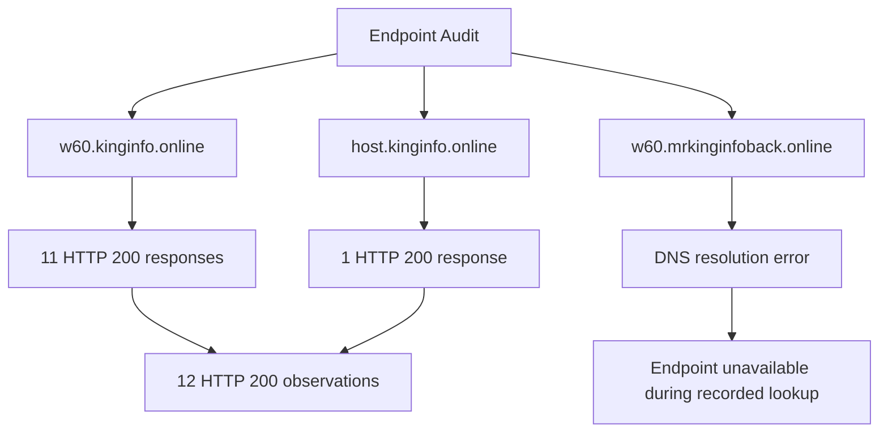
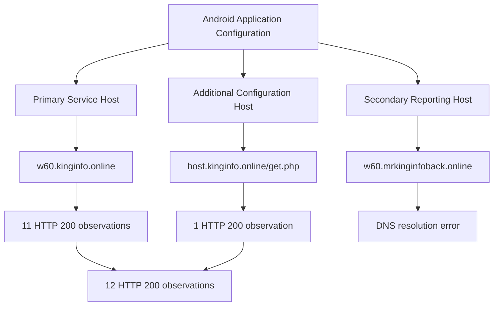

# C2 Endpoint Observations and HTTP Response Analysis

## 1. Overview

This document records the HTTP and HTTPS endpoint observations associated with the infrastructure configured in the primary APK labelled `HDFC BANK LOAN SERVICE`.

The application configuration references multiple PHP endpoints hosted under:

```text
kinginfo.online
```

An additional endpoint is configured under:

```text
host.kinginfo.online
```

The investigation performed endpoint availability checks and recorded HTTP response codes, response headers, TLS-related information, and DNS resolution behavior.

The objective is to document the externally observable behavior of the configured endpoints without assuming that an HTTP response proves successful application functionality or backend data processing.

**Investigation boundary:** The findings represent recorded endpoint observations. No backend source-code access, authenticated administrative access, or server-side database examination was performed.

---

## 2. Collection Information

| Attribute | Recorded value |
|---|---|
| Collection timestamp | 2026-11-04 13:02:38 UTC |
| Protocol | HTTPS |
| Primary hostname | `w60.kinginfo.online` |
| Additional hostname | `host.kinginfo.online` |
| Secondary reporting hostname | `w60.mrkinginfoback.online` |
| Main observation | HTTP responses and DNS resolution |
| TLS issuer observed | Google Trust Services |
| Proxy/CDN indicator | Cloudflare |

The timestamp represents the recorded endpoint audit time and should not be interpreted as the current availability of these endpoints.

---

## 3. Configured Endpoint Inventory

The following endpoints were identified in the APK configuration and examined during infrastructure collection.

### 3.1 Primary application endpoints

| No. | Endpoint path | Documented application purpose | Observed result |
|---:|---|---|---|
| 1 | `/background_service.php` | Device-information reporting | HTTP 200 |
| 2 | `/save_token.php` | FCM token registration | HTTP 200 |
| 3 | `/web/api/check_online.php` | Online-state checking | HTTP 200 |
| 4 | `/permission.php` | Permission-related communication | HTTP 200 |
| 5 | `/sms_forward.php` | HTTP SMS forwarding | HTTP 200 |
| 6 | `/sms_forward_number.php` | SMS forwarding-number configuration | HTTP 200 |
| 7 | `/sms_send.php` | Remote SMS job handling | HTTP 200 |
| 8 | `/call_forward.php` | Call-forwarding configuration | HTTP 200 |
| 9 | `/call_forward_setting.php` | Call-forwarding settings | HTTP 200 |
| 10 | `/ussd_setting.php` | USSD configuration | HTTP 200 |
| 11 | `/update_ussd.php` | USSD status reporting | HTTP 200 |
| 12 | `/update_call_forward.php` on `w60.mrkinginfoback.online` | Call-forwarding status reporting | DNS resolution error |

### 3.2 Additional configured endpoint

| Hostname | Endpoint path | Documented purpose | Observed result |
|---|---|---|---|
| `host.kinginfo.online` | `/get.php` | Additional application configuration retrieval | HTTP 200 |

**Count clarification:** The audit recorded 11 HTTP 200 responses under `w60.kinginfo.online`, plus one HTTP 200 response from `host.kinginfo.online/get.php`. Therefore, the total is **12 HTTP 200 observations**.

The secondary call-forwarding reporting endpoint encountered a DNS resolution error.

---

## 4. Endpoint Response Summary



### 4.1 Interpretation

The 12 HTTP 200 observations establish that the corresponding HTTP requests received successful HTTP status responses during collection.

However, HTTP 200 alone does not establish:

- Successful application-level processing.
- Validity of the returned data.
- Successful SMS forwarding.
- Successful call-forwarding changes.
- Successful USSD execution.
- FCM token registration.
- Successful storage of device information.
- Successful database writes.

A server may return HTTP 200 while performing no meaningful operation, returning an error message in the response body, or serving a generic page.

The response body and application-specific behavior must be examined separately.

---

## 5. HTTP Response Header Observations

The recorded endpoint responses contained the following infrastructure indicators.

| Header / Attribute | Observation |
|---|---|
| `Server` | Cloudflare |
| TLS certificate issuer | Google Trust Services |
| HSTS | `max-age=31536000` |
| Cloudflare request identifier | `CF-Ray` |
| Observed edge-location identifiers | LHR, SJC, FRA, SIN, LAX |

### 5.1 Cloudflare server header

The observed:

```text
Server: cloudflare
```

header indicates Cloudflare involvement in the HTTP response path.

This is consistent with the DNS observations documented in `dns-analysis.md`.

The header does not identify the origin web server or backend hosting provider.

### 5.2 HSTS observation

The responses included:

```text
Strict-Transport-Security: max-age=31536000
```

This indicates an HSTS policy with a maximum age of 31,536,000 seconds.

HSTS instructs supporting browsers to use HTTPS for the applicable host after receiving the policy.

The observation does not independently establish the security of the application's API implementation or the correctness of its TLS configuration.

### 5.3 Cloudflare Ray identifiers

The recorded `CF-Ray` identifiers contained the following edge-location codes:

| Code | Observation |
|---|---|
| LHR | London-area Cloudflare edge identifier |
| SJC | San Jose-area Cloudflare edge identifier |
| FRA | Frankfurt-area Cloudflare edge identifier |
| SIN | Singapore-area Cloudflare edge identifier |
| LAX | Los Angeles-area Cloudflare edge identifier |

These identifiers represent Cloudflare request-processing locations.

They must not be interpreted as proof of the physical location of the origin server, application operator, or domain registrant.

---

## 6. Endpoint Response Analysis

### 6.1 Device-information endpoint

```text
https://w60.kinginfo.online/background_service.php
```

The APK's `BackgroundService.smali` implementation prepares device-related information and sends it using HTTP POST.

Documented fields include:

- `device_name`
- `device_model`
- `device_id`
- `sim1_carrier`
- `sim2_carrier`
- `sim1_number`
- `sim2_number`
- `created_at`
- `last_seen`
- `status`
- `battery`

The endpoint returned HTTP 200 during the recorded audit.

**Interpretation:** The endpoint responded to the examination request. This does not establish that it accepted, processed, or stored device information submitted by the application.

### 6.2 FCM token registration endpoint

```text
https://w60.kinginfo.online/save_token.php
```

The APK contains code that prepares an HTTP POST containing:

- `device_id`
- `fcm_token`

The endpoint returned HTTP 200 during collection.

**Interpretation:** The endpoint was responsive during the audit. Backend token registration and persistent storage were not independently verified.

### 6.3 SMS forwarding endpoint

```text
https://w60.kinginfo.online/sms_forward.php
```

The application contains an HTTP POST implementation for forwarding message-related information.

The documented fields include:

- `device_id`
- `sender`
- `user_number`
- `message`
- `timestamp`
- `type`
- `part_number`
- `total_parts`

The endpoint returned HTTP 200 during collection.

**Interpretation:** The endpoint returned an HTTP success status during the audit. No victim SMS submission or successful server-side storage was established.

### 6.4 SMS forwarding-number configuration endpoint

```text
https://w60.kinginfo.online/sms_forward_number.php
```

The application uses this endpoint to retrieve forwarding configuration.

During the investigation, a response was recorded containing:

```json
{
  "forward_number": "[REDACTED]",
  "status": "off"
}
```

The telephone number is intentionally redacted because it may represent personal information.

The observation establishes that the endpoint returned a forwarding-number field and an `off` status in that particular response.

It does not establish the ownership of the number, its association with a victim, or the historical state of the forwarding configuration.

### 6.5 Remote SMS job endpoint

```text
https://w60.kinginfo.online/sms_send.php
```

The application references this endpoint in its outbound SMS handling implementation.

The endpoint returned HTTP 200 during collection.

**Interpretation:** The endpoint responded to the audit request. The presence of a response does not establish that an SMS job was returned, accepted, or successfully executed.

### 6.6 Call-forwarding endpoints

```text
https://w60.kinginfo.online/call_forward.php
https://w60.kinginfo.online/call_forward_setting.php
```

These endpoints are referenced by the application's call-forwarding implementation.

Both returned HTTP 200 during the recorded audit.

The observations establish endpoint responsiveness, not successful call-forwarding configuration changes or carrier-side operations.

### 6.7 USSD endpoints

```text
https://w60.kinginfo.online/ussd_setting.php
https://w60.kinginfo.online/update_ussd.php
```

These endpoints are referenced by the application's USSD-related functionality.

Both returned HTTP 200 during collection.

The observations do not establish successful USSD execution or server-side storage of operation results.

### 6.8 Additional configuration endpoint

```text
https://host.kinginfo.online/get.php
```

This endpoint was referenced through the application's additional configuration file:

```text
web_server.json
```

The associated key was:

```text
w60
```

The endpoint returned HTTP 200 during the recorded audit.

This establishes a configured endpoint and an HTTP response. The full backend configuration retrieval behavior and returned configuration contents are not established by the status code alone.

---

## 7. Secondary Call-Forwarding Reporting Endpoint

The APK configuration references:

```text
https://w60.mrkinginfoback.online/update_call_forward.php
```

During collection, the hostname encountered a DNS resolution error.

### 7.1 Observation

| Attribute | Result |
|---|---|
| Hostname | `w60.mrkinginfoback.online` |
| Path | `/update_call_forward.php` |
| DNS resolution | Failed |
| HTTP response | Not obtained |
| Observation status | Unavailable during recorded lookup |

### 7.2 Interpretation

Because DNS resolution failed, the HTTP endpoint could not be reached through the recorded lookup.

Possible explanations include:

- Missing or changed DNS records.
- Expired or inactive hostname configuration.
- Temporary DNS infrastructure issues.
- Resolver-specific problems.

The observation does not establish permanent endpoint deactivation or explain why the hostname failed to resolve.

---

## 8. Infrastructure Response Architecture



This diagram summarizes the recorded endpoint audit and does not represent verified application-level transactions.

---

## 9. Security Assessment

The endpoint observations are relevant because the APK contains code paths that reference the endpoints for sensitive functionality.

| Infrastructure capability | Potential security relevance | Evidence classification |
|---|---|---|
| Device-information reporting | Potential device and SIM information disclosure | Configuration and code-derived |
| FCM token registration | Potential device messaging association | Configuration and code-derived |
| HTTP SMS forwarding | Potential financial SMS disclosure | Configuration and code-derived |
| Number-based SMS forwarding configuration | Potential remote forwarding control | Configuration and code-derived |
| Outbound SMS job handling | Potential remote SMS transmission | Configuration and code-derived |
| Call-forwarding configuration | Potential remote telephony configuration | Configuration and code-derived |
| USSD configuration and reporting | Potential remote USSD operation handling | Configuration and code-derived |

The endpoint audit establishes that the configured infrastructure returned HTTP responses during collection.

It does not establish that these potentially sensitive operations were successfully performed on any victim device.

---

## 10. Evidence and Confidence Boundaries

| Claim | Assessment |
|---|---|
| 11 endpoints under `w60.kinginfo.online` returned HTTP 200 | Supported by recorded audit |
| `host.kinginfo.online/get.php` returned HTTP 200 | Supported by recorded audit |
| Total of 12 HTTP 200 observations | Supported by recorded audit |
| Secondary hostname returned a DNS resolution error | Supported by recorded audit |
| Cloudflare server header was observed | Supported by recorded audit |
| Google Trust Services issuer was observed | Supported by recorded audit |
| HSTS policy was observed | Supported by recorded audit |
| Multiple Cloudflare edge identifiers were observed | Supported by recorded audit |
| HTTP 200 proves successful SMS forwarding | Not established |
| HTTP 200 proves successful FCM token storage | Not established |
| HTTP 200 proves call forwarding was enabled | Not established |
| HTTP 200 proves USSD execution succeeded | Not established |
| Backend database storage was verified | Not established |
| Origin server identity was established | Not established |

---

## 11. Limitations

1. Endpoint responses represent the recorded collection time.
2. HTTP status codes alone do not establish application-level success.
3. Backend source code was not available.
4. Backend database access was not available.
5. No authenticated administrative session was examined.
6. The response containing the forwarding-number field was redacted for privacy.
7. The ownership of the returned telephone number is unknown.
8. The secondary reporting hostname could not be resolved during collection.
9. Cloudflare headers do not identify the origin server.
10. No victim-device transaction was used to validate these endpoints.

---

## 12. Conclusion

The endpoint audit documented 12 HTTP 200 responses across the configured primary and additional application infrastructure.

The responses contained Cloudflare-related headers, a Google Trust Services TLS issuer observation, HSTS policy information, and multiple Cloudflare edge-location identifiers.

The secondary call-forwarding reporting hostname `w60.mrkinginfoback.online` encountered a DNS resolution error during the recorded observation.

The results demonstrate that the configured endpoints were responsive to the examined requests at the time of collection. They do not prove successful application transactions, victim-data receipt, backend storage, or successful telephony operations.

The findings should therefore be classified as **observed endpoint availability and infrastructure-response characteristics**, with application-level and backend behavior unconfirmed.

---

*Analysis type: Passive HTTP/HTTPS endpoint observation.*

*Collection timestamp: 2026-11-04 13:02:38 UTC.*

*Backend processing: Not established.*

*Origin attribution: Not established.*