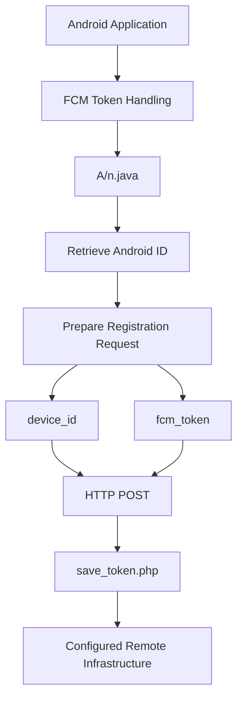
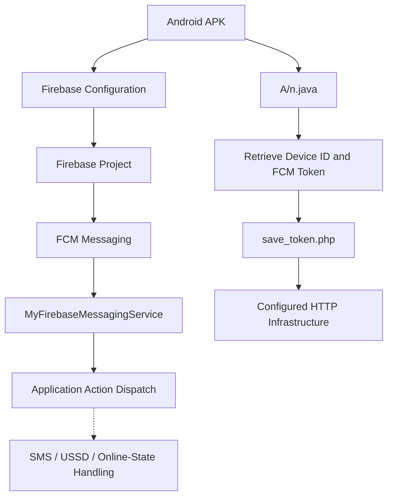

# Firebase Infrastructure Analysis

## 1. Overview

This document examines the Firebase infrastructure configuration identified in the primary APK labelled `HDFC BANK LOAN SERVICE`.

Static analysis identified Firebase Cloud Messaging (FCM) configuration associated with a Firebase project.

The application also contains functionality for handling FCM registration tokens and transmitting device-related registration information to a separately configured HTTP endpoint.

The investigation focuses on:

- Firebase project identification.
- Firebase application configuration.
- Sender ID.
- FCM token registration.
- Relationship between Firebase and the configured HTTP infrastructure.
- Infrastructure intelligence limitations.
- Security implications of the identified configuration.

**Investigation boundary:** The Firebase configuration was recovered through static analysis. Firebase Console access, project-owner verification, authenticated backend access, and live FCM command delivery were not performed.

---

## 2. Identified Firebase Configuration

The following configuration values were identified in the APK.

| Attribute | Observed value |
|---|---|
| Firebase project ID | `fcmtoken-af5a6` |
| Sender ID | `705898731` |
| Firebase application ID | `1:705898731153:web:130e5565c49b143bfb9130` |
| Firebase API key | Redacted |
| Identified integration | Firebase Cloud Messaging |

### 2.1 Firebase project identifier

```text
fcmtoken-af5a6
```

This value identifies the Firebase project referenced by the application configuration.

It provides an infrastructure indicator that can be used to correlate application artifacts and publicly observable Firebase-related information.

The project identifier does not establish the identity of the project owner or administrator.

### 2.2 Sender ID

```text
705898731
```

The sender ID is part of the Firebase messaging configuration.

It identifies the configured messaging sender context referenced by the application.

Its presence does not prove that the project currently accepts messages or that a particular device received a message.

### 2.3 Firebase application ID

```text
1:705898731153:web:130e5565c49b143bfb9130
```

The application ID is an identifier associated with the configured Firebase application.

The observed identifier contains the `web` application-type segment.

This value should be preserved exactly as recovered from the APK. It should not be used alone to infer the complete Android package identity or project ownership.

---

## 3. Firebase and Application Architecture

The APK contains two related but distinct infrastructure mechanisms:

1. Firebase Cloud Messaging configuration and message handling.
2. HTTP-based communication with the application's configured PHP endpoints.

The application-side FCM message handler is:

```text
MyFirebaseMessagingService.java
```

The documented token-registration functionality is implemented in:

```text
A/n.java
```

### 3.1 Firebase message-handling component

The application contains a Firebase messaging service that processes incoming message actions.

The identified actions include:

```text
ONLINE_CHECK
SYNC_DEVICE
PING
SEND_SMS
GET_SMS
RUN_USSD
```

Their application-side implementation is documented in:

[`../../analysis/fcm-analysis.md`](../analysis/fcm-analysis.md)

### 3.2 Token-registration component

The implementation in `A/n.java` prepares an HTTP POST containing:

- `device_id`
- `fcm_token`

The configured registration endpoint is:

```text
https://w60.kinginfo.online/save_token.php
```

This represents a separate application-level registration mechanism.

The Firebase messaging integration and HTTP token-registration endpoint should not be assumed to share the same backend or administrative ownership without additional evidence.

---

## 4. FCM Token Registration Analysis

### 4.1 Documented registration process

The available static-analysis records indicate the following sequence:

1. The application obtains or processes an FCM registration token.
2. The Android device identifier is retrieved.
3. The application loads the configured `save_token.php` endpoint.
4. An HTTP POST request is prepared.
5. The request includes the device identifier and FCM token.
6. The application processes the HTTP response.

### 4.2 Registration flow



### 4.3 Security significance

An FCM registration token is associated with an application instance and can be used in Firebase messaging workflows.

The combination of an FCM token and device identifier in a registration request could allow a backend to associate an application installation with a messaging identifier if the backend stores and uses that association.

Potential security implications include:

- Device-specific messaging.
- Application-instance identification.
- Remote message delivery.
- Association of device identifiers with messaging tokens.

These implications describe the potential use of the implemented registration mechanism.

**Not established:** Successful registration, persistent backend storage, or subsequent use of the token.

---

## 5. Relationship Between Firebase and HTTP Infrastructure

The investigation identified the following infrastructure elements:

| Infrastructure element | Identifier | Documented role |
|---|---|---|
| Firebase project | `fcmtoken-af5a6` | Messaging configuration |
| Firebase sender ID | `705898731` | Messaging sender identifier |
| Firebase application ID | `1:705898731153:web:130e5565c49b143bfb9130` | Application identifier |
| Token registration endpoint | `save_token.php` | Device and FCM token registration |
| Message handler | `MyFirebaseMessagingService.java` | Incoming FCM action dispatch |
| Device registration implementation | `A/n.java` | HTTP token-registration functionality |

### 5.1 Combined architecture



### 5.2 Important distinction

The diagram represents the application-side architecture identified during static analysis.

It does not establish that:

- The Firebase project is controlled by the same person operating `kinginfo.online`.
- The HTTP endpoint and Firebase project share a backend.
- The application successfully registered its FCM token.
- The Firebase project delivered commands to an actual device.
- Any command was successfully executed.

A technical relationship within the APK is not equivalent to proof of common infrastructure ownership.

---

## 6. Firebase Configuration and Security Considerations

Firebase configuration values embedded in client applications should be interpreted carefully.

A Firebase project ID, sender ID, application ID, or client API key may be intentionally distributed as part of application configuration.

Their presence alone does not establish unauthorized access or a vulnerability.

A proper security assessment would require examination of the relevant Firebase services, access controls, and backend authorization mechanisms.

### 6.1 Relevant security questions

| Security question | Investigation status |
|---|---|
| Which Firebase project is referenced? | Identified |
| Which sender ID is configured? | Identified |
| Which Firebase application ID is configured? | Identified |
| Does the application process FCM actions? | Identified through static analysis |
| Is the Firebase project currently active? | Not established |
| Who owns or administers the project? | Not established |
| Are unauthorized clients able to access project resources? | Not established |
| Are Firebase messaging permissions or authorization controls correctly configured? | Not established |
| Were remote commands delivered? | Not established |
| Was an FCM token stored by the HTTP backend? | Not established |

### 6.2 API key handling

The Firebase API key is intentionally redacted from this public repository documentation.

The investigation does not establish whether the key is restricted, whether it is currently valid, or whether it provides access to any sensitive Firebase resource.

An exposed client-side Firebase API key should not automatically be described as a compromised credential.

---

## 7. Infrastructure Correlation

The Firebase configuration can be correlated with the application's other identified infrastructure indicators.

| Indicator | Source | Relationship |
|---|---|---|
| `fcmtoken-af5a6` | Firebase configuration | Identifies configured Firebase project |
| `705898731` | Firebase configuration | Identifies sender ID |
| `1:705898731153:web:130e5565c49b143bfb9130` | Firebase configuration | Identifies configured Firebase application |
| `save_token.php` | `server.json` and application implementation | HTTP token-registration destination |
| `MyFirebaseMessagingService.java` | Decompiled application code | Incoming message-action handling |
| `A/n.java` | Decompiled application code | Device and token registration logic |

These indicators form a useful correlation set for independent investigation.

However, the available evidence does not prove that the Firebase project and the configured PHP infrastructure have common ownership.

---

## 8. Reproducibility and Verification

The following steps can be used for an independent examination of Firebase configuration.

These are reference commands, not claims that every operation was performed during the original investigation.

### 8.1 Search the decoded APK

```bash
grep -RniE 'project_id|messaging_sender_id|google_app_id' \
    primary_decoded/
```

### 8.2 Locate Firebase configuration files

```bash
find primary_decoded/ -type f \
    \( -name 'google-services.json' \
    -o -name 'firebase*.json' \)
```

### 8.3 Search decompiled source

```bash
grep -RniE 'FirebaseMessaging|onNewToken|fcm_token|save_token' \
    primary_decoded/sources/
```

### 8.4 Inspect the token-registration implementation

```bash
grep -RniE 'save_token|fcm_token|device_id' \
    primary_decoded/sources/
```

The exact source path may differ depending on the decompiler's package and output structure.

### 8.5 Preserve sensitive configuration

Do not publish:

- Unredacted API keys where unnecessary.
- Active authentication tokens.
- FCM registration tokens belonging to real devices.
- Device-specific identifiers.
- Credentials or private backend configuration.

Store original examination artifacts separately from public documentation.

---

## 9. Evidence and Confidence Boundaries

| Claim | Assessment |
|---|---|
| Firebase project ID is present in configuration | Supported by static analysis |
| Sender ID is present | Supported by static analysis |
| Firebase application ID is present | Supported by static analysis |
| FCM message-handling component exists | Supported by static analysis |
| Six message actions were identified | Supported by static analysis |
| Device ID and FCM token are prepared for HTTP registration | Supported by static analysis |
| `save_token.php` is configured | Supported by static analysis |
| Firebase project ownership is known | Not established |
| Firebase project is currently active | Not established |
| Backend token storage occurred | Not established |
| A remote FCM command was received | Not established |
| Firebase and PHP infrastructure share ownership | Not established |
| Unauthorized Firebase resource access occurred | Not established |

---

## 10. Limitations

1. Firebase Console access was not available.
2. The Firebase project owner was not identified.
3. Live FCM message delivery was not tested.
4. Token registration was not independently verified against backend storage.
5. The API key was not tested for validity or access.
6. Firebase security rules and backend authorization policies were not examined.
7. The relationship between Firebase administration and the PHP endpoint operator remains unknown.
8. No victim-device messaging logs were acquired.
9. Dynamic analysis was not performed.

---

## 11. Conclusion

The primary APK contains Firebase configuration associated with project `fcmtoken-af5a6`, sender ID `705898731`, and application ID `1:705898731153:web:130e5565c49b143bfb9130`.

Static analysis also identified application-side FCM message handling and a separate HTTP token-registration mechanism in `A/n.java`, referencing `save_token.php`.

The combination of token registration and command dispatch provides an application-side mechanism for associating an installation with Firebase messaging functionality.

However, the investigation did not establish Firebase project ownership, backend token storage, actual remote message delivery, or successful execution of remote commands.

The findings should therefore be classified as **identified Firebase messaging configuration and code-derived token-registration functionality**, with backend control and runtime operation unconfirmed.

---

*Analysis type: Static Firebase infrastructure and configuration analysis.*

*Firebase project ownership: Not established.*

*Token registration: Implementation identified; backend storage not verified.*

*Live FCM delivery: Not tested.*