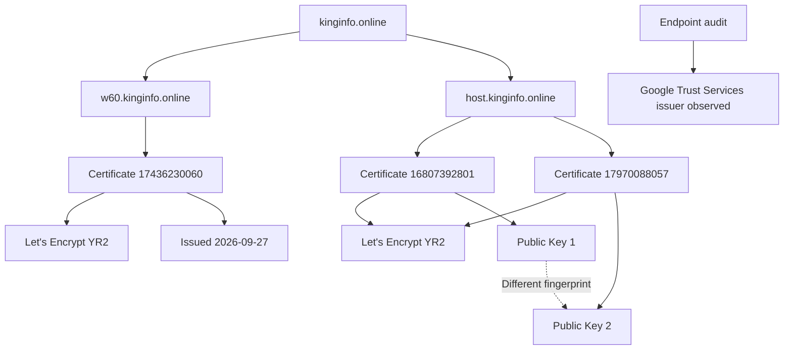

# TLS and Certificate Infrastructure Analysis

## 1. Overview

This document examines the TLS certificate and publicly observable certificate infrastructure associated with the domains referenced by the primary APK labelled `HDFC BANK LOAN SERVICE`.

The investigation identified TLS-related information through endpoint response observations and Certificate Transparency data.

The analysis focuses on:

- TLS certificate issuer observations.
- Let's Encrypt certificate records.
- Certificate validity periods.
- Certificate and public-key SHA-256 fingerprints.
- Certificate Transparency collection results.
- Hostname and certificate relationships.
- Infrastructure security implications and attribution limitations.

**Investigation boundary:** This document uses the certificate and TLS observations preserved during the investigation. A complete TLS protocol and cipher-suite assessment was not established.

---

## 2. Identified Hostnames

The following hostnames were relevant to the certificate investigation.

| Hostname | Infrastructure role |
|---|---|
| `w60.kinginfo.online` | Primary application service hostname |
| `host.kinginfo.online` | Additional configuration hostname |
| `w60.mrkinginfoback.online` | Secondary call-forwarding reporting hostname |

The first two hostnames have documented certificate observations in the available records.

The secondary hostname encountered a DNS resolution error during infrastructure collection. Its certificate status was not established through the available observations.

---

## 3. TLS Issuer Observation

During the endpoint audit on 2026-11-04 at 13:02:38 UTC, the recorded HTTPS responses included a certificate issuer identified as:

```text
Google Trust Services
```

The responses also contained Cloudflare-related HTTP headers.

### 3.1 Interpretation

The Google Trust Services issuer observation documents the certificate issuer reported during the endpoint examination.

It should be distinguished from the separate Let's Encrypt YR2 certificate records obtained through Certificate Transparency research.

These observations may relate to different certificate presentation or issuance contexts. The available records do not establish the complete certificate chain and certificate-selection behavior for every hostname.

### 3.2 Important distinction

| Observation | Meaning |
|---|---|
| Google Trust Services issuer | TLS issuer observed during endpoint collection |
| Let's Encrypt YR2 | Issuer recorded in the Certificate Transparency dataset |
| Cloudflare HTTP header | Cloudflare involvement in the observed HTTP response path |
| Cloudflare DNS addresses | Public DNS resolution through Cloudflare-associated infrastructure |

These observations should not be combined into an unsupported claim that every hostname uses the same certificate or certificate authority.

---

## 4. Certificate Transparency Dataset

### 4.1 Collection source

Certificate records were collected through Cert Spotter.

The available dataset contained:

| Collection page | Records returned |
|---|---:|
| Page 1 | 100 |
| Page 2 | 100 |
| Page 3 | 29 |
| Page 4 | 0 |
| **Total** | **229** |

### 4.2 Dataset summary

| Attribute | Observed result |
|---|---:|
| Total certificate records | 229 |
| Unique certificate IDs | 229 |
| Unique DNS names | 167 |
| Unique numbered `w` hostnames | 143 |
| Hostname-certificate records | 180 |
| Repeated hostnames | 37 |

### 4.3 Collection limitation

The fourth collection page returned:

- HTTP status: `200`
- Content length: `3`
- Certificate records: `0`
- `Retry-After`: `3600`

The empty response and retry instruction mean that the available collection cannot be treated as a guaranteed exhaustive certificate history.

The reported counts describe the dataset obtained during the investigation, not every certificate that may have existed for the domains.

---

## 5. `w60.kinginfo.online` Certificate Analysis

The investigation identified the following certificate record for:

```text
w60.kinginfo.online
```

### 5.1 Certificate details

| Attribute | Observed value |
|---|---|
| Certificate ID | `17436230060` |
| Hostname | `w60.kinginfo.online` |
| Issuer | Let's Encrypt YR2 |
| Issued | 2026-09-27 02:07:17 UTC |
| Expires | 2026-12-26 02:07:16 UTC |
| Revoked | False |
| Observed SAN | `w60.kinginfo.online` |

### 5.2 Certificate fingerprint

```text
63d72c5c9a96756ef7d88f6c2965d2b6962ab744dbae983159eafb1808b39321
```

### 5.3 Public-key fingerprint

```text
78439e520243b864cc5e082ed503d61fdbdbf67358b764c1f505e538d441a3ca
```

### 5.4 Interpretation

The record establishes that a Let's Encrypt YR2 certificate associated with `w60.kinginfo.online` was present in the collected certificate dataset.

The recorded validity period identifies the certificate's observed issuance and expiration dates.

The recorded `revoked: false` value reflects the certificate-status field in the collected record. It should not be interpreted as a permanent or current guarantee of certificate validity.

The observed SAN entry identifies the hostname recorded in this certificate observation.

The certificate does not establish the identity of the person or organization operating the application infrastructure.

---

## 6. `host.kinginfo.online` Certificate Analysis

Two certificate records were identified for:

```text
host.kinginfo.online
```

Both records identify Let's Encrypt YR2 as the issuer.

### 6.1 Certificate comparison

| Attribute | Certificate 1 | Certificate 2 |
|---|---|---|
| Certificate ID | `16807392801` | `17970088057` |
| Hostname | `host.kinginfo.online` | `host.kinginfo.online` |
| Issuer | Let's Encrypt YR2 | Let's Encrypt YR2 |
| Issued | 2026-08-27 | 2026-10-25 |
| Expires | 2026-11-25 | 2027-01-23 |
| Public-key fingerprint | `4319b47dce7fac5770cb1c605aafa2d6a8cdf51ce027bf8820833b72cca74654` | `81d0ade030edb4c739a49947d740a4abc419cad3cefd2f78765d1b5d555fd6ff` |

### 6.2 Public-key comparison

The two certificates contain different public-key SHA-256 fingerprints.

This establishes that the certificates do not use the same public key.

Possible explanations include:

- Certificate renewal with key rotation.
- Changes to certificate provisioning.
- Changes to the TLS deployment configuration.

The available evidence does not identify which explanation applies.

### 6.3 Interpretation

The two records demonstrate repeated certificate issuance for the same hostname.

Different public keys indicate a change in the cryptographic key material between the recorded certificates.

This observation does not establish that the underlying server changed, that a different operator took control, or that the infrastructure became malicious.

---

## 7. Repeated Hostname Certificate Pattern

The collected dataset contained 37 repeated hostnames, each associated with exactly two certificate records.

The analysis identified:

| Attribute | Observed value |
|---|---:|
| Repeated hostnames | 37 |
| Certificate records per repeated hostname | 2 |
| Average issuance interval | Approximately 58.73 days |
| Minimum interval | Approximately 58.45 days |
| Maximum interval | Approximately 59.05 days |

### 7.1 Public-key observations

The repeated hostname records were associated with different public-key SHA-256 fingerprints.

The observed pattern is consistent with periodic certificate renewal accompanied by key rotation.

### 7.2 Security interpretation

Periodic certificate renewal is common in modern TLS deployments.

The approximately 59-day issuance intervals are an infrastructure pattern worth recording, but they do not independently establish:

- Malicious certificate provisioning.
- A particular certificate-management tool.
- Automated deployment ownership.
- A shared operator across all hostnames.
- A relationship between every numbered hostname and the investigated APK.

The pattern should be treated as a supporting infrastructure observation rather than a standalone indicator of compromise.

---

## 8. Numbered Hostname Certificate Relationships

The Certificate Transparency dataset contained numbered hostnames following a pattern similar to:

```text
w1
w3
w4
...
w144
```

The collected dataset contained 143 unique numbered `w` hostnames.

The identifier `w2` was absent from the observed sequence.

### 8.1 Relationship with `w60`

The application configuration references:

```text
w60.kinginfo.online
```

The certificate dataset also contains a certificate record associated with this hostname.

This creates a direct correlation between:

1. The hostname configured in the APK.
2. The hostname observed in the certificate dataset.
3. The recorded certificate metadata for `w60`.

### 8.2 Interpretation

The numbered naming pattern may indicate a hostname-generation or infrastructure-naming convention.

However, it does not prove that all numbered hostnames are active, share an origin server, or belong to the same application operator.

The observed relationship between `w60` and the APK is a hostname correlation, not proof of common ownership or malicious activity across the entire numbered hostname set.

---

## 9. Certificate Relationship Diagram



**Interpretation:** The diagram represents the available certificate observations. The Google Trust Services issuer observation is kept separate from the Let's Encrypt certificate records because the available evidence does not establish that they describe the same certificate chain.

---

## 10. TLS Security Observations

### 10.1 HTTPS availability

The configured application endpoints were accessed using HTTPS during the endpoint audit.

The recorded responses included Cloudflare-related headers and a Google Trust Services issuer observation.

### 10.2 HSTS

The endpoint audit recorded the following response header:

```text
Strict-Transport-Security: max-age=31536000
```

The maximum age is:

```text
31536000 seconds
```

This corresponds to one year.

HSTS is a browser security mechanism that instructs supporting clients to use HTTPS for the applicable hostname after receiving the policy.

Its presence does not prove that the backend API is secure or that application requests are properly authenticated.

### 10.3 Cloudflare involvement

The recorded HTTP responses contained:

```text
Server: cloudflare
```

This is consistent with the Cloudflare-associated DNS observations.

Cloudflare may provide TLS termination and reverse-proxy services, meaning that the certificate visible at an edge connection may differ from certificates used internally between the proxy and origin.

The available records do not establish the exact TLS architecture between Cloudflare and the origin server.

---

## 11. TLS and Certificate Reproducibility

The following commands are reference procedures for independently examining certificate information.

They are not claims that every command was executed during the original investigation.

### 11.1 Inspect the presented certificate

```bash
openssl s_client \
  -connect w60.kinginfo.online:443 \
  -servername w60.kinginfo.online \
  -showcerts
```

This displays certificate-chain information presented during the TLS connection.

### 11.2 Inspect certificate details

After saving a certificate as `server.crt`:

```bash
openssl x509 -in server.crt -noout -text
```

Useful fields include:

- Subject.
- Issuer.
- Validity period.
- Subject Alternative Names.
- Public-key information.
- Signature algorithm.

### 11.3 Calculate the certificate fingerprint

```bash
openssl x509 -in server.crt -noout -fingerprint -sha256
```

### 11.4 Inspect validity dates

```bash
openssl x509 -in server.crt -noout -dates
```

### 11.5 Inspect the public key

```bash
openssl x509 -in server.crt -pubkey -noout
```

### 11.6 Calculate the public-key fingerprint

```bash
openssl x509 -in server.crt -pubkey -noout \
  | openssl pkey -pubin -outform DER \
  | sha256sum
```

The resulting fingerprint can be compared with collected public-key fingerprints, provided the same fingerprinting method is used.

### 11.7 Check negotiated TLS details

```bash
openssl s_client \
  -connect w60.kinginfo.online:443 \
  -servername w60.kinginfo.online \
  -brief
```

This can provide information about the negotiated TLS version and cipher suite at the time of testing.

A new connection may produce different results from the original collection because certificates, TLS configuration, and proxy behavior can change.

---

## 12. Evidence and Confidence Boundaries

| Claim | Assessment |
|---|---|
| Google Trust Services issuer was observed during endpoint collection | Supported by recorded endpoint audit |
| Let's Encrypt YR2 certificate exists in collected data for `w60.kinginfo.online` | Supported by certificate dataset |
| Let's Encrypt YR2 certificates exist for `host.kinginfo.online` | Supported by certificate dataset |
| Two `host.kinginfo.online` certificates use different public keys | Supported by certificate dataset |
| Approximately 59-day repeated issuance pattern exists | Supported by dataset analysis |
| 143 unique numbered `w` hostnames were observed | Supported by dataset analysis |
| The Cert Spotter dataset is exhaustive | Not established |
| Every hostname shares the same certificate | Not established |
| Every hostname shares the same origin server | Not established |
| Certificate issuance proves malicious hosting | Not established |
| Certificate issuer identifies the application operator | Not established |
| Complete TLS protocol and cipher-suite configuration is known | Not established |
| The backend's internal TLS configuration is known | Not established |

---

## 13. Limitations

1. The available Certificate Transparency dataset is not proven exhaustive.
2. The fourth collection page returned zero certificate records.
3. Complete multi-SAN certificate aggregation was not established.
4. The Google Trust Services issuer observation and Let's Encrypt records are not proven to represent the same certificate chain.
5. A complete historical certificate chain was not reconstructed for every hostname.
6. The origin server's certificate configuration was not independently examined.
7. No complete TLS protocol or cipher-suite audit was preserved in the investigation records.
8. Certificate validity does not establish website legitimacy.
9. Certificate renewal patterns do not independently establish malicious behavior.
10. No infrastructure ownership attribution is made from certificate information alone.

---

## 14. Conclusion

The TLS and certificate investigation identified multiple certificate-related observations associated with the application's configured infrastructure.

The principal findings include:

- Google Trust Services was observed as a TLS issuer during the endpoint audit.
- Let's Encrypt YR2 certificate records were identified for `w60.kinginfo.online` and `host.kinginfo.online`.
- The two recorded `host.kinginfo.online` certificates use different public-key fingerprints.
- The collected dataset contains 229 certificate records and 167 unique DNS names.
- A repeated issuance pattern of approximately 59 days was observed among 37 repeated hostnames.
- The numbered `w` hostname dataset contains 143 unique observed hostnames.

These observations provide useful information about the publicly visible certificate infrastructure.

However, the investigation does not establish the origin server's complete TLS configuration, certificate-management ownership, malicious certificate use, or the identity of the infrastructure operator.

The findings should therefore be classified as **observed TLS issuer and Certificate Transparency characteristics**, with infrastructure ownership and attribution unconfirmed.

---

*Analysis type: Passive TLS and Certificate Transparency analysis.*

*Certificate dataset: 229 records.*

*Dataset completeness: Not established.*

*Infrastructure attribution: Not established.*