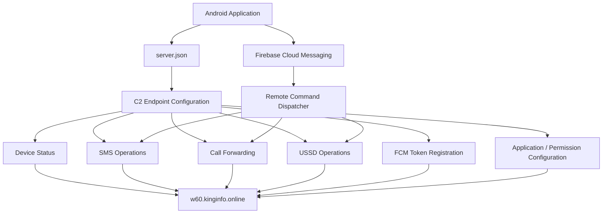
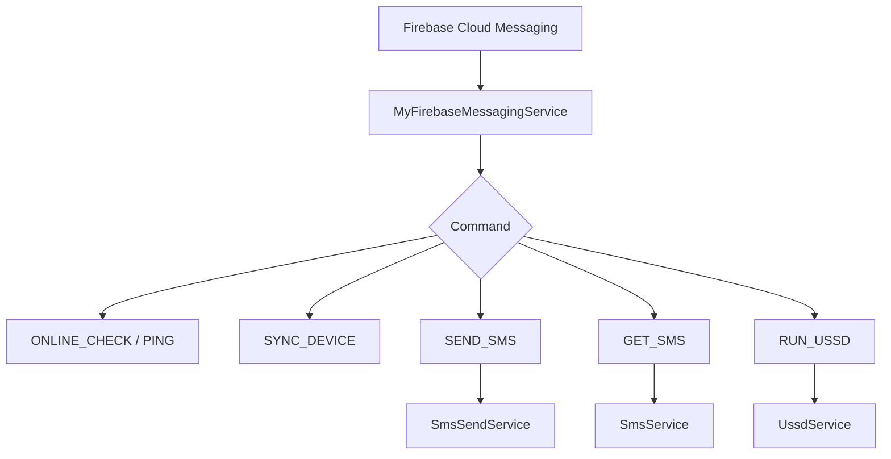

# Command-and-Control (C2) Infrastructure Investigation Report

## 1. Report Information

| Field | Details |
|---|---|
| Report title | C2 Infrastructure Investigation Report |
| Primary domain | `kinginfo.online` |
| Secondary domain | `mrkinginfoback.online` |
| Configuration domain | `host.kinginfo.online` |
| Primary application package | `com.sec.android.app.finance.kaxqj68` |
| Investigation type | Static configuration analysis and passive infrastructure intelligence |
| Endpoint assessment | HTTP response and DNS/TLS observations |
| Dynamic analysis | Not performed |
| Attribution | Undetermined |

## 2. Executive Summary

The Android application examined during this investigation contains a configuration-driven communication architecture connecting its functionality to multiple remote HTTP endpoints.

The primary configured domain is:

`kinginfo.online`

Additional infrastructure references include:

- `w60.kinginfo.online`
- `host.kinginfo.online`
- `w60.mrkinginfoback.online`

The configuration associates remote endpoints with device status reporting, SMS forwarding, SMS transmission, FCM token registration, call-forwarding settings, USSD operations, permission configuration, and application upload functionality.

The application also contains a Firebase Cloud Messaging (FCM) integration. Static code examination identified command handlers associated with SMS operations, device synchronisation, online status, and USSD execution.

Infrastructure observations included DNS resolution through Cloudflare, TLS certificate information, certificate-transparency records, and HTTP responses from configured endpoints.

An endpoint audit recorded HTTP 200 responses from 12 endpoints. One configured call-forwarding update hostname failed DNS resolution during the audit.

A response from the SMS forwarding-number endpoint contained a telephone number and a forwarding status of `off`. The telephone number is intentionally redacted in this public report.

These findings establish configured infrastructure and observed endpoint responses. They do not establish successful command execution, server-side data storage, infrastructure ownership, or the identity of an operator.

## 3. Investigation Objectives

The infrastructure investigation aimed to:

1. Extract remote endpoint configuration from the APK.
2. Associate configured endpoints with their code-derived functions.
3. Identify Firebase project configuration.
4. Examine DNS resolution and domain-registration information.
5. Review TLS certificate and certificate-transparency observations.
6. Record HTTP endpoint responses.
7. Identify infrastructure relationships without making unsupported attribution claims.
8. Preserve infrastructure indicators for defensive reference.

## 4. Infrastructure Architecture

### 4.1 High-level architecture

The application uses a configuration-driven model in which different application components communicate with dedicated remote endpoints.



*Diagram represents the relationships identified from application configuration and static code. It does not represent a runtime-captured network session.*

### 4.2 Infrastructure components

| Component | Observed role |
|---|---|
| Android APK | Client application containing communication logic |
| `server.json` | Stores remote endpoint configuration |
| `w60.kinginfo.online` | Primary configured application service hostname |
| `host.kinginfo.online` | Separate configuration retrieval hostname |
| `w60.mrkinginfoback.online` | Call-forwarding status update hostname |
| Firebase Cloud Messaging | Command-delivery integration |
| Cloudflare | Observed DNS/CDN/TLS edge infrastructure |

## 5. Extracted C2 Endpoint Inventory

The following endpoints were recovered from the application's configuration.

### 5.1 Primary application endpoints

| Endpoint | Configured function |
|---|---|
| `https://w60.kinginfo.online/background_service.php` | Device and background status reporting |
| `https://w60.kinginfo.online/sms_forward.php` | SMS forwarding |
| `https://w60.kinginfo.online/sms_forward_number.php` | SMS forwarding-number configuration |
| `https://w60.kinginfo.online/call_forward.php` | Call-forwarding-related operation |
| `https://w60.kinginfo.online/call_forward_setting.php` | Call-forwarding configuration |
| `https://w60.kinginfo.online/sms_send.php` | Remote SMS transmission |
| `https://w60.kinginfo.online/app_upload.php` | Application upload-related functionality |
| `https://w60.kinginfo.online/permission.php` | Permission configuration |
| `https://w60.kinginfo.online/save_token.php` | FCM token registration |
| `https://w60.kinginfo.online/web/api/check_online.php` | Online-status checking |
| `https://w60.kinginfo.online/ussd_setting.php` | USSD configuration |
| `https://w60.kinginfo.online/update_ussd.php` | USSD status reporting |

### 5.2 Secondary infrastructure endpoints

| Endpoint | Configured function |
|---|---|
| `https://w60.mrkinginfoback.online/update_call_forward.php` | Call-forwarding status update |
| `https://host.kinginfo.online/get.php` | Web configuration retrieval |

The `host.kinginfo.online/get.php` URL was also referenced through `web_server.json`, with the key `w60`.

### 5.3 Endpoint relationship

The endpoint names and their corresponding application code indicate a modular service structure.

For example:

- SMS-related functionality uses dedicated forwarding and transmission endpoints.
- Call-forwarding functionality uses separate configuration and update endpoints.
- USSD functionality uses configuration and reporting endpoints.
- Device status and FCM token registration use separate endpoints.

This separation is consistent with a backend architecture exposing different application operations through individual HTTP routes.

The actual backend implementation and database structure were not recovered.

## 6. Firebase Cloud Messaging Infrastructure

### 6.1 Recovered Firebase configuration

| Attribute | Value |
|---|---|
| Firebase project ID | `fcmtoken-af5a6` |
| Sender ID | `705898731` |
| Firebase App ID | `1:705898731153:web:130e5565c49b143bfb9130` |
| API key | Redacted |

No Firebase Realtime Database URL was recovered from the examined configuration. No database hostname should be inferred from the project identifier.

### 6.2 FCM token registration

The application contains token-registration logic in `A/n.java`.

The identified request fields include:

- `device_id`
- `fcm_token`

The configured destination is:

`https://w60.kinginfo.online/save_token.php`

The code records the HTTP response code.

This demonstrates an implementation for submitting an FCM token and device identifier to the configured endpoint. It does not establish successful backend registration or storage.

### 6.3 Remote command handling

`MyFirebaseMessagingService.java` contains command-dispatch logic.

| Command | Identified action |
|---|---|
| `ONLINE_CHECK` | Updates online state |
| `SYNC_DEVICE` | Updates synchronisation state |
| `PING` | Updates online state |
| `SEND_SMS` | Starts SMS transmission service |
| `GET_SMS` | Starts SMS service with latest-SMS retrieval flag |
| `RUN_USSD` | Starts USSD service with command parameters |



*This is a code-derived command flow, not proof of actual FCM message delivery.*

### 6.4 Security significance

The FCM integration provides a potential remote command channel for sensitive device operations.

Its security significance comes from the combination of:

- Token registration.
- Remote command dispatch.
- SMS transmission functionality.
- SMS retrieval functionality.
- USSD execution functionality.

However, no evidence collected in this investigation demonstrates that a specific remote command was delivered to or executed by an infected device.

## 7. DNS and Domain Intelligence

### 7.1 Primary domain registration

The RDAP information collected for `kinginfo.online` recorded:

| Attribute | Observation |
|---|---|
| Domain | `kinginfo.online` |
| Registration date | 2026-06-25 06:26 UTC |
| Expiration date | 2027-06-25 |
| Registrar | PDR Ltd / PublicDomainRegistry |
| Nameserver 1 | `anna.ns.cloudflare.com` |
| Nameserver 2 | `robert.ns.cloudflare.com` |

The RDAP response included a nested entity named `Prabhat Kamat` with an abuse-related role under the registrar information.

This entity must not be interpreted as the domain registrant, application developer, or infrastructure operator.

### 7.2 Secondary domain registration

The RDAP lookup for `mrkinginfoback.online` returned HTTP 404 during collection.

DNS resolution for `w60.mrkinginfoback.online` returned NXDOMAIN during the recorded assessment.

These observations describe the collection-time results. They do not establish the domain's historical status or explain why resolution failed.

### 7.3 DNS resolution

The following Cloudflare-associated addresses were observed for the primary subdomains:

| Record type | Observed value |
|---|---|
| A | `104.21.3.189` |
| A | `172.67.131.27` |
| AAAA | `2606:4700:3031::6815:3bd` |
| AAAA | `2606:4700:3037::ac43:831b` |

Recorded DNS observation time:

`2026-11-03 14:49:33 UTC`

These addresses were identified as Cloudflare edge addresses. They must not be represented as verified origin-server IP addresses.

## 8. TLS and Certificate Intelligence

### 8.1 TLS observations

The endpoint audit recorded:

- TLS certificates issued by Google Trust Services.
- Cloudflare server headers.
- HSTS headers with `max-age=31536000`.
- Cloudflare Ray identifiers associated with multiple edge locations.

Observed Cloudflare Ray location codes included:

`LHR`, `SJC`, `FRA`, `SIN`, `LAX`

These are edge-location identifiers, not evidence of backend server locations.

### 8.2 Certificate transparency collection

Certificate intelligence was collected using Cert Spotter.

| Collection item | Result |
|---|---:|
| Page 1 | 100 records |
| Page 2 | 100 records |
| Page 3 | 29 records |
| Page 4 | 0 records |
| Combined records | 229 |
| Unique certificate IDs | 229 |
| Unique DNS names | 167 |
| Numbered `w` hostnames observed | 143 |

The collection was not exhaustive because the fourth-page response was empty and included a retry-after interval.

The observed numbered hostname pattern included `w1` through `w144`, with `w2` absent from the collected dataset.

These figures describe the collected dataset only. They do not establish the complete certificate history of the domain.

### 8.3 Repeated certificate observations

The collected dataset contained 37 hostnames with exactly two certificate records each.

The observed records showed:

- Different public-key SHA-256 fingerprints between the two records for each repeated hostname.
- An average issuance gap of approximately 58.73 days.
- A minimum gap of approximately 58.45 days.
- A maximum gap of approximately 59.05 days.

This pattern is consistent with automated certificate renewal and key rotation at roughly 59-day intervals.

It does not establish malicious activity, common ownership, or operational relationships between all numbered hostnames.

### 8.4 `w60.kinginfo.online` certificate

| Attribute | Observation |
|---|---|
| Certificate ID | `17436230060` |
| Issued | 2026-09-27 02:07:17 UTC |
| Expires | 2026-12-26 02:07:16 UTC |
| Revoked | False |
| Issuer | Let's Encrypt YR2 |
| Certificate SHA-256 | `63d72c5c9a96756ef7d88f6c2965d2b6962ab744dbae983159eafb1808b39321` |
| Public-key SHA-256 | `78439e520243b864cc5e082ed503d61fdbdbf67358b764c1f505e538d441a3ca` |
| Observed SAN | `w60.kinginfo.online` |

### 8.5 `host.kinginfo.online` certificate observations

Two Let's Encrypt YR2 certificate records were identified.

| Attribute | Certificate 1 | Certificate 2 |
|---|---|---|
| Certificate ID | `16807392801` | `17970088057` |
| Issuance date | 2026-08-27 | 2026-10-25 |
| Expiration date | 2026-11-25 | 2027-01-23 |
| Public-key SHA-256 | `4319b47dce7fac5770cb1c605aafa2d6a8cdf51ce027bf8820833b72cca74654` | `81d0ade030edb4c739a49947d740a4abc419cad3cefd2f78765d1b5d555fd6ff` |

Neither observed `host.kinginfo.online` public-key fingerprint matched any of the collected numbered `w` hostname timeline records.

The available records do not establish a common certificate-key relationship between these observations.

### 8.6 Certificate transparency limitations

The certificate collection has important limitations:

1. The Cert Spotter dataset was not exhaustive.
2. The fourth-page result was empty during collection.
3. The crt.sh query returned HTTP 502.
4. Certificate issuance does not establish active service operation.
5. Certificate relationships alone do not establish common ownership.
6. The collected certificate records do not independently prove malicious hosting.

## 9. HTTP Endpoint Audit

### 9.1 Audit summary

The endpoint audit was supplied with the following collection timestamp:

`2026-11-04 13:02:38 UTC`

The audit recorded HTTP 200 responses from 12 configured endpoints.

The `w60.mrkinginfoback.online/update_call_forward.php` endpoint returned a DNS resolution error.

### 9.2 Endpoint results

<badge color="success">12 HTTP 200 responses</badge>

| Endpoint | Observed result |
|---|---|
| `w60.kinginfo.online/background_service.php` | HTTP 200 |
| `w60.kinginfo.online/save_token.php` | HTTP 200 |
| `w60.kinginfo.online/web/api/check_online.php` | HTTP 200 |
| `w60.kinginfo.online/permission.php` | HTTP 200 |
| `w60.kinginfo.online/sms_forward.php` | HTTP 200 |
| `w60.kinginfo.online/sms_forward_number.php` | HTTP 200 |
| `w60.kinginfo.online/sms_send.php` | HTTP 200 |
| `w60.kinginfo.online/call_forward.php` | HTTP 200 |
| `w60.kinginfo.online/call_forward_setting.php` | HTTP 200 |
| `w60.kinginfo.online/ussd_setting.php` | HTTP 200 |
| `w60.kinginfo.online/update_ussd.php` | HTTP 200 |
| `host.kinginfo.online/get.php` | HTTP 200 |
| `w60.mrkinginfoback.online/update_call_forward.php` | DNS resolution error |

### 9.3 HTTP response interpretation

An HTTP 200 response indicates that an HTTP response was returned successfully at the protocol level.

It does not establish:

- That the endpoint accepted a valid application command.
- That authentication or authorisation checks were absent.
- That a database operation succeeded.
- That SMS or device information was stored.
- That the application successfully communicated with the endpoint during execution.

The audit results should therefore be interpreted as endpoint responsiveness observations, not proof of operational C2 functionality.

## 10. Sensitive Endpoint Response Observation

During the investigation, a response was recorded from:

`https://w60.kinginfo.online/sms_forward_number.php`

The supplied request was:

```bash
curl "https://w60.kinginfo.online/sms_forward_number.php"
```

The returned JSON contained two fields:

```json
{
  "forward_number": "[REDACTED]",
  "status": "off"
}
```

The actual telephone number is intentionally excluded from this public report because it may be personal or otherwise sensitive information.

### 10.1 Observation

The response demonstrated that the endpoint returned:

- A telephone-number field.
- A forwarding-status field with the value `off`.

The supplied command shows a GET request without additional authentication parameters or custom headers.

### 10.2 Security significance

The response raises a potential concern regarding exposure of sensitive forwarding configuration.

However, the available evidence does not establish:

- Who owns the returned telephone number.
- Whether the number belongs to an operator, victim, test account, or another party.
- Which device, if any, is associated with it.
- Whether the endpoint behaves identically for other requests or clients.
- Whether the forwarding mechanism was operational at the time.
- Whether the response was intended to be publicly accessible.

The recorded `off` value should not be interpreted as proof that all SMS forwarding functionality was disabled.

### 10.3 Reporting recommendation

The response should be treated as potentially sensitive evidence.

Do not publish the original telephone number in public repository files, screenshots, commits, or IOC feeds.

Preserve the original response securely in the private investigation evidence store, with an appropriate hash and access record.

## 11. Additional Web Configuration Server Observation

A separate information-page observation was recorded for:

`https://host.kinginfo.online/`

The collected page exposed the following environment information:

| Attribute | Observed value |
|---|---|
| PHP version | `8.5.12` |
| Web server | `nginx/1.31.2` |
| Operating system information | Ubuntu |
| PHP execution model | PHP-FPM |
| `display_errors` | On |
| `open_basedir` | `/www/wwwroot/host/:/tmp/` |
| File upload limit | 50 MB |
| Document root | `/www/wwwroot/host` |
| Reported `SERVER_ADDR` | `187.127.147.11` |

The page also exposed a list of disabled PHP functions, including:

- `system`
- `exec`
- `shell_exec`
- `proc_open`

The `SERVER_ADDR` value was exposed by the PHP information page. It was not independently verified as the origin address of the primary application infrastructure.

The exposed environment information is an infrastructure observation. It does not, by itself, establish a confirmed exploitable vulnerability.

## 12. Infrastructure Relationship Assessment

The investigation identified several relationships supported by configuration and observations.

| Relationship | Evidence | Assessment |
|---|---|---|
| APK to `w60.kinginfo.online` | `server.json` endpoint references | Direct configuration relationship |
| APK to Firebase project | Recovered Firebase configuration and FCM code | Direct configuration relationship |
| Firebase token registration to primary domain | `A/n.java` and `save_token.php` | Code-derived relationship |
| `host.kinginfo.online` to application configuration | `web_server.json` | Direct configuration relationship |
| Call-forwarding workflow to secondary domain | `update_call_forward_url` | Direct configuration relationship |
| Primary subdomains to Cloudflare | DNS and HTTP observations | Observed infrastructure relationship |
| Numbered `w` hostnames to certificate records | Certificate-transparency dataset | Observed certificate relationship |
| All domains to one operator | No conclusive evidence | Not established |

## 13. Risk Assessment

| Observation | Potential risk | Confidence |
|---|---|---|
| Multiple configured remote operation endpoints | Centralised remote control of sensitive application functions | High |
| SMS forwarding endpoints | Potential exposure of banking and financial messages | High |
| Remote SMS transmission endpoint | Potential unauthorised SMS transmission | High |
| FCM token registration and command handling | Potential remote command channel | High |
| Call-forwarding and USSD endpoints | Potential manipulation of telephony settings | High |
| Sensitive forwarding configuration response | Potential information disclosure | Medium |
| Cloudflare-proxied DNS records | Origin infrastructure cannot be inferred from edge IPs | High |
| Numbered certificate pattern | Automated certificate lifecycle is plausible | Medium |
| PHP information exposure | Environment information disclosure | High |

Confidence describes the strength of the recorded observation or relationship, not the severity or proof of exploitation.

## 14. Investigation Limitations

The following limitations apply:

1. Dynamic analysis was not performed.
2. No live application traffic capture was obtained during APK execution.
3. Backend source code and database contents were not available.
4. Successful server-side data storage was not established.
5. No infrastructure operator was identified.
6. Cloudflare edge IP addresses were not treated as origin addresses.
7. Certificate-transparency collection was incomplete.
8. The secondary domain's historical DNS state was not established.
9. The returned telephone number was not attributed to an individual or device.
10. Endpoint HTTP responses do not establish successful application-level operations.
11. No exploitability assessment was conducted against the observed server software.

## 15. Conclusion

The APK contains a configuration-driven remote communication architecture involving multiple HTTP endpoints and Firebase Cloud Messaging.

The configured infrastructure supports code-derived workflows associated with device status reporting, SMS collection and forwarding, remote SMS transmission, call-forwarding configuration, USSD operations, and FCM token registration.

Passive infrastructure observations identified Cloudflare-associated DNS records, TLS certificate information, certificate-transparency patterns, responsive HTTP endpoints, and a sensitive forwarding-configuration response.

The evidence supports documenting the infrastructure as associated with the examined APK configuration. It does not establish the identity of the infrastructure operator, successful victim-device communication, actual data exfiltration, or server-side storage.

The infrastructure should therefore be classified as **suspicious infrastructure configured by a highly suspicious Android application**, with attribution and runtime impact remaining undetermined.

---

## 16. Related Repository Documentation

| Document | Purpose |
|---|---|
| `reports/static-analysis-report.md` | Consolidated APK static-analysis findings |
| `reports/final-investigation-report.md` | Overall investigation conclusions |
| `infrastructure/dns-analysis.md` | DNS and registration observations |
| `infrastructure/domain-intelligence.md` | Domain intelligence |
| `infrastructure/endpoint-observations.md` | HTTP endpoint audit |
| `infrastructure/firebase-analysis.md` | Firebase configuration and command integration |
| `infrastructure/tls-analysis.md` | TLS and certificate intelligence |
| `analysis/fcm-analysis.md` | FCM command handling |
| `analysis/sms-analysis.md` | SMS collection and forwarding |
| `analysis/call-forwarding-analysis.md` | Call-forwarding functionality |
| `analysis/ussd-analysis.md` | USSD functionality |
| `evidence/evidence-register.md` | Evidence inventory |
| `evidence/chain-of-custody.md` | Evidence handling record |

**Report status:** Infrastructure investigation documented  
**Dynamic analysis:** Not performed  
**Attribution:** Undetermined  
**Server-side data receipt/storage:** Not established  
**Victim impact:** Not established